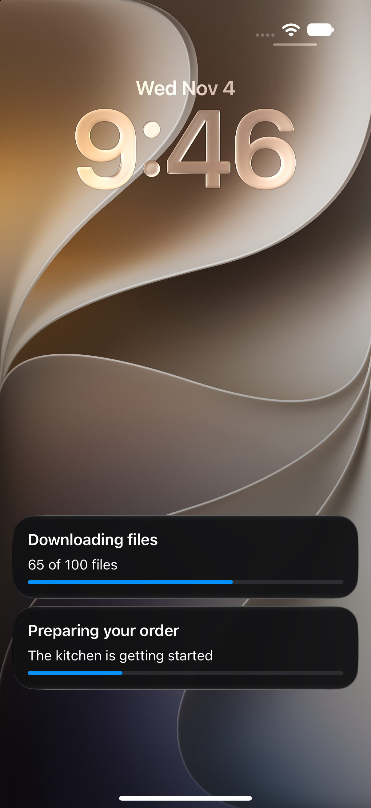
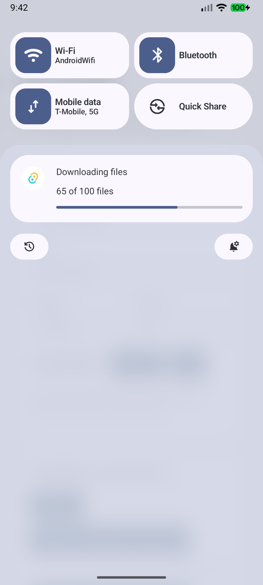

# tauri-plugin-live-activity

[](https://www.npmjs.com/package/tauri-plugin-live-activity-api)
[](https://crates.io/crates/tauri-plugin-live-activity)
[](https://github.com/1eedaegon/tauri-plugin-live-activity/actions/workflows/ci.yml)

Tauri 2에서 iOS Live Activity와 Android 진행 알림을 표시하는 커뮤니티 플러그인입니다.
**초기 알파 버전입니다.** [English](https://github.com/1eedaegon/tauri-plugin-live-activity/blob/main/README.md)

| 플랫폼 | 표시 방식 |
| --- | --- |
| iOS 16.1+ | ActivityKit · 잠금 화면 / Dynamic Island |
| Android API 24+ | 진행 알림 · API 36+에서 조건 충족 시 Live Update 승격 |
| macOS / Windows / Linux | 미구현 |

<table>
  <tr><th>iOS · 주문 준비와 다운로드</th><th>Android · 다운로드</th></tr>
  <tr>
    <td></td>
    <td></td>
  </tr>
</table>

iOS 27.2 시뮬레이터와 Android API 37 에뮬레이터에서 직접 캡처했습니다.
예제 앱이 전달한 진행률을 실제 네이티브 UI로 표시한 화면입니다.
구형 Android에서는 같은 예제가 [일반 진행 알림](https://raw.githubusercontent.com/1eedaegon/tauri-plugin-live-activity/main/docs/images/android-notification-fallback.png)으로 표시됩니다.

## 설치

Tauri 2와 Rust 1.90 이상이 필요합니다.

```sh
npm install tauri-plugin-live-activity-api@next
```

`src-tauri/Cargo.toml`:

```toml
[dependencies]
tauri-plugin-live-activity = "=0.1.0-alpha.1"
```

Tauri 빌더에 등록합니다.

```rust
tauri::Builder::default()
    .plugin(tauri_plugin_live_activity::init())
    // ...
```

앱 capability의 `permissions`에 추가합니다.

```json
[
  "live-activity:default",
  "live-activity:allow-request-permissions",
  "live-activity:allow-start",
  "live-activity:allow-update",
  "live-activity:allow-end"
]
```

**iOS는 Widget Extension 설정이 필요합니다.**
[iOS 설정](https://github.com/1eedaegon/tauri-plugin-live-activity/blob/main/docs/ios-integration.md) ·
[Android 설정](https://github.com/1eedaegon/tauri-plugin-live-activity/blob/main/docs/android-integration.md)

## 사용 예시

```ts
import { start, update, end } from 'tauri-plugin-live-activity-api';

// 먼저 Android 알림 권한 또는 iOS Live Activity 설정을 확인합니다.
const download = await start({
  activityKey: 'download:files',
  schemaVersion: 1,
  template: 'progress',
  fallback: 'notification',
  snapshot: {
    revision: 0, title: '파일 다운로드', status: '시작하는 중', progress: 0,
  },
});

await update({
  id: download.id,
  snapshot: {
    revision: 1, title: '파일 다운로드', status: '100개 중 65개', progress: 0.65,
  },
});

await end({ id: download.id, policy: { kind: 'immediate' } });
```

갱신할 때는 `revision`을 늘리고 전체 snapshot을 보냅니다.
재실행 후에는 `list()`로 상태를 다시 조회합니다. 타이머는 `template: 'timer'`와
`timer: { startedAt, endsAt }`을 사용하며, 시각 단위는 Unix 밀리초입니다.

플러그인은 상태를 표시합니다. 실제 다운로드와 백그라운드 실행은 호스트 앱이 담당합니다.
알림 표시와 승격 여부는 OS 설정에 따라 달라집니다.

[실행 가능한 예제](https://github.com/1eedaegon/tauri-plugin-live-activity/tree/main/examples/demo) ·
[검증 결과](https://github.com/1eedaegon/tauri-plugin-live-activity/blob/main/docs/validation.md)

## 라이선스

[MIT](LICENSE-MIT) 또는 [Apache-2.0](LICENSE-APACHE).
