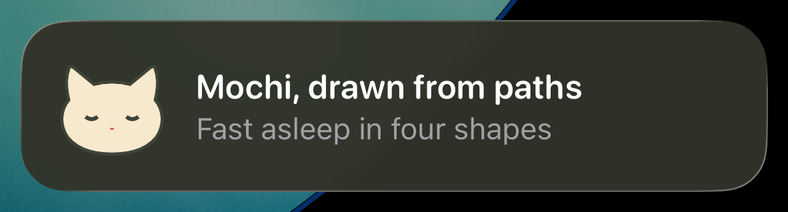
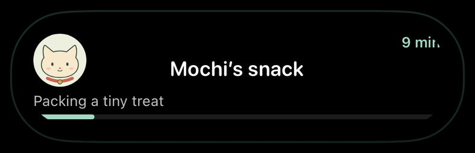
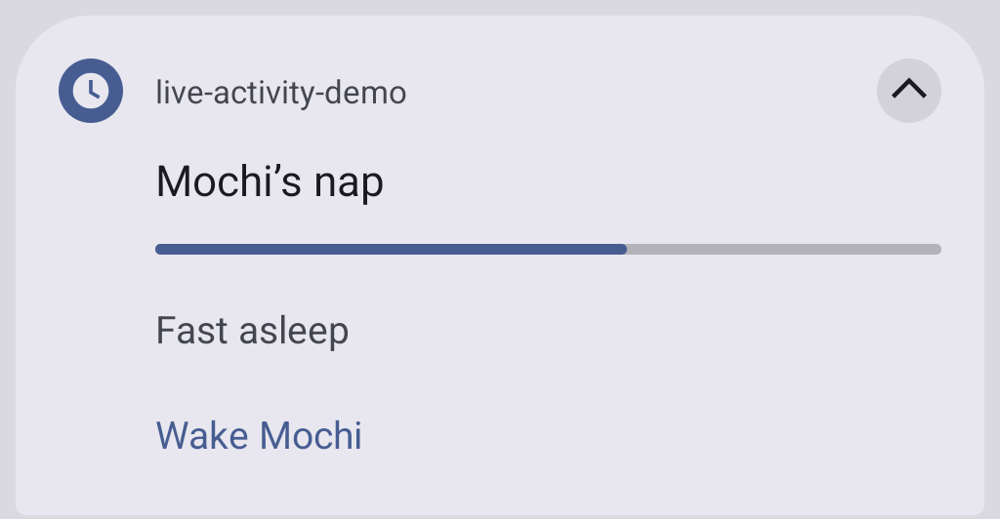
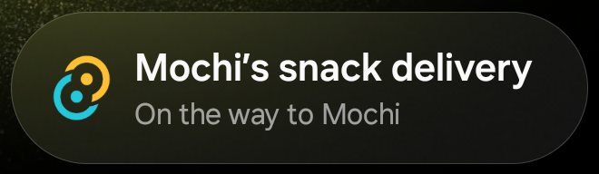

# tauri-plugin-live-activity

[](https://www.npmjs.com/package/tauri-plugin-live-activity)
[](https://crates.io/crates/tauri-plugin-live-activity)
[](https://github.com/1eedaegon/tauri-plugin-live-activity/actions/workflows/ci.yml)
[](LICENSE)

Tauri 2 앱이 하고 있는 일을 iPhone 잠금 화면과 Dynamic Island에, Android에서는 진행 중 알림으로
보여 줍니다. 레이아웃은 TSX, TypeScript 또는 Rust로 적고, 그리는 일은 플러그인이 맡습니다.
[English](https://github.com/1eedaegon/tauri-plugin-live-activity/blob/main/README.md)

<table>
  <tr><th>iOS 잠금 화면</th><th>Dynamic Island</th></tr>
  <tr>
    <td></td>
    <td></td>
  </tr>
  <tr><th>Android 알림</th><th>Samsung Now Bar</th></tr>
  <tr>
    <td></td>
    <td></td>
  </tr>
</table>

네 장 모두 고양이 Mochi를 따라가는 [데모 앱](https://github.com/1eedaegon/tauri-plugin-live-activity/tree/main/examples/demo)에서
캡처했습니다. iOS 16.2 이상, Android 8 이상에서 동작하고, 데스크톱에서는 활동 명령이
`UNSUPPORTED_PLATFORM`을 돌려줍니다. iOS에서는 [activitykit](https://github.com/1eedaegon/activitykit-rs)
크레이트 위에서 동작해 플러그인 자체의 Swift 코드가 없고, Android에서는 모든 액티비티가
[liveupdate](https://github.com/1eedaegon/liveupdate-rs) 위의 Rust에서 돌며 Kotlin은 권한 명령만 맡습니다.
1.0 전까지는 마이너 버전이 바뀔 때 API도 바뀔 수 있습니다.

## 설치

Tauri 2 앱 폴더에서:

```sh
cargo add tauri-plugin-live-activity --manifest-path src-tauri/Cargo.toml
npm i tauri-plugin-live-activity
npx tauri-plugin-live-activity setup
```

그다음 `src-tauri/src/lib.rs`의 빌더에 플러그인을 등록합니다:

```rust
.plugin(tauri_plugin_live_activity::init())
```

`setup`은 플러그인 권한을 허용하고, Android 최소 버전을 API 26으로 올리고, Mac에서는 액티비티를 그리는
위젯 확장을 Xcode 프로젝트에 추가합니다. `tauri ios init` 뒤에 실행하고, `src-tauri/gen/apple`을 새로
만들 때마다 다시 실행합니다. `--dry-run`은 바꿀 내용만 보여 줍니다.

## React와 TSX

레이아웃은 `tauri-plugin-live-activity/jsx`의 컴포넌트로 짠 트리입니다. 이 엔트리는 자체 JSX 소스라
파일에 React가 필요 없고, 서버에서도 같은 트리를 푸시 페이로드용으로 만들 수 있습니다. HTML 요소가 없는
JSX이므로 레이아웃은 별도 파일에 둡니다.

```tsx
/** @jsxImportSource tauri-plugin-live-activity/jsx */
// delivery-layout.tsx
import { Button, HStack, Progress, SFSymbol, Text, VStack } from 'tauri-plugin-live-activity/jsx';

// iOS: 잠금 화면이 이 트리를 그대로 그리고, 펼친 Dynamic Island에도 같은 트리가 보입니다
//      (iOS 16.2 이상, Button은 iOS 17 이상).
// Android: 알림이 처음 두 Text를 제목과 본문으로, 첫 Progress를 진행률 막대로, Button을 최대 세 개까지
//      동작으로 가져가고, 심볼·이미지·스타일은 그리지 않습니다.
export const lockScreen = (
  <VStack alignment="leading" spacing={8}>
    <HStack spacing={8}><SFSymbol name="cat.fill" /><Text bind="title" /></HStack>
    <Text bind="status" />
    <Progress bind="done" />
    <Button actionId="done"><Text>All done</Text></Button>
  </VStack>
);
```

`tauri-plugin-live-activity/react`는 액티비티 하나를 컴포넌트와 함께 움직입니다(React 18 이상, 선택적 peer
의존성). 마운트되면 시작하고, 렌더에서 값이 바뀌면 갱신을 보내고, 언마운트나 `enabled: false`에 끝냅니다:

```tsx
// Delivery.tsx
import { requestPermissions } from 'tauri-plugin-live-activity';
import { useLiveActivity } from 'tauri-plugin-live-activity/react';
import { lockScreen } from './delivery-layout';

// 첫 시작 전에 한 번: Android는 'notifications', iOS는 'liveActivities'.
await requestPermissions(platform === 'android' ? 'notifications' : 'liveActivities');

export function Delivery({ order }: { order: Order }) {
  const { status, error, pushToken } = useLiveActivity({
    activityKey: `delivery:${order.id}`,
    layout: { lockScreen },
    values: { title: order.title, status: order.status, done: order.done },
    enabled: order.open,
    // Android 전용: 잠금 화면에서 알림을 누가 보는지('public', 'private', 'secret').
    android: { visibility: 'public' },
    // iOS 전용: ActivityKit에 이 액티비티의 APNs 토큰을 요청하고, 토큰은 `pushToken`으로 옵니다.
    push: 'token',
    // 이 액티비티의 Button 탭. 탭으로 앱이 켜졌을 때도 옵니다.
    onAction: ({ actionId }) => { if (actionId === 'done') closeOrder(order.id); },
  });
  return <StatusLine status={status} error={error?.message} token={pushToken} />;
}
```

`layout`과 `styles`는 시작할 때만 읽으니, 바꾸려면 `activityKey`를 바꿔 새 액티비티를 시작합니다. 거부된
요청은 `error`에 남습니다. 노드마다 컴포넌트가 하나씩 있고(`VStack`, `HStack`, `ZStack`, `Spacer`, `Divider`,
`Text`, `SFSymbol`, `Image`, `Path`, `Progress`, `Gauge`, `TimerText`, `Button`, `Custom`) 노드의 멤버가 그대로
prop입니다. [더 보기](https://github.com/1eedaegon/tauri-plugin-live-activity/blob/main/docs/usage.md#tsx-and-react)

## Rust

같은 요청을 Rust에서는 `app.live_activity()`로 보냅니다. 이 메서드들은 플랫폼의 답이 올 때까지 막히므로
메인 스레드 밖에서 부릅니다(iOS에서 메인 스레드에서 부르면 바로 `NATIVE_ERROR`로 답합니다):

```rust
use std::collections::BTreeMap;
use tauri::{AppHandle, Runtime};
use tauri_plugin_live_activity::{
    Element, EndPolicy, Fallback, Layout, LayoutEndInput, LayoutSnapshot, LayoutStartInput,
    LayoutUpdateInput, LiveActivityExt, Result, Value,
};

fn snapshot(revision: u64, status: &str) -> LayoutSnapshot {
    let values = BTreeMap::from([("status".to_string(), Value::Text(status.into()))]);
    LayoutSnapshot { revision, values, stale_at: None, timestamp: None }
}

fn deliver<R: Runtime>(app: &AppHandle<R>) -> Result<()> {
    let input = LayoutStartInput {
        activity_key: "mochi:snack".into(),
        schema_version: 2,
        // Android와, Live Activity가 없는 iOS에서는 알림으로 보입니다.
        fallback: Fallback::Notification,
        layout: Layout {
            lock_screen: Element::Text { value: None, bind: Some("status".into()) }.into(),
            island: None, background: None, keyline: None,
        },
        styles: None,
        snapshot: snapshot(0, "On time"),
        android: None, // Android 전용: 잠금 화면 표시 범위는 `AndroidOptions { visibility }`
        push: None,    // iOS 전용: `Some(LayoutPush::Token)`이면 액티비티의 APNs 토큰을 요청
    };
    let activity = app.live_activity().start_layout(input)?;
    // 갱신마다 모든 값을 다시, 더 높은 revision으로 보냅니다.
    app.live_activity().update_layout(LayoutUpdateInput { id: activity.id.clone(), snapshot: snapshot(1, "At the door") })?;
    app.live_activity().end_layout(LayoutEndInput { id: activity.id, policy: EndPolicy::Immediate {}, snapshot: None })?;
    Ok(())
}
```

놓치면 안 되는 탭은 Rust에서 받습니다. 시스템이 탭 때문에 앱을 켤 때는 웹 뷰가 아직 없을 수 있고,
JavaScript 리스너는 기다려 주지 않습니다. 만들어진 `App`에 `run` 전에 핸들러를 등록합니다:

```rust
let handle = app.handle().clone();
app.live_activity().on_action(move |event| {
    if event.action_id == "done" {
        let input = LayoutEndInput { id: event.activity_id, policy: EndPolicy::Immediate {}, snapshot: None };
        let _ = handle.live_activity().end_layout(input);
    }
});
```

## TypeScript만으로

React 없이도 명령 세 개와 `layout` 빌더로 같은 일을 합니다:

```ts
import { endLayout, layout, startLayout, updateLayout } from 'tauri-plugin-live-activity';

const { vstack, bound, progress } = layout;
const snack = await startLayout({
  activityKey: 'mochi:snack',
  schemaVersion: 2,
  fallback: 'notification',
  layout: { lockScreen: vstack([bound('title'), bound('status'), progress('done')]) },
  snapshot: { revision: 0, values: { title: 'Mochi’s snack', status: 'Packing a tiny treat', done: 0.15 } },
});
await updateLayout({ id: snack.id, snapshot: { revision: 1, values: { title: 'Mochi’s snack', status: 'On the way', done: 0.65 } } });
await endLayout({ id: snack.id, policy: { kind: 'immediate' } });
```

레이아웃은 시작한 모습 그대로이고, 갱신마다 모든 값을 더 높은 revision으로 다시 보냅니다. 탭은
`onAction`으로, 푸시 토큰과 푸시된 내용은 `onPushToken`, `onPushToStartToken`, `onUpdated`로 옵니다.

## 레이아웃에 넣을 수 있는 것

| 노드 | 보여 주는 것 | iOS | Android |
|---|---|---|---|
| `text`, `bound` | 문자열, 또는 키의 값 | 예 | 처음 둘이 제목과 본문 |
| `symbol` | SF Symbol. `variableBind`는 0~1 값으로 가변 심볼을 채움 | 예 | 아니오 |
| `image` | 위젯 에셋 카탈로그의 그림, 또는 앱이 쓴 PNG | 예 | 처음 그린 이미지가 큰 아이콘 |
| `path` | SVG 패스 데이터 | 예 | 아니오 |
| `gauge` | `min`과 `max` 사이의 숫자를 고리나 막대로 | 예 | 아니오 |
| `progress` | 0~1의 숫자를 고리나 막대로 | 예 | 첫 번째가 알림의 진행률 막대 |
| `timerText` | `end`까지 내려가거나 `start`부터 올라가는 시간. 시스템이 셈 | 예 | 크로노미터 |
| `button` | `onAction` / `on_action`으로 오는 탭 | iOS 17 이상 | 최대 세 개의 동작 |
| `vstack`, `hstack`, `zstack`, `spacer`, `divider` | 배치 | 예 | 평평하게 |
| `custom` | 이름으로 고른 자체 SwiftUI 뷰 | 예 | 아니오 |

스타일은 토큰으로 글꼴·색·굵기·프레임 등을 정합니다(`styles: { title: { size: 22 } }`,
`bound('title', { style: 'title' })`). `color`, `background`, `tint`, `opacity`, `size`, `weight`,
`cornerRadius`와 레이아웃의 `background`, `keyline`은 값에 묶어(`color: bind('tone')`) 갱신으로 바꿀 수
있습니다. Android는 스타일을 그리지 않습니다. 레이아웃·스타일·값은 무게 제한 3584를 함께 씁니다. 플랫폼이
빼놓은 것은 레코드의 `degradedFeatures`가 알려 줍니다.

Dynamic Island는 `lockScreen` 옆에 자기 부분을 따로 받습니다. 비워 둔 부분은 잠금 화면 트리(펼친 모습)나
그 첫 심볼(compact leading, minimal)을 보여 줍니다:

```ts
island: {
  expanded: { leading: image('mochi'), center: bound('title'), trailing: bound('eta'), bottom: progress('done') },
  compactLeading: symbol('pawprint.fill'),
  compactTrailing: bound('eta'),
  minimal: progress('done', { kind: 'circular' }),
},
keyline: '#A3D9C2', // 아일랜드 테두리 색
```

## 푸시 (iOS)

서버가 APNs로 액티비티를 갱신하고 끝내고 시작합니다. `push: 'token'`(iOS 18에서는 `{ channel }`도)으로
시작하면 액티비티의 토큰이 `onPushToken`으로, 앱의 push-to-start 토큰(iOS 17.2, 플러그인 설정의
`pushToStart`)이 `onPushToStartToken`으로, 푸시가 전달한 내용이 `onUpdated`로 옵니다. 페이지가 구독할 때
플러그인이 이미 쥐고 있던 토큰은 바로 옵니다. 페이로드는 서버에서 activitykit의 `push::Payload`로 만듭니다.
[더 보기](https://github.com/1eedaegon/tauri-plugin-live-activity/blob/main/docs/usage.md#pushes)

## 기본 부품 너머

대부분은 Swift 없이 됩니다. `setup --font fonts/Pacifico-Regular.ttf --asset art/paw@3x.png`가 글꼴과 그림을
위젯 확장에 넣어 주고, 스타일과 `image('paw')`에서 이름으로 씁니다. 앱이 그린 그림은 App Group(`setup
--app-group`)을 거칩니다: `writeImage('badge.png', png)` 뒤에 `image({ file: 'badge.png' })`. 자체 뷰는
`gen/apple/LiveActivityWidget/LiveActivityCustomViews.swift`의 SwiftUI로, `setup`이 한 번 만들고 다시
덮어쓰지 않으며, `custom('ring', { props: { level: bind('done') } })`으로 놓습니다. 그린 PNG는 최대 1 MiB,
1224 × 480 픽셀입니다. [더 보기](https://github.com/1eedaegon/tauri-plugin-live-activity/blob/main/docs/usage.md#beyond-the-built-in-parts)

## 제약

- iOS: iOS 16.2의 iPhone 또는 iPadOS 17의 iPad, 버튼은 iOS 17부터. 액티비티는 앱이 전면일 때만 시작되고
  (아니면 `NOT_FOREGROUND`), 시스템이 8시간 뒤 끝냅니다.
- iOS는 각 액티비티의 마지막 값을 앱의 Application Support에 평문으로 둡니다. 플러그인 설정에
  `"receipts": "redacted"`를 주면 가립니다.
- 버튼 탭은 Rust `on_action` 핸들러를 최대 4초 기다립니다. JavaScript 리스너는 기다리지 않습니다.
- 푸시는 iOS만. Android는 진행 중 알림을 보여 주고, 시스템이 허용하는 곳에서는 Live Update로 올립니다.
- npm 패키지와 크레이트는 같은 마이너 버전으로 맞춥니다.

## Samsung Now Bar

`tauri.conf.json`에 `"plugins": { "live-activity": { "android": { "samsungNowBar": true } } }`를 두면 One UI 9의
Now Bar가 보여 줄 제목과 본문을 보냅니다. One UI는 Samsung의 허용 목록에 있는 앱이나, 개발자 옵션 "모든 앱의
라이브 알림"이 켜진 동안의 모든 앱에만 Now Bar를 보여 줍니다.

## 더 알아보기

[문서](https://github.com/1eedaegon/tauri-plugin-live-activity/tree/main/docs)가 나머지를 다룹니다: `setup`이
바꾸는 것과 손으로 하는 법, iOS와 Android 캡처가 있는 모든 노드, 플러그인 옵션, 테스트 기록.

## 라이선스

[MIT](LICENSE-MIT) 또는 [Apache-2.0](LICENSE-APACHE).
