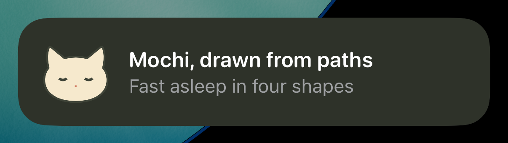
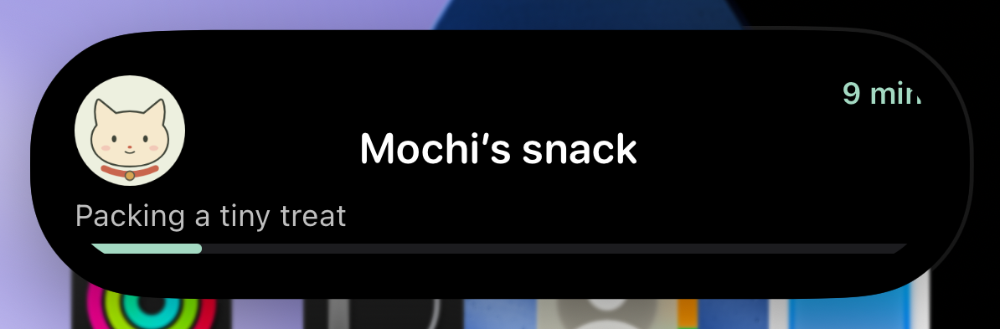
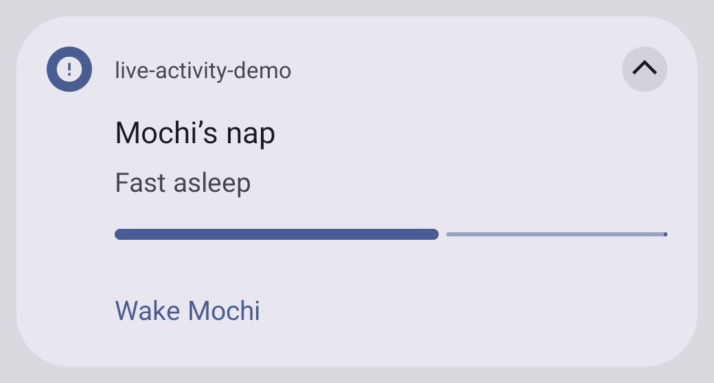
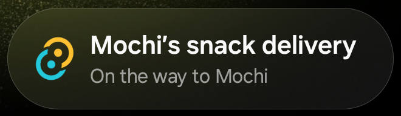
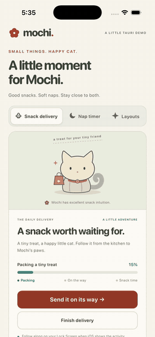
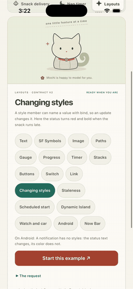
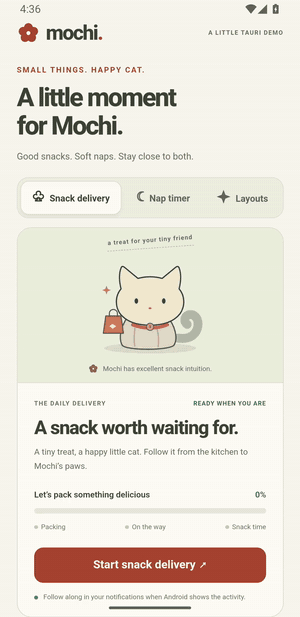

# tauri-plugin-live-activity

[](https://www.npmjs.com/package/tauri-plugin-live-activity)
[](https://crates.io/crates/tauri-plugin-live-activity)
[](https://github.com/1eedaegon/tauri-plugin-live-activity/actions/workflows/ci.yml)
[](LICENSE)

Tauri 2 앱이 하고 있는 일을 iPhone 잠금 화면과 Dynamic Island에, Android에서는 진행 중 알림으로
보여 줍니다. 레이아웃은 TSX, TypeScript 또는 Rust로 적고, 그리는 일은 플러그인이 맡습니다.
[English](https://github.com/1eedaegon/tauri-plugin-live-activity/blob/main/README.md)

<table>
  <tr><th>iOS 잠금 화면</th><th>Dynamic Island</th></tr>
  <tr>
    <td></td>
    <td></td>
  </tr>
  <tr><th>Android 알림</th><th>Samsung Now Bar</th></tr>
  <tr>
    <td></td>
    <td></td>
  </tr>
</table>

데모가 도는 모습입니다. iPhone 17 Pro 시뮬레이터와 Android 16 에뮬레이터에서 녹화했습니다:

<table>
  <tr><th>iOS: 잠금 화면의 간식 배달과 낮잠 타이머</th><th>iOS: 갱신으로 바뀌는 바인딩된 스타일</th><th>Android: 같은 요청이 잠금 화면의 알림으로</th></tr>
  <tr>
    <td></td>
    <td></td>
    <td></td>
  </tr>
</table>

모두 고양이 Mochi를 따라가는 [데모 앱](https://github.com/1eedaegon/tauri-plugin-live-activity/tree/main/examples/demo)에서
캡처했습니다. iOS 16.2 이상, Android 8 이상에서 동작하고, 데스크톱에서는 활동 명령이
`UNSUPPORTED_PLATFORM`을 돌려줍니다. 플러그인은 [liveactivity](https://github.com/1eedaegon/liveactivity-rs)
크레이트의 어댑터이고, 이 크레이트가 iOS는 [activitykit](https://github.com/1eedaegon/activitykit-rs), Android는
[liveupdate](https://github.com/1eedaegon/liveupdate-rs) 위에서 돌립니다. 그래서 플러그인 자체의 Swift 코드가 없고
Kotlin은 권한 명령과 liveupdate의 Android 어댑터 호출만 맡습니다.

## 설치

Tauri 2 앱 폴더에서:

```sh
cargo add tauri-plugin-live-activity --manifest-path src-tauri/Cargo.toml
npm i tauri-plugin-live-activity
npx tauri-plugin-live-activity setup
```

그다음 `src-tauri/src/lib.rs`의 빌더에 플러그인을 등록합니다:

```rust
.plugin(tauri_plugin_live_activity::init())
```

`setup`은 플러그인 권한을 허용하고, Android 최소 버전을 API 26으로 올리고, Mac에서는 액티비티를 그리는
위젯 확장을 Xcode 프로젝트에 추가합니다. `tauri ios init` 뒤에 실행하고, `src-tauri/gen/apple`을 새로
만들 때마다 다시 실행합니다. `--dry-run`은 바꿀 내용만 보여 줍니다.

## React와 TSX

레이아웃은 `tauri-plugin-live-activity/jsx`의 컴포넌트로 짠 트리입니다. 이 엔트리는 자체 JSX 소스라
파일에 React가 필요 없고, 서버에서도 같은 트리를 푸시 페이로드용으로 만들 수 있습니다. HTML 요소가 없는
JSX이므로 레이아웃은 별도 파일에 둡니다.

```tsx
/** @jsxImportSource tauri-plugin-live-activity/jsx */
// delivery-layout.tsx
import { Button, HStack, Progress, SFSymbol, Text, VStack } from 'tauri-plugin-live-activity/jsx';

// iOS: 잠금 화면이 이 트리를 그대로 그리고, 펼친 Dynamic Island에도 같은 트리가 보입니다
//      (iOS 16.2 이상, Button은 iOS 17.2 이상).
// Android: 알림이 처음 두 Text를 제목과 본문으로, 첫 Progress를 진행률 막대로, Button을 최대 세 개까지
//      동작으로 가져가고, 심볼과 스타일은 그리지 않습니다.
export const lockScreen = (
  <VStack alignment="leading" spacing={8}>
    <HStack spacing={8}><SFSymbol name="cat.fill" /><Text bind="title" /></HStack>
    <Text bind="status" />
    <Progress bind="done" />
    <Button actionId="done"><Text>All done</Text></Button>
  </VStack>
);
```

`tauri-plugin-live-activity/react`는 액티비티 하나를 컴포넌트와 함께 움직입니다(React 18 이상, 선택적 peer
의존성). 마운트되면 시작하고, 렌더에서 값이 바뀌면 갱신을 보내고, 언마운트나 `enabled: false`에 끝냅니다:

```tsx
// Delivery.tsx
import { getCapabilities, requestPermissions } from 'tauri-plugin-live-activity';
import { useLiveActivity } from 'tauri-plugin-live-activity/react';
import { lockScreen } from './delivery-layout';

// 첫 시작 전에 한 번: Android는 'notifications', iOS는 'liveActivities'.
export async function allowActivities() {
  const { platform } = await getCapabilities();
  await requestPermissions(platform === 'android' ? 'notifications' : 'liveActivities');
}

export function Delivery({ order }: { order: Order }) {
  const { status, error, pushToken } = useLiveActivity({
    activityKey: `delivery:${order.id}`,
    layout: { lockScreen },
    values: { title: order.title, status: order.status, done: order.done },
    enabled: order.open,
    // Android 전용: 잠금 화면에서 알림을 누가 보는지('public', 'private', 'secret').
    android: { visibility: 'public' },
    // iOS 전용: ActivityKit에 이 액티비티의 APNs 토큰을 요청하고, 토큰은 `pushToken`으로 옵니다.
    push: 'token',
    // 이 액티비티의 Button 탭. 탭으로 앱이 켜졌을 때도 옵니다.
    onAction: ({ actionId }) => { if (actionId === 'done') closeOrder(order.id); },
  });
  // pushToken: iOS에서 이 액티비티의 APNs 토큰. 서버에 보낼 것.
  return <p>{status}{error ? ` (${error.message})` : ''}</p>;
}
```

`layout`과 `styles`는 시작할 때만 읽으니, 바꾸려면 `activityKey`를 바꿔 새 액티비티를 시작합니다. 거부된
요청은 `error`에 남습니다. 노드마다 컴포넌트가 하나씩 있고(`VStack`, `HStack`, `ZStack`, `Spacer`, `Divider`,
`Text`, `SFSymbol`, `Image`, `Path`, `Progress`, `Gauge`, `TimerText`, `Button`, `Link`, `Toggle`, `Custom`) 노드의 멤버가 그대로
prop입니다. [더 보기](https://github.com/1eedaegon/tauri-plugin-live-activity/blob/main/docs/usage.md#tsx-and-react)

## Rust

같은 요청을 Rust에서는 `app.live_activity()`로 보냅니다. 이 메서드들은 플랫폼의 답이 올 때까지 막히므로
메인 스레드 밖에서 부릅니다(iOS에서 메인 스레드에서 부르면 바로 `NATIVE_ERROR`로 답합니다):

```rust
use std::collections::BTreeMap;
use tauri::{AppHandle, Runtime};
use tauri_plugin_live_activity::{
    AndroidOptions, AndroidVisibility, Element, Layout, LayoutEndInput, LayoutSnapshot, LayoutStartInput,
    LayoutUpdateInput, LiveActivityExt, Result, Value,
};

fn snapshot(revision: u64, status: &str) -> LayoutSnapshot {
    let values = BTreeMap::from([("status".to_string(), Value::Text(status.into()))]);
    LayoutSnapshot::new(revision, values)
}

fn deliver<R: Runtime>(app: &AppHandle<R>) -> Result<()> {
    let layout = Layout {
        lock_screen: Element::Text { value: None, bind: Some("status".into()) }.into(),
        island: None, background: None, keyline: None, url: None, small: None,
    };
    // Android와, Live Activity가 없는 iOS에서는 알림으로 보입니다.
    let mut input = LayoutStartInput::new("mochi:snack", layout, snapshot(0, "On time"));
    // Android 전용: 잠금 화면 표시 범위, 포그라운드 배치, 워치의 Ongoing Activity.
    input.android = Some(AndroidOptions::new(AndroidVisibility::Public).with_wear_ongoing_activity(false));
    // 그 밖에: `ios`(`IosOptions::new(transient)`, iOS 18), `scheduled`(`ScheduledStart::new(at, alert)`,
    // iOS 26과 Android), `push`(`Some(LayoutPush::Token)`, iOS).
    let activity = app.live_activity().start_layout(input)?;
    // 갱신마다 모든 값을 다시, 더 높은 revision으로 보냅니다.
    app.live_activity().update_layout(LayoutUpdateInput::new(activity.id.clone(), snapshot(1, "At the door")))?;
    app.live_activity().end_layout(LayoutEndInput::immediate(activity.id))?;
    Ok(())
}
```

요청은 생성자로 만들고, 열거형은 늘어날 수 있으니 `_` 가지로 매치하면 다음 버전에서도 컴파일됩니다. Android
콘텐츠에 쓰는 liveupdate의 타입은 플러그인이 쓰는 크레이트째로 `tauri_plugin_live_activity::liveupdate`에
있습니다:

```rust
use tauri_plugin_live_activity::liveupdate::{Timer, TimerStyle};
let clock = TimerStyle::new(Timer::new(started_at, ends_at), true); // `ends_at`까지 거꾸로 셉니다
```

놓치면 안 되는 탭은 Rust에서 받습니다. 시스템이 탭 때문에 앱을 켤 때는 웹 뷰가 아직 없을 수 있고,
JavaScript 리스너는 기다려 주지 않습니다. 만들어진 `App`에 `run` 전에 핸들러를 등록합니다:

```rust
let handle = app.handle().clone();
app.live_activity().on_action(move |event| {
    if event.action_id == "done" {
        let _ = handle.live_activity().end_layout(LayoutEndInput::immediate(event.activity_id));
    }
});
```

## TypeScript만으로

React 없이도 명령 세 개와 `layout` 빌더로 같은 일을 합니다:

```ts
import { endLayout, layout, startLayout, updateLayout } from 'tauri-plugin-live-activity';

const { vstack, bound, progress } = layout;
const snack = await startLayout({
  activityKey: 'mochi:snack',
  schemaVersion: 2,
  fallback: 'notification',
  layout: { lockScreen: vstack([bound('title'), bound('status'), progress('done')]) },
  snapshot: { revision: 0, values: { title: 'Mochi’s snack', status: 'Packing a tiny treat', done: 0.15 } },
});
await updateLayout({ id: snack.id, snapshot: { revision: 1, values: { title: 'Mochi’s snack', status: 'On the way', done: 0.65 } } });
await endLayout({ id: snack.id, policy: { kind: 'immediate' } });
```

시작 요청에 `scheduled: { at, alert }`를 주면 나중에 시작하고(iOS 26과 Android. Android에서는 사용자가 정확한 알람을 허용해야 제시간에 시작하며, `openExactAlarmSettings()`가 그 설정 화면을 엽니다), `ios: { transient: true }`이면 일시적 액티비티가 됩니다(iOS 18). 레이아웃은 시작한 모습 그대로이고, 갱신마다 모든 값을 더 높은 revision으로 다시 보냅니다. 탭은
`onAction`으로, 푸시 토큰과 푸시된 내용은 `onPushToken`, `onPushToStartToken`, `onUpdated`로, 앱이 호출하지 않은
액티비티의 변화는 `onState`, `onStarted`, `onOpened`(Android: 액티비티의 알림으로 앱을 연 일. 앱을 실행시킨 열림도 페이지가 구독할 때까지 보관됩니다), `onPermissions`, `onUnknown`(`live-activity://unknown`, Android: 액티비티에 대해 저장되어 있지만 이 버전이 이름을 모르는 이벤트), `onHandled`(Android: 앱의 서비스나 리시버가 직접 받은 탭, 아래)로 옵니다. 탭은 자기가 어떤 탭인지 말합니다. `tap.id`는 몇 번 전달돼도 같고, iOS에서 앱이 곧바로 받지 못한 탭(탭이 앱을 띄운 경우)은 나중에 `tap.late`로 오므로, id마다 한 번만 처리합니다:

```ts
await onAction(({ actionId, tap }) => {
  if (tap?.id && handled.has(tap.id)) return; // `handled`: 앱이 실행 사이에 보관하는 id 집합
  if (tap?.id) handled.add(tap.id);
  // actionId 처리
});
```

iOS에서는 `getCapabilities().ios`가 아이폰이 실행하는 기능(`pushToStart`, `pushChannels`, `transient`,
`scheduledStart`, `smallFamily`)을 알려 주므로 요청을 시도해 보지 않아도 됩니다.

Android에서는 시작에 `android: { visibility, publicVersion, placement, wearOngoingActivity, targets }`를 줍니다:

```ts
android: {
  visibility: 'public',       // 잠긴 기기에 보이는 정도: 'public', 'private', 'secret'
  placement: 'foreground',    // 앱의 포그라운드 서비스가 쥐는 알림(`foregroundPlacement`)
  wearOngoingActivity: false, // 워치 화면에서 뺌(Wear OS 3~6, Tauri 앱은 워치에서 돌지 않음)
  // 버튼 `record`의 탭이 화면 없이 앱의 서비스를 바로 실행(`actionTargets`).
  targets: { record: { kind: 'foregroundService', component: 'com.example.RecorderService', action: 'com.example.RECORD' } },
}
```

서비스는 `LiveUpdateForeground.attach(service, type)`(활동이 생기기 전까지 자기 알림을 띄우려면 `attachOr`)로 이 알림을
쥐고, 탭은 `LiveUpdateActions.take(context, intent)`로 먼저 받습니다. 그 탭은 `onAction`이 아니라 `onHandled`로 옵니다.
[더 보기](https://github.com/1eedaegon/tauri-plugin-live-activity/blob/main/docs/android-integration.md#a-tap-that-runs-your-own-code)

스냅샷에는 `relevance`(앱의 여러 액티비티 중 Dynamic Island가 무엇을 보일지 정하는 점수)와 `android`
콘텐츠(레이아웃 투영 대신 Android 방식 그대로 쓰는 알림: 구간이 있는 진행 막대, 지표, 칩 텍스트)를 넣을 수
있고, `updateLayout`은 iPhone 화면을 켜는 `alert`를 받습니다. [자세히](https://github.com/1eedaegon/tauri-plugin-live-activity/blob/main/docs/usage.md#android-content)

## 레이아웃에 넣을 수 있는 것

| 노드 | 보여 주는 것 | iOS | Android |
|---|---|---|---|
| `text`, `bound` | 문자열, 또는 키의 값 | 예 | 처음 둘이 제목과 본문 |
| `symbol` | SF Symbol. `variableBind`는 0~1 값으로 가변 심볼을 채움 | 예 | 아니오 |
| `image` | 위젯 에셋 카탈로그의 그림, 또는 앱이 쓴 PNG | 예 | 처음 그린 이미지가 큰 아이콘 |
| `path` | SVG 패스 데이터 | 예 | 아니오 |
| `gauge` | `min`과 `max` 사이의 숫자를 고리나 막대로 | 예 | 아니오 |
| `progress` | 0~1의 숫자를 고리나 막대로 | 예 | 첫 번째가 알림의 진행률 막대 |
| `timerText` | `end`까지 내려가거나 `start`부터 올라가는 시간. 시스템이 셈 | 예 | 크로노미터 |
| `button` | `onAction` / `on_action`으로 오는 탭 | iOS 17.2 이상 | 최대 세 개의 동작 |
| `link` | 탭하면 그 URL을 앱에서 여는 노드 | 예 | URL을 여는 동작(기기가 `links`를 제공할 때) |
| `toggle` | 불리언 값을 보여 주는 스위치, 탭은 `on`으로 옴 | iOS 17.2 이상 | 레이블을 제목으로 한 동작, 켜진 동안 체크 표시 |
| `vstack`, `hstack`, `zstack`, `spacer`, `divider` | 배치 | 예 | 평평하게 |
| `custom` | 이름으로 고른 자체 SwiftUI 뷰 | 예 | 아니오 |

스타일은 토큰으로 글꼴·색·굵기·프레임 등을 정합니다(`styles: { title: { size: 22 } }`,
`bound('title', { style: 'title' })`). `color`, `background`, `tint`, `opacity`, `size`, `weight`,
`cornerRadius`와 레이아웃의 `background`, `keyline`은 값에 묶어(`color: bind('tone')`) 갱신으로 바꿀 수
있습니다. Android는 스타일을 그리지 않습니다. 레이아웃·스타일·값은 무게 제한 3584를 함께 씁니다. 플랫폼이
빼놓은 것은 레코드의 `degradedFeatures`가 알려 줍니다.

Dynamic Island는 `lockScreen` 옆에 자기 부분을 따로 받습니다. 비워 둔 부분은 잠금 화면 트리(펼친 모습)나
그 첫 심볼(compact leading, minimal)을 보여 줍니다:

```ts
island: {
  expanded: { leading: image('mochi'), center: bound('title'), trailing: bound('eta'), bottom: progress('done') },
  compactLeading: symbol('pawprint.fill'),
  compactTrailing: bound('eta'),
  minimal: progress('done', { kind: 'circular' }),
},
keyline: '#A3D9C2', // 아일랜드 테두리 색
```

iOS에서는 페어링된 Apple Watch(iOS 18)와 CarPlay(iOS 26)가 아일랜드의 compact 부분을 보여 줍니다. 위젯
익스텐션이 그 패밀리를 그리도록 해 두면(`setup --small-family`) `small`이 거기에 자기 트리를 줍니다. 노드는
12개까지이고 버튼·링크·토글은 넣을 수 없습니다: `small: hstack([symbol('pawprint.fill'), bound('eta')])`.
Android에서는 폰의 ongoing 알림이 페어링된 워치로 전달되지 않고 Live Update만 일부 워치에 전달되며, Android
Auto에는 이를 보여 줄 자리가 없습니다. Android는 `small`을 `degradedFeatures`에 적습니다. [더 보기](https://github.com/1eedaegon/tauri-plugin-live-activity/blob/main/docs/usage.md#a-watch-and-a-car)

잠금 화면의 카드에는 여백이 없고, 더 좁은 레이아웃은 가운데에 놓입니다. 루트에 padding을 주고, 가장자리에 붙일
노드에는 `frame: { maxWidth: 'infinity', alignment: 'leading' }`인 스타일을 줍니다.
[더 보기](https://github.com/1eedaegon/tauri-plugin-live-activity/blob/main/docs/usage.md#placement-on-the-lock-screen)

## 푸시 (iOS)

서버가 APNs로 액티비티를 갱신하고 끝내고 시작합니다. `push: 'token'`(iOS 18에서는 `{ channel }`도)으로
시작하면 액티비티의 토큰이 `onPushToken`으로, 앱의 push-to-start 토큰(iOS 17.2, 플러그인 설정의
`pushToStart`)이 `onPushToStartToken`으로, 푸시가 전달한 내용이 `onUpdated`로 옵니다. 페이지가 구독할 때
플러그인이 이미 쥐고 있던 토큰은 바로 옵니다. 페이로드는 서버에서 activitykit의 `push::Payload`로 만듭니다.
[더 보기](https://github.com/1eedaegon/tauri-plugin-live-activity/blob/main/docs/usage.md#pushes)

## 기본 부품 너머

대부분은 Swift 없이 됩니다. `setup --font fonts/Pacifico-Regular.ttf --asset art/paw@3x.png`가 글꼴과 그림을
위젯 확장에 넣어 주고, 스타일과 `image('paw')`에서 이름으로 씁니다. 앱이 그린 그림은 App Group(`setup
--app-group`)을 거칩니다: `writeImage('badge.png', png)` 뒤에 `image({ file: 'badge.png' })`. 자체 뷰는
`gen/apple/LiveActivityWidget/LiveActivityCustomViews.swift`의 SwiftUI로, `setup`이 한 번 만들고 다시
덮어쓰지 않으며, `custom('ring', { props: { level: bind('done') } })`으로 놓습니다. 그린 PNG는 최대 1 MiB,
1224 × 480 픽셀입니다. [더 보기](https://github.com/1eedaegon/tauri-plugin-live-activity/blob/main/docs/usage.md#beyond-the-built-in-parts)

## 제약

- iOS: iOS 16.2의 iPhone 또는 iPadOS 17의 iPad, 버튼과 토글은 iOS 17.2부터. 액티비티는 앱이 전면일 때만 시작되고
  (아니면 `NOT_FOREGROUND`), 시스템이 8시간 뒤 끝냅니다.
- iOS는 각 액티비티의 마지막 값을 앱의 Application Support에 평문으로 둡니다. 플러그인 설정에
  `"receipts": "redacted"`를 주면 가립니다.
- 버튼 탭은 Rust `on_action` 핸들러를 최대 4초 기다립니다. JavaScript 리스너는 기다리지 않습니다.
- 푸시는 iOS만. Android는 진행 중 알림을 보여 주고, 시스템이 허용하는 곳에서는 Live Update로 올립니다.
- Android 15부터 시계가 14일보다 오래된 타이머는 `INVALID_INPUT`으로 거절됩니다. Android는 그런 알림을 보여 주지
  않고 앱에도 알리지 않습니다.
- `SYSTEM_LIMIT`은 플랫폼의 한도입니다. Android에서는 살아 있는 액티비티 32개, 1,000,000바이트 저장소가 꽉 찬 경우,
  두 번째 포그라운드 배치이고, iOS에서는 ActivityKit의 한도입니다.
- npm 패키지와 크레이트는 같은 마이너 버전으로 맞춥니다.

## Samsung Now Bar

`tauri.conf.json`에 `"plugins": { "live-activity": { "android": { "samsungNowBar": true } } }`를 두면 One UI 9의
Now Bar가 보여 줄 제목과 본문을 보냅니다. One UI는 Samsung의 허용 목록에 있는 앱이나, 개발자 옵션 "모든 앱의
라이브 알림"이 켜진 동안의 모든 앱에만 Now Bar를 보여 줍니다.

## 더 알아보기

[문서](https://github.com/1eedaegon/tauri-plugin-live-activity/tree/main/docs)가 나머지를 다룹니다: `setup`이
바꾸는 것과 손으로 하는 법, iOS와 Android 캡처가 있는 모든 노드, 플러그인 옵션, 테스트 기록.

## 라이선스

[MIT](LICENSE-MIT) 또는 [Apache-2.0](LICENSE-APACHE).
