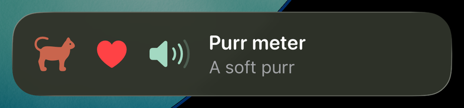
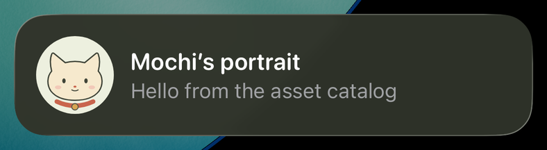
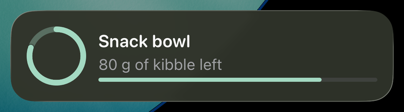
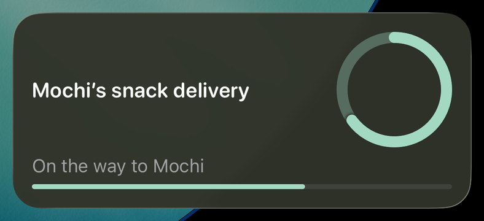
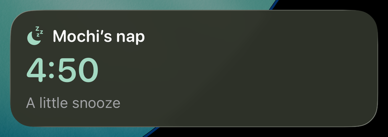
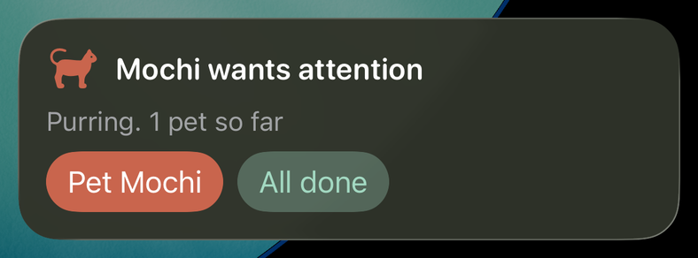
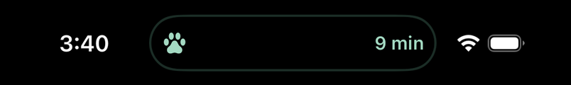
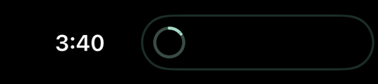

# tauri-plugin-live-activity

[](https://www.npmjs.com/package/tauri-plugin-live-activity)
[](https://crates.io/crates/tauri-plugin-live-activity)
[](https://github.com/1eedaegon/tauri-plugin-live-activity/actions/workflows/ci.yml)
[](LICENSE)

Tauri 2 앱이 하고 있는 일을 iPhone 잠금 화면과 Dynamic Island에, Android에서는 진행 중 알림으로
보여 줍니다. 레이아웃은 TypeScript로 적고, 그리는 일은 플러그인이 맡습니다.
[English](https://github.com/1eedaegon/tauri-plugin-live-activity/blob/main/README.md)

<table>
  <tr><th>iOS 잠금 화면</th><th>Dynamic Island</th></tr>
  <tr>
    <td></td>
    <td></td>
  </tr>
  <tr><th>Android 알림</th><th>Samsung Now Bar</th></tr>
  <tr>
    <td></td>
    <td></td>
  </tr>
</table>

네 장 모두 고양이 Mochi를 따라가는 [데모 앱](https://github.com/1eedaegon/tauri-plugin-live-activity/tree/main/examples/demo)에서
캡처했습니다. 플러그인은 iOS 16.2 이상과 Android 8 이상에서 동작하고, 데스크톱에서는 활동 명령이
`UNSUPPORTED_PLATFORM`을 돌려줍니다. iOS에서는 [activitykit](https://github.com/1eedaegon/activitykit-rs) 크레이트
위에서 동작하므로 플러그인 자체의 Swift 코드가 없습니다. Android에서는 진행률과 타이머 템플릿의 수명 주기를
[liveupdate](https://github.com/1eedaegon/liveupdate-rs) 크레이트로 Rust에서 처리합니다. 레이아웃도 이 크레이트가
안드로이드 알림 스타일로 그리고, 플러그인의 Kotlin은 권한 명령만 맡습니다. 1.0 전까지는 마이너 버전이 바뀔 때 API도 바뀔 수
있습니다.

## 설치

Tauri 2 앱 폴더에서 실행합니다.

```sh
cargo add tauri-plugin-live-activity --manifest-path src-tauri/Cargo.toml
npm i tauri-plugin-live-activity
npx tauri-plugin-live-activity setup
```

그리고 `src-tauri/src/lib.rs`의 빌더에 한 줄을 더합니다.

```rust
.plugin(tauri_plugin_live_activity::init())
```

`setup`은 플러그인 권한을 허용하고, Android 최소 버전을 API 26으로 올리고, Mac에서는 활동을 그리는
위젯 확장을 activitykit의 Swift 패키지로 Xcode 프로젝트에 추가합니다. `tauri ios init` 뒤에 실행하고, 나중에
`src-tauri/gen/apple`을 처음부터 다시 만들었다면 한 번 더 실행하세요. 0.3으로 설정한 앱이라면 다시 한 번
실행하면 위젯과 직접 만든 뷰를 activitykit으로 옮겨 줍니다. 무엇이 바뀔지는 `--dry-run`으로 먼저 볼 수 있습니다.

## 사용법

```ts
import { getCapabilities, layout, requestPermissions, startLayout, updateLayout, endLayout } from 'tauri-plugin-live-activity';

const { vstack, bound, progress } = layout;
const { platform } = await getCapabilities();
await requestPermissions(platform === 'android' ? 'notifications' : 'liveActivities');

const snack = await startLayout({
  activityKey: 'mochi:snack',
  schemaVersion: 2,
  fallback: 'notification',
  layout: { lockScreen: vstack([bound('title'), bound('status'), progress('done')]) },
  snapshot: { revision: 0, values: { title: 'Mochi’s snack', status: 'Packing a tiny treat', done: 0.15 } },
});
await updateLayout({ id: snack.id, snapshot: { revision: 1, values: { title: 'Mochi’s snack', status: 'On the way', done: 0.65 } } });
await endLayout({ id: snack.id, policy: { kind: 'immediate' } });
```

레이아웃은 시작할 때 모습 그대로 유지됩니다. 갱신할 때는 모든 값을 더 높은 revision과 함께 다시
보냅니다.

## 스타일 바꾸기

트리는 시작할 때 정해지지만, 몇몇 스타일 멤버는 값을 가리킬 수 있습니다. 그러면 갱신으로 바꿀 수 있습니다.

```ts
const { bind } = layout;
// styles: { status: { color: bind('tone'), weight: bind('weight') } }, values: { tone: 'green', weight: 'regular', … }
await updateLayout({ id, snapshot: { revision: 2, values: { ...values, tone: 'red', weight: 'bold' } } });
```

```rust
let status = Style { color: Some(Bound::key("tone").into()), ..Style::default() };
// 나중에: 값을 모두 다시 보내면서 색만 바꿉니다.
values.insert("tone".into(), Value::Text("red".into()));
app.live_activity().update_layout(LayoutUpdateInput { id, snapshot: LayoutSnapshot { revision: 2, values, stale_at: None, timestamp: None } })?;
```

값을 가리킬 수 있는 것은 `color`, `background`, `tint`, `opacity`, `size`, `weight`, `cornerRadius`와
레이아웃의 `background`, `keyline`뿐입니다. 색은 이름이나 hex 색만 되고, 라이트·다크 쌍은 쓸 수 없습니다.
나머지는 시작한 그대로 남으니, 바꾸려면 활동을 끝내고 다시 시작하세요. 갱신마다 값을 전부 다시 보내고,
레이아웃·스타일·값을 합친 weight는 3584를 넘을 수 없습니다. Android는 스타일을 그리지 않습니다.
0.2.x 크레이트는 바인딩을 거부하므로 npm 패키지와 크레이트의 마이너 버전을 맞추세요.
[자세히](https://github.com/1eedaegon/tauri-plugin-live-activity/blob/main/docs/usage.md#changing-styles)

## 레이아웃에 넣을 수 있는 것

레이아웃은 `text`/`bound`, `path`(SVG path 데이터), `vstack`·`hstack`·`zstack`·`spacer`·`divider`와
아래 여섯 가지로 만듭니다. 그림은 모두 iOS 잠금화면입니다. 예시의 빌더는 `layout`에서 꺼내 씁니다
(`const { vstack, hstack, text, bound, symbol, image, gauge, progress, timerText, button } = layout;`).

### 심볼



```ts
hstack([
  symbol('cat.fill'),
  symbol('heart.fill', { rendering: 'multicolor' }),
  symbol('speaker.wave.3.fill', { variableBind: 'purr' }), // purr: 0.35
])
```

SF Symbols입니다. `variableBind`는 0~1 값으로 가변 심볼을 채웁니다. iOS 전용입니다.

### 이미지



```ts
hstack([image('mochi', { resizable: true, style: 'portrait' }), bound('title')])
// styles: { portrait: { frame: { width: 56, height: 56 } } }
```

위젯 확장의 에셋 카탈로그에 있는 그림입니다. iOS 전용입니다.

### 게이지



```ts
hstack([gauge('bowl', { max: 100, kind: 'circular' }), gauge('bowl', { max: 100 })]) // bowl: 80
```

`min`~`max` 사이의 숫자를 원이나 막대로 보여 줍니다. iOS 전용입니다.

### 진행률



```ts
vstack([bound('title'), progress('done', { kind: 'circular' }), progress('done')]) // done: 0.65
```

0~1 사이의 숫자입니다. Android에서는 첫 번째 진행률이 알림의 막대가 됩니다.

### 타이머



```ts
vstack([bound('title'), timerText('start', 'end')]) // end: Date.now() + 5 * 60_000
```

시스템이 세는 타이머로, `end`까지 줄어들거나 `start`부터 늘어납니다(`countsDown: false`). Android에서는 알림의 크로노미터가 됩니다.

### 버튼



```ts
hstack([button('pet', text('Pet Mochi')), button('done', text('All done'))])

await onAction(async ({ actionId, activityId }) => {
  if (actionId === 'done') await endLayout({ id: activityId, policy: { kind: 'immediate' } });
});
```

탭은 `onAction`으로, 앱이 열려 있지 않을 때는 Rust의 `on_action`으로 전달됩니다. iOS 17 이상이며, Android는 최대 세 개를 알림 버튼으로 보여 줍니다.

### Dynamic Island

<table>
  <tr><th>컴팩트</th><th>미니멀</th><th>확장</th></tr>
  <tr>
    <td></td>
    <td></td>
    <td></td>
  </tr>
</table>

```ts
island: {
  expanded: {
    leading: image('mochi', { resizable: true, style: 'portrait' }),
    center: bound('title'),
    trailing: bound('eta'),
    bottom: vstack([bound('status'), progress('done')]),
  },
  compactLeading: symbol('pawprint.fill'),
  compactTrailing: bound('eta'),
  minimal: progress('done', { kind: 'circular' }),
},
keyline: '#A3D9C2', // 아일랜드 테두리 색
```

레이아웃에서 `lockScreen` 옆에 `island`를 둡니다. 빠진 부분은 잠금화면 트리(확장)나 그 첫 심볼(컴팩트 왼쪽, 미니멀)을 보여 줍니다.

Android는 레이아웃을 알림으로 보여 줍니다. 첫 두 텍스트가 제목과 본문이 되고, 첫 진행률 막대와 타이머, 버튼 최대 세 개가 들어갑니다. 빠진 것은 `degradedFeatures`에 이름이 남습니다.

## 기본 부품 너머

대부분은 Swift 없이 바꿀 수 있습니다. 글꼴과 그림을 위젯 확장에 넣고 이름으로 부르면 됩니다.

```sh
npx tauri-plugin-live-activity setup --font fonts/Pacifico-Regular.ttf --asset art/paw@3x.png
```

```ts
styles: { title: { fontFamily: 'Pacifico-Regular', size: 22 } }, // 글꼴을 부르는 이름은 setup이 알려 줍니다
lockScreen: hstack([image('paw'), bound('title', { style: 'title' })]),
```

앱이 캔버스나 Rust로 직접 그린 그림은 App Group을 거칩니다(`setup --app-group`). PNG를 쓴 다음 시작하거나
갱신하면 위젯이 그 그림을 그립니다.

```ts
await writeImage('badge.png', png); // Rust: app.live_activity().write_image("badge.png", &png)
lockScreen: image({ file: 'badge.png' }, { resizable: true }),
```

직접 만든 뷰가 필요하면 `gen/apple/LiveActivityWidget/LiveActivityCustomViews.swift`에 SwiftUI로 쓰고 `custom`으로
놓습니다. 이 파일은 `setup`이 한 번 만들고 다시는 덮어쓰지 않습니다.

```ts
custom('ring', { props: { level: bind('done'), width: 4 } }),
```

```swift
"ring": ActivityKitCustomView { props in Ring(level: props.number("level") ?? 0) },
```

뷰가 없는 이름은 아무것도 그리지 않고 `degradedFeatures`에 `layout.custom.ring`으로 남습니다. 마지막 수단은
복사된 `LiveActivityWidget.swift`(activitykit의 위젯 템플릿)를 직접 고치는 것입니다. 그러면 `setup`은 그 파일을
그대로 두고, 템플릿이 바뀐 부분은 직접 합쳐야 합니다.

제한: Live Activity는 네트워크를 쓸 수 없고 메모리도 적습니다. 그린 PNG는 1 MiB, 1224 × 480 픽셀까지이고,
이는 Apple의 가장 큰 잠금화면 크기를 @3x로 잰 값입니다. 글꼴은 확장 안에 있어야 합니다. 기기에서는 App
Group을 Apple 계정에 한 번 등록해야 하는데, 자동 서명이 대신 해 줍니다. 검증기는 커스텀 뷰의 이름과 props만
보고 뷰 자체는 보지 않습니다. Android는 이 가운데 아무것도 그리지 않고, 처음 나오는 그린 그림만 알림의 큰
아이콘이 됩니다. 레이아웃, 스타일, 값은 여전히 3584를 나눠 씁니다.
[자세히](https://github.com/1eedaegon/tauri-plugin-live-activity/blob/main/docs/usage.md#beyond-the-built-in-parts)

## 제약

- iOS: iOS 16.2 이상의 iPhone 또는 iPadOS 17 이상의 iPad가 필요하고, 버튼은 iOS 17부터 동작합니다. 활동은 앱이
  포그라운드에 있을 때만 시작되고(아니면 `NOT_FOREGROUND`), 시스템이 8시간 뒤에 끝냅니다.
- iOS는 활동마다 마지막 값을 앱의 Application Support에 평문으로 남깁니다. 플러그인 설정에
  `"receipts": "redacted"`를 주면 값 대신 다이제스트만 남깁니다.
- 버튼을 누르면 Rust의 `on_action` 핸들러가 끝날 때까지 최대 4초 기다립니다. JavaScript 리스너는 기다리지 않습니다.
- `app.live_activity()`의 Rust 메서드는 응답이 올 때까지 스레드를 멈추므로 메인 스레드가 아닌 곳에서 호출하세요. iOS에서
  메인 스레드에서 호출하면 바로 `NATIVE_ERROR`를 돌려줍니다. JavaScript의 명령은 멈추지 않습니다.
- 푸시 갱신은 없습니다. Android는 진행 중 알림으로 보여 주고, 시스템이 허용하면 Live Update로 올립니다.

## Samsung Now Bar

`tauri.conf.json`에 `"plugins": { "live-activity": { "android": { "samsungNowBar": true } } }`를 넣으면
One UI 9의 Now Bar가 보여 줄 제목과 본문을 함께 보냅니다. 다만 One UI는 Samsung 허용 목록에 있는
앱만 Now Bar에 띄우고(개발자 옵션 "Live notifications for all apps"를 켜면 모든 앱), 플러그인이 앱을
그 목록에 넣을 수는 없습니다.

## 더 알아보기

나머지는 [문서](https://github.com/1eedaegon/tauri-plugin-live-activity/tree/main/docs)에 있습니다.
`setup`이 바꾸는 내용과 손으로 설정하는 방법, iOS·Android 캡처가 붙은 레이아웃 노드 전체, Rust에서
버튼을 처리하는 방법, 진행률·타이머 템플릿, 플러그인 옵션, 테스트 기록을 영어로 정리했습니다.

## 라이선스

[MIT](LICENSE-MIT) 또는 [Apache-2.0](LICENSE-APACHE).
