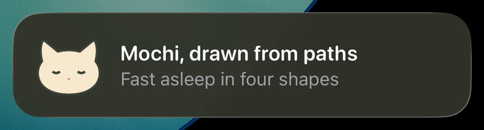
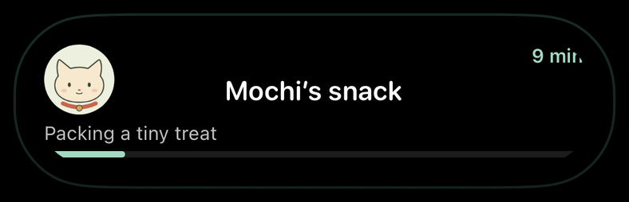
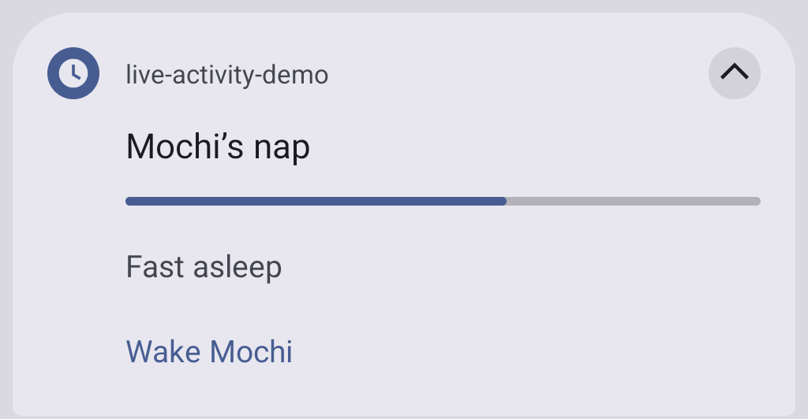
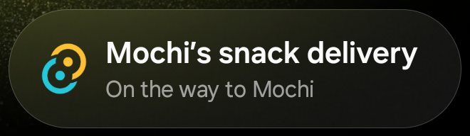
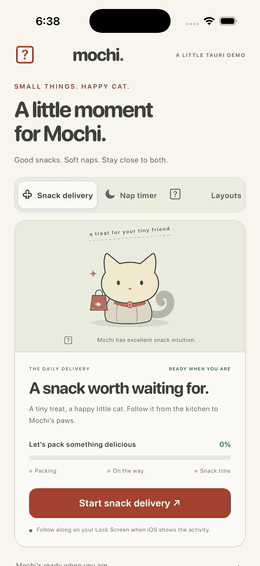
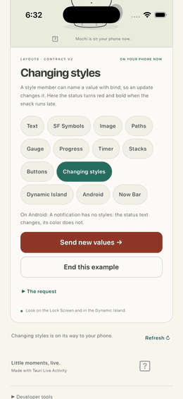
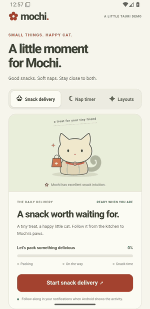

# tauri-plugin-live-activity

[](https://www.npmjs.com/package/tauri-plugin-live-activity)
[](https://crates.io/crates/tauri-plugin-live-activity)
[](https://github.com/1eedaegon/tauri-plugin-live-activity/actions/workflows/ci.yml)
[](LICENSE)

Show what your Tauri 2 app is doing on the iPhone Lock Screen and in the Dynamic Island, and as
an ongoing notification on Android. You describe the layout in TSX, TypeScript or Rust; the plugin draws it.
[한국어](https://github.com/1eedaegon/tauri-plugin-live-activity/blob/main/README.ko.md)

<table>
  <tr><th>iOS Lock Screen</th><th>Dynamic Island</th></tr>
  <tr>
    <td></td>
    <td></td>
  </tr>
  <tr><th>Android notification</th><th>Samsung Now Bar</th></tr>
  <tr>
    <td></td>
    <td></td>
  </tr>
</table>

The demo running, recorded on the iPhone 17 Pro simulator and an Android 16 emulator:

<table>
  <tr><th>iOS: a snack delivery and a nap timer on the Lock Screen</th><th>iOS: a bound style changes with an update</th><th>Android: the same request as a notification on the lock screen</th></tr>
  <tr>
    <td></td>
    <td></td>
    <td></td>
  </tr>
</table>

All of them come from the [demo app](https://github.com/1eedaegon/tauri-plugin-live-activity/tree/main/examples/demo),
which follows a cat named Mochi. iOS 16.2+ and Android 8+; on desktop the activity commands answer
`UNSUPPORTED_PLATFORM`. The plugin is an adapter of the [liveactivity](https://github.com/1eedaegon/liveactivity-rs)
crate, which runs iOS on [activitykit](https://github.com/1eedaegon/activitykit-rs) and Android on
[liveupdate](https://github.com/1eedaegon/liveupdate-rs): the plugin has no Swift of its own, and its Kotlin answers
the permission commands and carries liveupdate's Android adapter. Before 1.0, a minor version may change the API.

## Install

In the folder of your Tauri 2 app:

```sh
cargo add tauri-plugin-live-activity --manifest-path src-tauri/Cargo.toml
npm i tauri-plugin-live-activity
npx tauri-plugin-live-activity setup
```

Then register the plugin in `src-tauri/src/lib.rs`:

```rust
.plugin(tauri_plugin_live_activity::init())
```

`setup` grants the plugin's permissions, raises the Android minimum to API 26 and, on a Mac, adds the
widget extension that draws the activity to the Xcode project. Run it after `tauri ios init`, and again
whenever `src-tauri/gen/apple` is made from scratch. `--dry-run` shows what it would change.

## React and TSX

A layout is a tree of components from `tauri-plugin-live-activity/jsx`, a JSX import source of its own: the
file needs no React, and a server can build the same tree for a push payload. Keep it in a file of its own,
since this JSX has no HTML elements.

```tsx
/** @jsxImportSource tauri-plugin-live-activity/jsx */
// delivery-layout.tsx
import { Button, HStack, Progress, SFSymbol, Text, VStack } from 'tauri-plugin-live-activity/jsx';

// iOS: the Lock Screen draws this tree as it is, and the expanded Dynamic Island shows it too
//      (iOS 16.2+; the Button needs iOS 17).
// Android: the notification takes the first two Texts as title and body, the first Progress as its
//      bar and up to three Buttons as actions; symbols and styles are left out.
export const lockScreen = (
  <VStack alignment="leading" spacing={8}>
    <HStack spacing={8}><SFSymbol name="cat.fill" /><Text bind="title" /></HStack>
    <Text bind="status" />
    <Progress bind="done" />
    <Button actionId="done"><Text>All done</Text></Button>
  </VStack>
);
```

`tauri-plugin-live-activity/react` keeps one activity in step with a component (React 18+, an optional
peer dependency). It starts on mount, sends the values as an update whenever a render changes them, and
ends on unmount or `enabled: false`:

```tsx
// Delivery.tsx
import { getCapabilities, requestPermissions } from 'tauri-plugin-live-activity';
import { useLiveActivity } from 'tauri-plugin-live-activity/react';
import { lockScreen } from './delivery-layout';

// Once, before the first start: 'notifications' on Android, 'liveActivities' on iOS.
export async function allowActivities() {
  const { platform } = await getCapabilities();
  await requestPermissions(platform === 'android' ? 'notifications' : 'liveActivities');
}

export function Delivery({ order }: { order: Order }) {
  const { status, error, pushToken } = useLiveActivity({
    activityKey: `delivery:${order.id}`,
    layout: { lockScreen },
    values: { title: order.title, status: order.status, done: order.done },
    enabled: order.open,
    // Android only: who sees the notification on the lock screen ('public', 'private' or 'secret').
    android: { visibility: 'public' },
    // iOS only: ask ActivityKit for the activity's APNs token; it lands in `pushToken`.
    push: 'token',
    // A tap on a Button of this activity, also when the tap launched the app.
    onAction: ({ actionId }) => { if (actionId === 'done') closeOrder(order.id); },
  });
  // pushToken: the activity's APNs token on iOS, for your server.
  return <p>{status}{error ? ` (${error.message})` : ''}</p>;
}
```

`layout` and `styles` are read at start: change the `activityKey` to start a new activity. A refused request
lands in `error`. One component per node: `VStack`, `HStack`, `ZStack`, `Spacer`, `Divider`, `Text`,
`SFSymbol`, `Image`, `Path`, `Progress`, `Gauge`, `TimerText`, `Button`, `Link`, `Toggle`, `Custom`, with the node's members as
props. [More](https://github.com/1eedaegon/tauri-plugin-live-activity/blob/main/docs/usage.md#tsx-and-react)

## Rust

The same requests from Rust, through `app.live_activity()`. The methods block until the platform answers, so
call them off the main thread (on iOS a call on the main thread answers `NATIVE_ERROR` at once):

```rust
use std::collections::BTreeMap;
use tauri::{AppHandle, Runtime};
use tauri_plugin_live_activity::{
    Element, EndPolicy, Fallback, Layout, LayoutEndInput, LayoutSnapshot, LayoutStartInput,
    LayoutUpdateInput, LiveActivityExt, Result, Value,
};

fn snapshot(revision: u64, status: &str) -> LayoutSnapshot {
    let values = BTreeMap::from([("status".to_string(), Value::Text(status.into()))]);
    LayoutSnapshot::new(revision, values)
}

fn deliver<R: Runtime>(app: &AppHandle<R>) -> Result<()> {
    let input = LayoutStartInput {
        activity_key: "mochi:snack".into(),
        schema_version: 2,
        // Android, and iOS without Live Activities: shown as a notification.
        fallback: Fallback::Notification,
        layout: Layout {
            lock_screen: Element::Text { value: None, bind: Some("status".into()) }.into(),
            island: None, background: None, keyline: None, url: None,
        },
        styles: None,
        snapshot: snapshot(0, "On time"),
        android: None, // Android only: `AndroidOptions::new(visibility)` for the lock screen
        ios: None,     // iOS only: `IosOptions::new(transient)` for a transient activity (iOS 18)
        scheduled: None, // iOS 26: `ScheduledStart::new(at, alert)` starts it later
        push: None,    // iOS only: `Some(LayoutPush::Token)` asks for the activity's APNs token
    };
    let activity = app.live_activity().start_layout(input)?;
    // Every update sends all values again, with a higher revision.
    app.live_activity().update_layout(LayoutUpdateInput::new(activity.id.clone(), snapshot(1, "At the door")))?;
    app.live_activity().end_layout(LayoutEndInput { id: activity.id, policy: EndPolicy::Immediate {}, snapshot: None })?;
    Ok(())
}
```

A tap that must not be lost belongs in Rust: the system can launch the app for it with no web view yet, and
JavaScript listeners are not awaited. Register the handler on the built `App` before `run`:

```rust
let handle = app.handle().clone();
app.live_activity().on_action(move |event| {
    if event.action_id == "done" {
        let input = LayoutEndInput { id: event.activity_id, policy: EndPolicy::Immediate {}, snapshot: None };
        let _ = handle.live_activity().end_layout(input);
    }
});
```

## Plain TypeScript

Without React, the three commands and the `layout` builders do the same:

```ts
import { endLayout, layout, startLayout, updateLayout } from 'tauri-plugin-live-activity';

const { vstack, bound, progress } = layout;
const snack = await startLayout({
  activityKey: 'mochi:snack',
  schemaVersion: 2,
  fallback: 'notification',
  layout: { lockScreen: vstack([bound('title'), bound('status'), progress('done')]) },
  snapshot: { revision: 0, values: { title: 'Mochi’s snack', status: 'Packing a tiny treat', done: 0.15 } },
});
await updateLayout({ id: snack.id, snapshot: { revision: 1, values: { title: 'Mochi’s snack', status: 'On the way', done: 0.65 } } });
await endLayout({ id: snack.id, policy: { kind: 'immediate' } });
```

A start may also carry `scheduled: { at, alert }` to begin later (iOS 26), and `ios: { transient: true }` for a transient
activity (iOS 18). The layout stays as it started; each update sends every value again, with a higher revision. Taps come to
`onAction`, push tokens and pushed content to `onPushToken`, `onPushToStartToken` and `onUpdated`, and what happens
to an activity outside the app's calls to `onState`, `onStarted`, `onOpened` (Android: the person opened the app from an
activity's notification; the opening that launched the app waits for the page) and `onPermissions`.

A snapshot may also carry a `relevance`, which decides which of the app's activities the Dynamic Island shows, and
an `android` content, the notification in Android's own terms (a segmented progress, metrics, the chip text) in
place of the projection of the layout; `updateLayout` takes an `alert`, which lights up the iPhone.
[More](https://github.com/1eedaegon/tauri-plugin-live-activity/blob/main/docs/usage.md#android-content)

## What a layout can hold

| Node | Shows | iOS | Android |
|---|---|---|---|
| `text`, `bound` | a string, or the value of a key | yes | the first two become title and body |
| `symbol` | an SF Symbol; `variableBind` fills a variable symbol from 0 to 1 | yes | no |
| `image` | a picture from the widget's asset catalog, or a PNG the app wrote | yes | the first drawn image is the large icon |
| `path` | SVG path data | yes | no |
| `gauge` | a number between `min` and `max`, as a ring or a bar | yes | no |
| `progress` | a number from 0 to 1, as a ring or a bar | yes | the first one is the notification's bar |
| `timerText` | a count down to `end` or up from `start`, kept by the system | yes | the chronometer |
| `button` | a tap for `onAction` / `on_action` | iOS 17+ | up to three actions |
| `link` | a tap that opens its URL in the app | iOS | an action that opens the URL (where the device offers `links`) |
| `toggle` | a switch of a boolean value; a tap comes as `on` | iOS 17+ | an action titled by its label, with a check mark while on |
| `vstack`, `hstack`, `zstack`, `spacer`, `divider` | arrangement | yes | flattened |
| `custom` | a SwiftUI view of your own, by name | yes | no |

Styles name a font, color, weight, frame and more by token (`styles: { title: { size: 22 } }`,
`bound('title', { style: 'title' })`); `color`, `background`, `tint`, `opacity`, `size`, `weight`,
`cornerRadius` and the layout's `background` and `keyline` may be bound to a value (`color: bind('tone')`)
and then change with an update. Android draws no styles. Layout, styles and values share a weight limit of 3584.
`degradedFeatures` in the record names what a platform left out.

The Dynamic Island takes its own parts next to `lockScreen`; a part left out shows the lock screen tree
(expanded) or its first symbol (compact leading, minimal):

```ts
island: {
  expanded: { leading: image('mochi'), center: bound('title'), trailing: bound('eta'), bottom: progress('done') },
  compactLeading: symbol('pawprint.fill'),
  compactTrailing: bound('eta'),
  minimal: progress('done', { kind: 'circular' }),
},
keyline: '#A3D9C2', // the island's edge color
```

## Pushes (iOS)

A server updates, ends or starts activities through APNs. Start with `push: 'token'` (or `{ channel }` on iOS 18)
and the activity's token comes to `onPushToken`; the app's push-to-start token (iOS 17.2, `pushToStart` in the
plugin configuration) to `onPushToStartToken`; content a push delivered to `onUpdated`. Tokens the plugin already
holds when a page subscribes come at once. The server builds the payloads with activitykit's `push::Payload`.
[More](https://github.com/1eedaegon/tauri-plugin-live-activity/blob/main/docs/usage.md#pushes)

## Beyond the built-in parts

Most customizing needs no Swift. `setup --font fonts/Pacifico-Regular.ttf --asset art/paw@3x.png` bundles fonts
and pictures in the widget extension, to be named in styles and `image('paw')`. Pictures the app draws go
through an App Group (`setup --app-group`): `writeImage('badge.png', png)`, then `image({ file: 'badge.png' })`.
A view of your own is SwiftUI in `gen/apple/LiveActivityWidget/LiveActivityCustomViews.swift`, which `setup`
creates once and never overwrites, placed with `custom('ring', { props: { level: bind('done') } })`. A drawn PNG is
at most 1 MiB and 1224 × 480 pixels. [More](https://github.com/1eedaegon/tauri-plugin-live-activity/blob/main/docs/usage.md#beyond-the-built-in-parts)

## Limits

- iOS: an iPhone with iOS 16.2 or an iPad with iPadOS 17; buttons need iOS 17. An activity starts only while the
  app is in the foreground (`NOT_FOREGROUND` otherwise), and the system ends it after 8 hours.
- iOS keeps each activity's last values in plain text in the app's Application Support, unless the plugin
  configuration sets `"receipts": "redacted"`.
- A button's tap waits for the Rust `on_action` handlers, at most 4 seconds; JavaScript listeners are not awaited.
- Pushes are iOS only. Android shows an ongoing notification, promoted to a Live Update where the system allows it.
- Android 16 shows nothing of a notification whose time is more than two weeks past, and the app is told nothing. This
  is a timer whose start or end lies that far before the post.
- Keep the npm package and the crate on the same minor version.

## Samsung Now Bar

`"plugins": { "live-activity": { "android": { "samsungNowBar": true } } }` in `tauri.conf.json` sends One UI 9
the title and body its Now Bar shows. One UI shows the Now Bar only for apps on Samsung's allow list, or for every
app while the developer option "Live notifications for all apps" is on.

## More

The [docs](https://github.com/1eedaegon/tauri-plugin-live-activity/tree/main/docs) cover the rest: what `setup`
changes and how to do it by hand, every node with iOS and Android captures, the plugin options and the test records.

## License

[MIT](LICENSE-MIT) or [Apache-2.0](LICENSE-APACHE).
