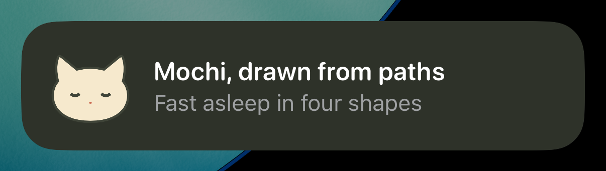
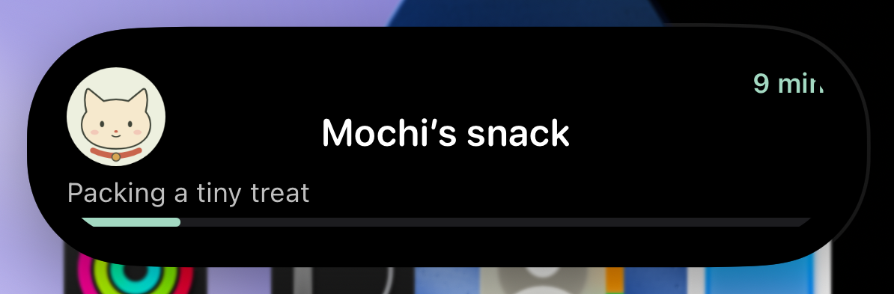
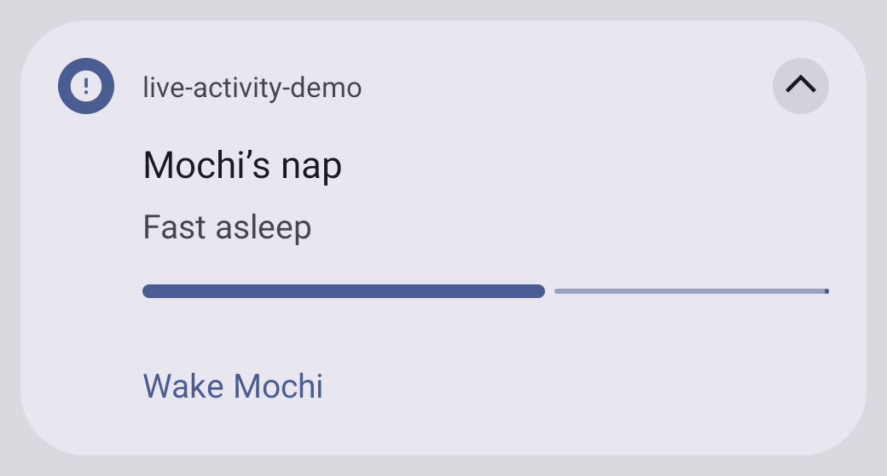
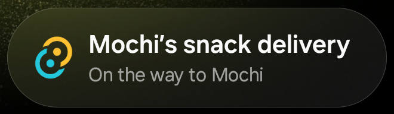
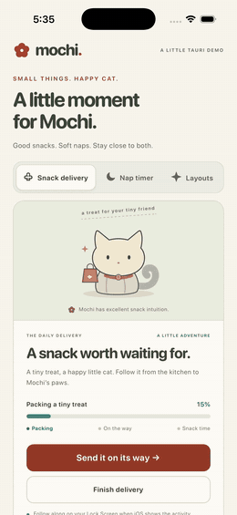
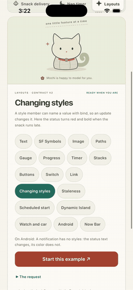
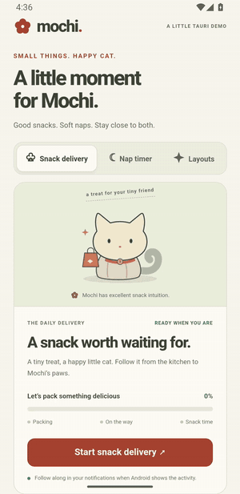
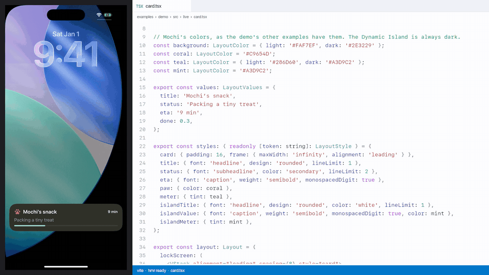

# tauri-plugin-live-activity

[](https://www.npmjs.com/package/tauri-plugin-live-activity)
[](https://crates.io/crates/tauri-plugin-live-activity)
[](https://github.com/1eedaegon/tauri-plugin-live-activity/actions/workflows/ci.yml)
[](LICENSE)

**iOS Live Activities and Android Live Updates for Tauri 2.** Show what your Tauri 2 app is doing on the iPhone
Lock Screen and in the Dynamic Island (ActivityKit), and as a Live Update or an ongoing notification on Android.
You describe the layout in TSX, TypeScript or Rust; the plugin draws it, through the
[liveactivity-rs](https://github.com/1eedaegon/liveactivity-rs) bridge.
[한국어](https://github.com/1eedaegon/tauri-plugin-live-activity/blob/main/README.ko.md) ·
[Site](https://1eedaegon.github.io/tauri-plugin-live-activity/)

<table>
  <tr><th>iOS Lock Screen</th><th>Dynamic Island</th></tr>
  <tr>
    <td></td>
    <td></td>
  </tr>
  <tr><th>Android notification</th><th>Samsung Now Bar</th></tr>
  <tr>
    <td></td>
    <td></td>
  </tr>
</table>

The demo running, recorded on the iPhone 17 Pro simulator and an Android 16 emulator:

<table>
  <tr><th>iOS: a snack delivery and a nap timer on the Lock Screen</th><th>iOS: a bound style changes with an update</th><th>Android: the same request as a notification on the lock screen</th></tr>
  <tr>
    <td></td>
    <td></td>
    <td></td>
  </tr>
</table>

The card's TSX edited while the demo runs: new values update the activity in place, and a new layout or new styles
start it again ([live editing](https://github.com/1eedaegon/tauri-plugin-live-activity/blob/main/docs/live-editing.md)):



All of them come from the [demo app](https://github.com/1eedaegon/tauri-plugin-live-activity/tree/main/examples/demo),
which follows a cat named Mochi.

## Supported versions

In short: iOS 16.1+ and Android 8+, and no activities on desktop.

| Where | From | What you get |
| --- | --- | --- |
| iPhone | iOS 16.1 | Live Activities on the Lock Screen and, on iPhones that have one, in the Dynamic Island. Stale dates and relevance from iOS 16.2; buttons, toggles and push-to-start from iOS 17.2 |
| iPad | iPadOS 17 | The same Live Activities on the Lock Screen |
| StandBy | iOS 17 | The Lock Screen card scaled up on an iPhone that charges on its side, where nodes with `ifFullscreen` show |
| Apple Watch | iOS 18 with watchOS 11 | A layout's `small` region in the watch's Smart Stack |
| Android | Android 8.0 (API 26) | An ongoing notification with a progress bar or a timer and up to three actions; the notification permission is asked from Android 13 (API 33) |
| Android Live Updates | Android 16 (API 36) | A promoted Live Update where the system and the person's settings allow one, the ongoing notification otherwise; `openPromotionSettings()` opens that setting |
| Samsung Now Bar | Android 17 (API 37), One UI 9 | The title and body that One UI's Now Bar shows, for apps on Samsung's allow list |
| macOS, Windows, Linux | not supported | No activities: the activity commands answer `UNSUPPORTED_PLATFORM` |

The plugin needs Tauri 2 and Rust 1.90 or later. `setup` sets the widget extension's deployment target to iOS 16.1 and
the Android `minSdk` to 26. The floor of every feature is in
[OS compatibility](https://github.com/1eedaegon/tauri-plugin-live-activity/blob/main/docs/compatibility.md).

## How it works

The plugin is the Tauri side of four crates. It keeps Tauri's commands, events, permissions and the `setup`
command. The [liveactivity-rs](https://github.com/1eedaegon/liveactivity-rs) bridge, the `liveactivity` crate, holds
the request contract, its checks and the lifecycle, and runs each request on the platform's backend:

```text
your Tauri 2 app             a layout in TSX, TypeScript or Rust
  │  start · update · end · events
  ▼
tauri-plugin-live-activity   Tauri commands, events, permissions, setup
  │
  ▼
liveactivity                 the liveactivity-rs bridge: one request contract,
  │                          its checks, the lifecycle
  ├─ iOS 16.1+ ────────────► activitykit (activitykit-rs)
  │                          ActivityKit through its Swift bridge, drawn by the
  │                          app's widget extension: Lock Screen, Dynamic Island
  └─ Android 8.0+ ─────────► liveupdate (liveupdate-rs)
                             an ongoing notification, a Live Update on Android 16+
```

The plugin has no Swift of its own; its Kotlin answers the permission commands and carries liveupdate's Android
adapter. The backend under the plugin can be replaced, or wrapped in layers: see [Your own backend](#your-own-backend). [iOS setup](https://github.com/1eedaegon/tauri-plugin-live-activity/blob/main/docs/ios-integration.md) and
[Android setup](https://github.com/1eedaegon/tauri-plugin-live-activity/blob/main/docs/android-integration.md) show
what `setup` changes in each project.

## Install

In the folder of your Tauri 2 app:

```sh
cargo add tauri-plugin-live-activity --manifest-path src-tauri/Cargo.toml
npm i tauri-plugin-live-activity
npx tauri-plugin-live-activity setup
```

Then register the plugin in `src-tauri/src/lib.rs`:

```rust
.plugin(tauri_plugin_live_activity::init())
```

`setup` grants the plugin's permissions, raises the Android minimum to API 26 and, on a Mac, adds the
widget extension that draws the activity to the Xcode project. Run it after `tauri ios init`, and again
whenever `src-tauri/gen/apple` is made from scratch. `--dry-run` shows what it would change.

## React and TSX

A layout is a tree of components from `tauri-plugin-live-activity/jsx`, a JSX import source of its own: the
file needs no React, and a server can build the same tree for a push payload. Keep it in a file of its own,
since this JSX has no HTML elements.

```tsx
/** @jsxImportSource tauri-plugin-live-activity/jsx */
// delivery-layout.tsx
import { Button, HStack, Progress, SFSymbol, Text, VStack } from 'tauri-plugin-live-activity/jsx';

// iOS: the Lock Screen draws this tree as it is, and the expanded Dynamic Island shows it too
//      (iOS 16.1+; the Button needs iOS 17.2).
// Android: the notification takes the first two Texts as title and body, the first Progress as its
//      bar and up to three Buttons as actions; symbols and styles are left out.
export const lockScreen = (
  <VStack alignment="leading" spacing={8}>
    <HStack spacing={8}><SFSymbol name="cat.fill" /><Text bind="title" /></HStack>
    <Text bind="status" />
    <Progress bind="done" />
    <Button actionId="done"><Text>All done</Text></Button>
  </VStack>
);
```

`tauri-plugin-live-activity/react` keeps one activity in step with a component (React 18+, an optional
peer dependency). It starts on mount, sends the values as an update whenever a render changes them, and
ends on unmount or `enabled: false`:

```tsx
// Delivery.tsx
import { getCapabilities, requestPermissions } from 'tauri-plugin-live-activity';
import { useLiveActivity } from 'tauri-plugin-live-activity/react';
import { lockScreen } from './delivery-layout';

// Once, before the first start: 'notifications' on Android, 'liveActivities' on iOS.
export async function allowActivities() {
  const { platform } = await getCapabilities();
  await requestPermissions(platform === 'android' ? 'notifications' : 'liveActivities');
}

export function Delivery({ order }: { order: Order }) {
  const { status, error, pushToken } = useLiveActivity({
    activityKey: `delivery:${order.id}`,
    layout: { lockScreen },
    values: { title: order.title, status: order.status, done: order.done },
    enabled: order.open,
    // Android only: who sees the notification on the lock screen ('public', 'private' or 'secret').
    android: { visibility: 'public' },
    // iOS only: ask ActivityKit for the activity's APNs token; it lands in `pushToken`.
    push: 'token',
    // A tap on a Button of this activity, also when the tap launched the app.
    onAction: ({ actionId }) => { if (actionId === 'done') closeOrder(order.id); },
  });
  // pushToken: the activity's APNs token on iOS, for your server.
  return <p>{status}{error ? ` (${error.message})` : ''}</p>;
}
```

`layout` and `styles` are read at start: change the `activityKey` to start a new activity. A refused request
lands in `error`. One component per node: `VStack`, `HStack`, `ZStack`, `Spacer`, `Divider`, `Text`,
`SFSymbol`, `Image`, `Path`, `Progress`, `Gauge`, `TimerText`, `Button`, `Link`, `Toggle`, `Custom`, with the node's members as
props. [More](https://github.com/1eedaegon/tauri-plugin-live-activity/blob/main/docs/usage.md#tsx-and-react)

## Rust

The same requests from Rust, through `app.live_activity()`. The methods block until the platform answers, so
call them off the main thread (on iOS a call on the main thread answers `NATIVE_ERROR` at once):

```rust
use std::collections::BTreeMap;
use tauri::{AppHandle, Runtime};
use tauri_plugin_live_activity::activitykit::layout::text;
use tauri_plugin_live_activity::{
    AndroidOptions, AndroidVisibility, Bound, Layout, LayoutEndInput, LayoutSnapshot, LayoutStartInput,
    LayoutUpdateInput, LiveActivityExt, Result, Value,
};

fn snapshot(revision: u64, status: &str) -> LayoutSnapshot {
    let values = BTreeMap::from([("status".to_string(), Value::Text(status.into()))]);
    LayoutSnapshot::new(revision, values)
}

fn deliver<R: Runtime>(app: &AppHandle<R>) -> Result<()> {
    let layout = Layout::new(text(Bound::key("status")));
    // Android, and iOS without Live Activities, show it as a notification.
    let mut input = LayoutStartInput::new("mochi:snack", layout, snapshot(0, "On time"));
    // Android only: the lock screen, the foreground placement, a watch's Ongoing Activity.
    input.android = Some(AndroidOptions::new(AndroidVisibility::Public).with_wear_ongoing_activity(false));
    // Also: `ios` (`IosOptions::new(transient)`, iOS 18), `scheduled` (`ScheduledStart::new(at, alert)`, iOS 26 and
    // Android), `push` (`Some(LayoutPush::Token)`, iOS).
    let activity = app.live_activity().start_layout(input)?;
    // Every update sends all values again, with a higher revision.
    app.live_activity().update_layout(LayoutUpdateInput::new(activity.id.clone(), snapshot(1, "At the door")))?;
    app.live_activity().end_layout(LayoutEndInput::immediate(activity.id))?;
    Ok(())
}
```

Requests are built on their constructors, and the enums may grow: match them with a `_` arm, and the code compiles
against the next version. liveupdate's types for an Android content come with the crate the plugin builds with,
`tauri_plugin_live_activity::liveupdate`:

```rust
use tauri_plugin_live_activity::liveupdate::{Timer, TimerStyle};
let clock = TimerStyle::new(Timer::new(started_at, ends_at), true); // counts down to `ends_at`
```

A tap that must not be lost belongs in Rust: the system can launch the app for it with no web view yet, and
JavaScript listeners are not awaited. Register the handler on the built `App` before `run`:

```rust
let handle = app.handle().clone();
app.live_activity().on_action(move |event| {
    if event.action_id == "done" {
        let _ = handle.live_activity().end_layout(LayoutEndInput::immediate(event.activity_id));
    }
});
```

## Plain TypeScript

Without React, the three commands and the `layout` builders do the same:

```ts
import { endLayout, layout, startLayout, updateLayout } from 'tauri-plugin-live-activity';

const { vstack, bound, progress } = layout;
const snack = await startLayout({
  activityKey: 'mochi:snack',
  schemaVersion: 2,
  fallback: 'notification',
  layout: { lockScreen: vstack([bound('title'), bound('status'), progress('done')]) },
  snapshot: { revision: 0, values: { title: 'Mochi’s snack', status: 'Packing a tiny treat', done: 0.15 } },
});
await updateLayout({ id: snack.id, snapshot: { revision: 1, values: { title: 'Mochi’s snack', status: 'On the way', done: 0.65 } } });
await endLayout({ id: snack.id, policy: { kind: 'immediate' } });
```

A start may also carry `scheduled: { at, alert }` to begin later (iOS 26 and Android; on Android it is on the minute once the
person allows exact alarms, where `openExactAlarmSettings()` takes them), and `ios: { transient: true }` for a transient
activity (iOS 18). The layout stays as it started; each update sends every value again, with a higher revision. Taps come to
`onAction`, push tokens and pushed content to `onPushToken`, `onPushToStartToken` and `onUpdated`, and what happens
to an activity outside the app's calls to `onState`, `onStarted`, `onOpened` (Android: the person opened the app from an
activity's notification; the opening that launched the app waits for the page), `onPermissions`, `onUnknown`
(`live-activity://unknown`; Android: something stored for an activity that this version has no event for) and
`onHandled` (Android: a tap that the app's own service or receiver took, below). A tap says which it is: `tap.id`
is the same however often it comes, and on iOS a tap the app did not take at once (it launched the app) comes
later with `tap.late`, so act on each id once:

```ts
await onAction(({ actionId, tap }) => {
  if (tap?.id && handled.has(tap.id)) return; // `handled`: the app's own set of ids, kept across launches
  if (tap?.id) handled.add(tap.id);
  // act on actionId
});
```

On iOS `getCapabilities().ios` says what the iPhone runs (`pushToStart`, `pushChannels`, `transient`,
`scheduledStart`, `smallFamily`), so a request need not be tried to learn it.

On Android a start takes `android: { visibility, publicVersion, placement, wearOngoingActivity, localOnly, watchMirror, targets }`:

```ts
android: {
  visibility: 'public',       // what a locked device shows: 'public', 'private' or 'secret'
  placement: 'foreground',    // the notification that the app's foreground service holds (`foregroundPlacement`)
  wearOngoingActivity: false, // off the face of a watch (Wear OS 3 to 6; a Tauri app does not run there)
  localOnly: true,            // ask Android not to bridge it to a paired watch (`localOnly`)
  // or watchMirror: true,     // mirror it to a paired watch instead, never beside localOnly (`watchMirror`)
  // The button `record` runs the app's own service at once, with no screen (`actionTargets`).
  targets: { record: { kind: 'foregroundService', component: 'com.example.RecorderService', action: 'com.example.RECORD' } },
}
```

The service attaches the notification with `LiveUpdateForeground.attach(service, type)` (or `attachOr`, with a
notification of its own until an activity holds the placement), and takes a tap first with
`LiveUpdateActions.take(context, intent)`; the tap then comes to `onHandled`, not `onAction`.
[More](https://github.com/1eedaegon/tauri-plugin-live-activity/blob/main/docs/android-integration.md#a-tap-that-runs-your-own-code)

A snapshot may also carry a `relevance`, which decides which of the app's activities the Dynamic Island shows, and
an `android` content, the notification in Android's own terms (a segmented progress, metrics, the chip text) in
place of the projection of the layout; `updateLayout` takes an `alert`, which lights up the iPhone.
[More](https://github.com/1eedaegon/tauri-plugin-live-activity/blob/main/docs/usage.md#android-content)

## What a layout can hold

| Node | Shows | iOS | Android |
|---|---|---|---|
| `text`, `bound` | a string, or the value of a key | yes | the first two become title and body |
| `symbol` | an SF Symbol; `variableBind` fills a variable symbol from 0 to 1 | yes | no |
| `image` | a picture from the widget's asset catalog, or a PNG the app wrote | yes | the first drawn image is the large icon |
| `path` | SVG path data | yes | no |
| `gauge` | a number between `min` and `max`, as a ring or a bar | yes | no |
| `progress` | a number from 0 to 1, as a ring or a bar | yes | the first one is the notification's bar |
| `timerText` | a count down to `end` or up from `start`, kept by the system | yes | the chronometer |
| `button` | a tap for `onAction` / `on_action` | iOS 17.2+ | up to three actions |
| `link` | a tap that opens its URL in the app | iOS | an action that opens the URL (where the device offers `links`) |
| `toggle` | a switch of a boolean value; a tap comes as `on` | iOS 17.2+ | an action titled by its label, with a check mark while on |
| `vstack`, `hstack`, `zstack`, `spacer`, `divider` | arrangement | yes | flattened |
| `custom` | a SwiftUI view of your own, by name | yes | no |

Styles name a font, color, weight, frame and more by token (`styles: { title: { size: 22 } }`,
`bound('title', { style: 'title' })`); `color`, `background`, `tint`, `opacity`, `size`, `weight`,
`cornerRadius` and the layout's `background` and `keyline` may be bound to a value (`color: bind('tone')`)
and then change with an update. Android draws no styles. Layout, styles and values share a weight limit of 3584.
`degradedFeatures` in the record names what a platform left out.

The Dynamic Island takes its own parts next to `lockScreen`; a part left out shows the lock screen tree
(expanded) or its first symbol (compact leading, minimal):

```ts
island: {
  expanded: { leading: image('mochi'), center: bound('title'), trailing: bound('eta'), bottom: progress('done') },
  compactLeading: symbol('pawprint.fill'),
  compactTrailing: bound('eta'),
  minimal: progress('done', { kind: 'circular' }),
},
keyline: '#A3D9C2', // the island's edge color
```

On iOS a paired Apple Watch (iOS 18) and CarPlay (iOS 26) show the island's compact parts. `small` gives them a
tree of their own, at most 12 nodes without buttons, links or toggles, once the widget extension draws that family
(`setup --small-family`): `small: hstack([symbol('pawprint.fill'), bound('eta')])`. On Android a phone's ongoing
notification is not bridged to a paired watch, and a Live Update only to some, which `android: { localOnly: true }`
asks Android not to do; `android: { watchMirror: true }` mirrors every snapshot to the watch by a second
notification that is not ongoing. Android Auto has no place for one. Android names `small` in `degradedFeatures`. [More](https://github.com/1eedaegon/tauri-plugin-live-activity/blob/main/docs/usage.md#a-watch-and-a-car)

On the Lock Screen the card has no margin and shows a narrower layout in its middle: give the root a padding, and a
node that should reach an edge a style with `frame: { maxWidth: 'infinity', alignment: 'leading' }`.
[More](https://github.com/1eedaegon/tauri-plugin-live-activity/blob/main/docs/usage.md#placement-on-the-lock-screen)

## Pushes

A server updates, ends or starts activities through APNs on iOS. Start with `push: 'token'` (or `{ channel }` on
iOS 18) and the activity's token comes to `onPushToken`; the app's push-to-start token (iOS 17.2, `pushToStart` in
the plugin configuration) to `onPushToStartToken`; content a push delivered to `onUpdated`. Tokens the plugin
already holds when a page subscribes come at once. `pushTarget(event)` makes of a token's event the JSON the server
keeps beside the activity's key, and the server sends liveactivity's `push::Message` to it
([server pushes](https://github.com/1eedaegon/liveactivity-rs/blob/main/docs/server-push.md)).

On Android the same message goes to an FCM target (`{ type: 'fcm', token }`, the token of Firebase Messaging) and
starts, updates or ends a layout activity while the app may not run. Build the plugin with its feature
`android-push`, hand the data messages of your messaging service to `LiveUpdatePush.handle(this, message.data)`,
and name your library in the manifest; what each push did comes to `onPushed`.
[More](https://github.com/1eedaegon/tauri-plugin-live-activity/blob/main/docs/usage.md#pushes)

## Beyond the built-in parts

Most customizing needs no Swift. `setup --font fonts/Pacifico-Regular.ttf --asset art/paw@3x.png` bundles fonts
and pictures in the widget extension, to be named in styles and `image('paw')`. Pictures the app draws go
through an App Group (`setup --app-group`): `writeImage('badge.png', png)`, then `image({ file: 'badge.png' })`.
A view of your own is SwiftUI in `gen/apple/LiveActivityWidget/LiveActivityCustomViews.swift`, which `setup`
creates once and never overwrites, placed with `custom('ring', { props: { level: bind('done') } })`. A drawn PNG is
at most 1 MiB and 1224 × 480 pixels. [More](https://github.com/1eedaegon/tauri-plugin-live-activity/blob/main/docs/usage.md#beyond-the-built-in-parts)

## Your own backend

`init()` is `Builder::new().build()`, on the platform's backend: ActivityKit on iOS and liveupdate on Android.
`Builder::layer` puts a layer over it, such as a renderer of what Android leaves out of a layout, a log or a stand-in
for tests. A `BackendLayer` overrides the calls it changes, and every other call goes to the backend under it, so a
layer never turns a feature off by leaving a method out; one that watches the taps wraps the `BackendContext` that
`attach` passes on.

`Builder::backend` puts a backend of your own in the platform's place, for example on desktop, and the layers go over
it. The platform's backend is then not built, except on Android, where it still opens the setting for exact alarms;
on iOS the plugin then builds no kit, so the configuration's `receipts` and `pushToStart` are your backend's to keep.
Your backend implements `LiveActivityBackend`, the interface of the liveactivity-rs bridge, and sends its events,
taps among them, through the context it gets in `attach`; the plugin calls no `sync_events`. liveactivity's `testkit`
feature checks a backend against the contract (`conformance`). The plugin keeps its Tauri side around either: the
commands, the events and the `live-activity:` permissions.

```rust
use std::sync::Arc;
use std::sync::atomic::{AtomicUsize, Ordering};
use tauri_plugin_live_activity::{
    BackendFuture, BackendLayer, Builder, LayoutActivityRecord, LayoutStartInput, LiveActivityBackend,
};

/// Counts the layout activities that start; every other call goes on unchanged.
#[derive(Default)]
struct Starts(AtomicUsize);

impl BackendLayer for Starts {
    fn start_layout<'a>(
        &'a self,
        input: LayoutStartInput,
        next: &'a dyn LiveActivityBackend,
    ) -> BackendFuture<'a, LayoutActivityRecord> {
        self.0.fetch_add(1, Ordering::Relaxed);
        next.start_layout(input)
    }
}

// In the builder of the app, in place of `.plugin(tauri_plugin_live_activity::init())`, with a handle to read the
// count by, `starts.0.load(Ordering::Relaxed)`:
let starts = Arc::new(Starts::default());
// .plugin(Builder::new().layer(starts.clone()).build())
```

## Limits

- iOS: an iPhone with iOS 16.1 or an iPad with iPadOS 17; buttons and toggles need iOS 17.2. iOS 16.1 has no stale date and no
  relevance score, and `frequentPushes` is `denied` there. An activity starts only while the app is in the foreground
  (`NOT_FOREGROUND` otherwise), and the system ends it after 8 hours.
- iOS keeps each activity's last values in plain text in the app's Application Support, unless the plugin
  configuration sets `"receipts": "redacted"`.
- A button's tap waits for the Rust `on_action` handlers, at most 4 seconds; JavaScript listeners are not awaited.
- Pushes on Android need the plugin's feature `android-push`, the app's own FCM messaging service and a layout
  activity; without them the app updates its notification itself.
- From Android 15 a timer whose clock is more than 14 days old is refused with `INVALID_INPUT`: Android would show
  nothing of such a notification and tell the app nothing.
- `SYSTEM_LIMIT` is the platform's limit: on Android 32 live activities, or no room left in the store of 1,000,000
  bytes, or a second foreground placement; on iOS ActivityKit's.
- Keep the npm package and the crate on the same minor version.

## Samsung Now Bar

`"plugins": { "live-activity": { "android": { "samsungNowBar": true } } }` in `tauri.conf.json` sends One UI 9
the title and body its Now Bar shows. One UI shows the Now Bar only for apps on Samsung's allow list, or for every
app while the developer option "Live notifications for all apps" is on.

## Questions

**Is there a Tauri plugin for iOS Live Activities and the Dynamic Island?** Yes: this one. tauri-plugin-live-activity
is a community plugin; Tauri has no official one. With it a Tauri 2 app starts, updates and ends ActivityKit Live
Activities on iOS 16.1 and later, drawn on the Lock Screen and in the Dynamic Island.

**Do I have to add a Widget Extension in Xcode by hand?** No. `npx tauri-plugin-live-activity setup` adds the widget
extension that draws the activity to the Xcode project in `src-tauri/gen/apple`. Run it again whenever `gen/apple` is
made from scratch.

**Does it support Android Live Updates?** Yes. On Android 16 (API 36) and later the plugin asks for a promoted Live
Update where the system and the person's settings allow one; elsewhere, from Android 8.0 (API 26), the same request
shows as an ongoing notification.

**What are the minimum iOS and Android versions?** iOS 16.1 on an iPhone, iPadOS 17 on an iPad and Android 8.0
(API 26). Some features need more: see [Supported versions](#supported-versions).

**Do I have to write Swift or Kotlin?** No. Layouts are TSX, TypeScript or Rust, and the native code comes with the
plugin and its crates. A view of your own can still be SwiftUI ([Beyond the built-in parts](#beyond-the-built-in-parts)).

**What is liveactivity-rs?** The Rust bridge this plugin is built on, the `liveactivity` crate. It owns the request
contract and the lifecycle, and runs iOS on activitykit-rs and Android on liveupdate-rs ([How it works](#how-it-works)).

**Can I replace the backend, or add to it?** Yes. `Builder::layer` puts a layer over the platform's backend, such as
a renderer, a log or a stand-in for tests, and `Builder::backend` puts a backend of your own in its place. Both use
the liveactivity-rs bridge's `LiveActivityBackend` interface ([Your own backend](#your-own-backend)).

**How is it different from a home-screen widget plugin?** Widget plugins such as tauri-plugin-widgets draw
WidgetKit and Android Glance widgets that stay on the home screen. This plugin draws Live Activities and Android Live
Updates, which follow one task while it runs. An app can use both.

**Can a server update an activity?** On iOS, through APNs: push tokens, push-to-start from iOS 17.2 and broadcast
channels from iOS 18 ([Pushes](#pushes)). On Android, through FCM, with the plugin's feature `android-push` and the
app's messaging service.

**Does it work on macOS, Windows or Linux?** No. There the activity commands answer `UNSUPPORTED_PLATFORM`, and
`getCapabilities()` says so.

## More

The [docs](https://github.com/1eedaegon/tauri-plugin-live-activity/tree/main/docs) cover the rest: what `setup`
changes and how to do it by hand, every node with iOS and Android captures, the plugin options and the test records.

## License

[MIT](LICENSE-MIT) or [Apache-2.0](LICENSE-APACHE).
