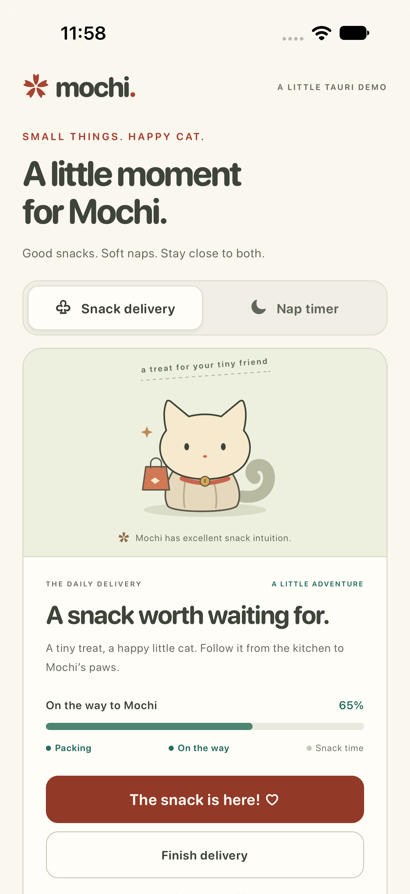
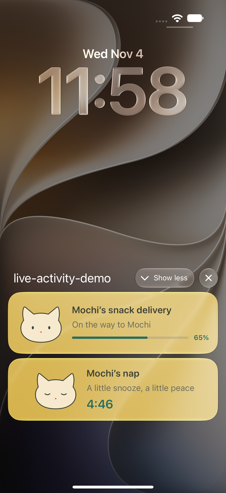
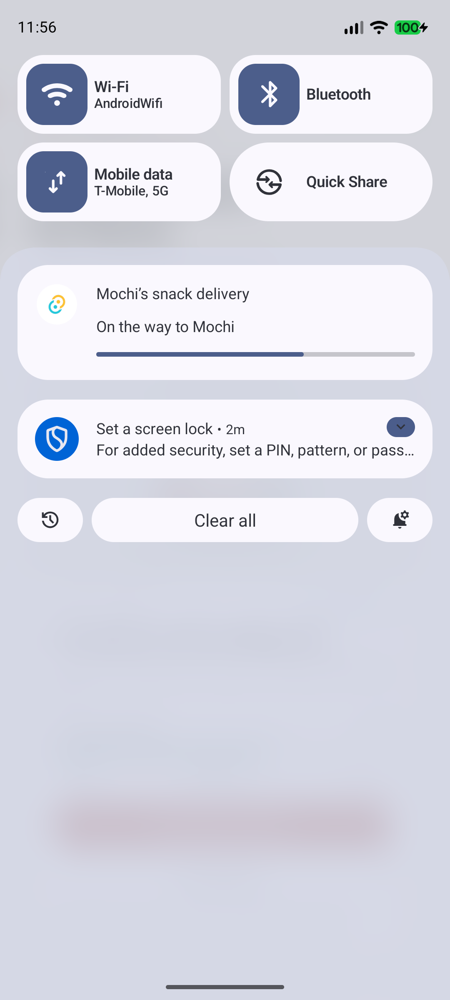

# tauri-plugin-live-activity

[](https://www.npmjs.com/package/tauri-plugin-live-activity)
[](https://crates.io/crates/tauri-plugin-live-activity)
[](https://github.com/1eedaegon/tauri-plugin-live-activity/actions/workflows/ci.yml)
[](LICENSE)

Live Activities on iPhone and iPad, and ongoing notifications on Android, for Tauri 2.
Community plugin. **Early alpha.** [한국어](https://github.com/1eedaegon/tauri-plugin-live-activity/blob/main/README.ko.md)

| Platform | Backend |
| --- | --- |
| iOS 16.1+ / iPadOS 17+ | ActivityKit · Lock Screen and Dynamic Island where available |
| Android API 26+ | Ongoing notifications · Live Update promotion on eligible API 36+ devices |
| macOS / Windows / Linux | Not implemented |

<table>
  <tr><th>Mochi demo</th><th>iOS Live Activities</th><th>Android Live Update</th></tr>
  <tr>
    <td></td>
    <td></td>
    <td></td>
  </tr>
</table>

Actual captures from iOS 27.2 Simulator and an Android API 37 emulator.
The demo follows a cat's snack delivery and nap timer, using state supplied by the app.
The iOS demo also includes an [expanded Dynamic Island view](https://raw.githubusercontent.com/1eedaegon/tauri-plugin-live-activity/main/docs/images/mochi-ios-dynamic-island.png).
On older Android versions, the same example uses an
[ongoing notification](https://raw.githubusercontent.com/1eedaegon/tauri-plugin-live-activity/main/docs/images/mochi-android-notification-fallback.png).

## Install

Requires Tauri 2 and Rust 1.90+.
Android requires API 26+, an updated WebView, and Android SDK 37 to build.
See the [version policy](https://github.com/1eedaegon/tauri-plugin-live-activity/blob/main/docs/compatibility.md) for feature and toolchain requirements.

```sh
npm install tauri-plugin-live-activity@next
```

`src-tauri/Cargo.toml`:

```toml
[dependencies]
tauri-plugin-live-activity = "=0.1.0-alpha.3"
```

Register the plugin in `src-tauri/src/lib.rs`:

```rust
tauri::Builder::default()
    .plugin(tauri_plugin_live_activity::init())
    // ...
```

Add these permissions to your capability file:

```json
"permissions": [
  "live-activity:default",
  "live-activity:allow-request-permissions",
  "live-activity:allow-start",
  "live-activity:allow-update",
  "live-activity:allow-end"
]
```

**iOS needs a Widget Extension.** Follow the [iOS setup](https://github.com/1eedaegon/tauri-plugin-live-activity/blob/main/docs/ios-integration.md).
For Android permission and channel behavior, see [Android setup](https://github.com/1eedaegon/tauri-plugin-live-activity/blob/main/docs/android-integration.md).

## Example: snacks for Mochi

```ts
import {
  getCapabilities, requestPermissions, start, update, end,
} from 'tauri-plugin-live-activity';

const { platform } = await getCapabilities();
await requestPermissions(platform === 'android' ? 'notifications' : 'liveActivities');

const snack = await start({
  activityKey: 'mochi:snack',
  schemaVersion: 1,
  template: 'progress',
  fallback: 'notification',
  snapshot: {
    revision: 0,
    title: 'Mochi’s snack delivery',
    status: 'Packing a tiny treat',
    progress: 0.15,
  },
});

await update({
  id: snack.id,
  snapshot: {
    revision: 1,
    title: 'Mochi’s snack delivery',
    status: 'On the way to Mochi',
    progress: 0.65,
  },
});

// When the snacks arrive:
await end({ id: snack.id, policy: { kind: 'immediate' } });
```

Use increasing revisions and send a complete snapshot on each update. `list()`
reconciles activities after an app restart. A timer uses `template: 'timer'` and
`timer: { startedAt, endsAt }` instead of `progress`; times are Unix milliseconds.

The plugin displays state. Your app still owns the underlying task, background execution,
and update frequency. OS permissions, Focus settings and promotion policy control
where it appears. `fallback: 'none'` rejects an unavailable native backend; it cannot
force Android to promote a notification.

## Try it locally

The [demo](https://github.com/1eedaegon/tauri-plugin-live-activity/tree/main/examples/demo)
includes snack delivery, a nap timer and lifecycle checks through the real Tauri bridge.

```sh
npm ci
npm test
npm run build:demo
# With the mobile toolchain configured:
cd examples/demo
npm run tauri -- android dev
# or: npm run tauri -- ios dev
```

See [validation results](https://github.com/1eedaegon/tauri-plugin-live-activity/blob/main/docs/validation.md)
and [OS coverage](https://github.com/1eedaegon/tauri-plugin-live-activity/blob/main/docs/platform-coverage.md)
for tested versions and remaining device checks.

## License

[MIT](LICENSE-MIT) or [Apache-2.0](LICENSE-APACHE).
