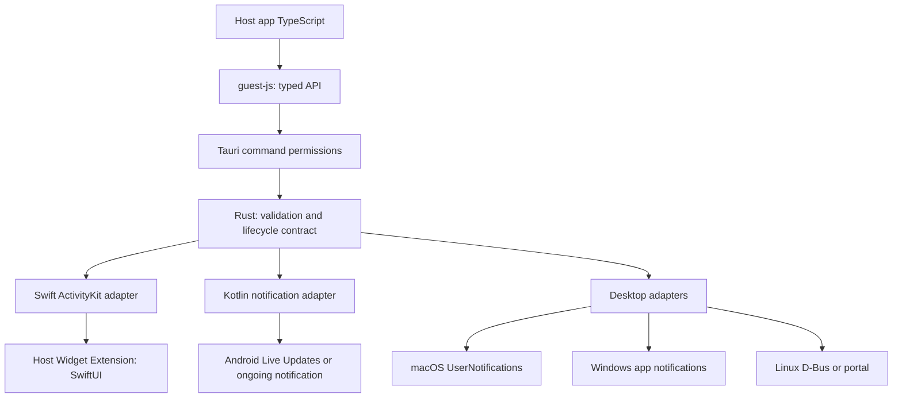

# 멀티플랫폼 설계 제안

상태: 초기 조사에서 정리한 설계안입니다. 첫 알파는 iOS·Android를 구현하며,
실제 구현 범위와 검증 결과는 [릴리스 검증](validation.md)을 기준으로 확인합니다.

## 제품 요구사항

사용자는 앱을 열지 않고 진행 중인 작업의 제목·상태·진행률·남은 시간을 확인하고,
눌러 앱의 해당 화면으로 돌아갈 수 있어야 합니다. 개발자는 OS마다 다른 UI 코드를
JS에서 직접 다루지 않고 시작·갱신·종료와 지원 기능 조회를 수행합니다.

초기 범위는 로컬 시작/갱신/종료, 권한·지원 기능 조회, 일반 진행률/타이머 템플릿,
상태 재조회, 네 모바일 기기와 데스크톱 대체 경로입니다. APNs/FCM, arbitrary custom UI,
이미지 다운로드, 작업 스케줄러, 위치 추적, 무제한 background 실행은 초기 범위 밖입니다.
초기 범위 밖 기능도 API 확장을 막지 않되 지금 사용하지 않는 구현은 만들지 않습니다.

## 비교 결과

| 대안 | 장점 | 비용·호환성 문제 | 판단 |
| --- | --- | --- | --- |
| Flutter 플러그인 직접 포팅 | 네이티브 구현 참고와 빠른 출발 | Flutter channel 의존, App Group 데이터 전달, RemoteViews와 최신 Live Updates 조건 충돌 | 구조와 사례만 참고 |
| 공식 notification 플러그인만 감싸기 | 기존 권한/OS 구현 재사용 | ActivityKit·위젯 타깃·정밀한 갱신/종료 의미를 그대로 제공하지 않음 | 알림 backend의 재사용 후보 |
| 모든 OS에 자체 overlay/window | 동일한 UI를 만들기 쉬움 | 잠금 화면 통합 불가, 추가 권한, 접근성·전력·background 제약 | 기본 backend로 제외 |
| 공통 상태 모델 + 네이티브 어댑터 | OS 특성 유지, 구형 OS에서 명시적 대체, 독립 테스트 | 기능 조회·상태 매핑 설계 필요 | 권장 |

이 선택은 요구 기기와 멀티플랫폼 범위에 대한 설계 판단입니다. 성능 우위를 실측한
결과가 아닙니다. [조사 소스](references.md)를 기준으로 플랫폼별 spike를 먼저 합니다.

## 구조와 책임



JS는 타입과 호출 진입점만 제공합니다. Rust에서 입력 검증·오류 형식·공통 정책을 정의하고,
Swift/Kotlin 또는 desktop adapter가 OS 상태를 관리합니다. OS 고유 코드를 Rust에서
억지로 통합하지 않고 각 backend에 같은 계약 테스트를 적용합니다. 관측 가능한 상태는
OS를 기준으로 합니다. portal 등 조회할 수 없는 backend의 로컬 기록은 실제 표시 상태의
증거가 아니므로 요청 이력과 관측 상태를 분리하고 후자는 unknown으로 유지합니다.

향후 디렉터리 구조 제안입니다. 아직 존재하지 않는 파일을 포함합니다.

```text
guest-js/                 # TypeScript API and public types
src/
  lib.rs                 # Plugin registration
  commands.rs            # Command entrypoints
  models.rs              # Shared requests, results, capability model
  error.rs               # Serializable errors
  mobile.rs              # Tauri mobile bridge
  desktop/               # macOS, Windows, Linux adapters
permissions/             # Generated command permissions and defaults
ios/                     # Swift plugin and shared ActivityAttributes model
android/                 # Kotlin plugin and standard notification renderer
templates/ios/           # Host Widget Extension integration template
examples/demo/           # Tauri host app and native integration fixtures
tests/                   # Contract and cross-backend fixtures
docs/
```

## iOS 설계

`ActivityAttributes`의 정적 식별자와 `ContentState`의 동적 텍스트·진행률·시각을
작은 Codable 모델로 정의합니다. 동일 Swift 모듈을 플러그인과 호스트 위젯이 참조하게
하여 서로 다른 타입/직렬화 정의가 생기는 것을 막습니다. 위젯은 호스트 앱에 embed하고
서명해야 하므로 Rust crate나 npm 설치만으로 모든 설정이 끝난다고 안내하지 않습니다.

Flutter 참고 구현은 App Group UserDefaults에 실제 데이터를 두고 상태 변화 표식을
ActivityKit으로 전달합니다. 여기서는 동적 상태 자체를 ContentState로 전달하는
Apple 기본 모델을 채택합니다. 기본 텍스트/진행률에는 공유 저장소가 필요하지 않습니다.
이미지 공유가 필요해질 때만 App Group과 크기 제한·파일 정리 정책을 추가합니다.

위젯 UI는 SwiftUI로 작성합니다. WebView HTML이나 Flutter widget을 삽입하지 않습니다.
표준 progress/timer 템플릿을 먼저 제공하고, 커스텀 템플릿은 호스트의 컴파일된 Swift
뷰로 확장합니다. 임의 JS 객체나 문자열로 Swift 타입을 런타임 생성하지 않습니다.
공통 모델의 schema version을 앱·확장이 함께 검증합니다.

iOS 16.1 초기 API와 16.2+ API를 availability gate로 나눕니다. ActivityKit 호출과
상태/token 관찰 task의 생성·취소를 actor 또는 지정 executor로 직렬화합니다.
사용자 dismiss, OS 종료, stale 상태는 별도 상태로 유지합니다.
앱 재실행 시 해당 attributes 타입의 OS 활동을 조회하여 다시 연결합니다.

## Android 설계

Kotlin에서 NotificationCompat와 채널을 사용합니다. 일반 알림과 Live Updates가
동일한 표준 텍스트/진행률 모델을 쓰도록 하고 RemoteViews는 초기 구현에 넣지 않습니다.
API 36+ 메서드는 compile SDK와 런타임 버전 검사를 모두 통과할 때만 호출합니다.

승격 요청, 승격 가능 여부, 실제 승격 결과를 분리합니다. 사용자나 OEM이 승격을
거부하면 요청자가 허용한 일반 알림으로 낮추고 그 사유를 반환합니다. 지속 알림이
항상 dismiss 불가능하다고 가정하지 않습니다. 변경 시 반복 sound/vibration을 억제합니다.

앱별 전용 tag namespace와 notification ID를 사용해 다른 알림을 덮어쓰지 않습니다.
해시 충돌에만 의존하지 않는 ID 매핑을 사용하며 종료·조회는 플러그인 소유 활동만
대상으로 합니다. 사용자 제거를 감지하는 native 수신 경로가 필요합니다.
background 실행은 호스트 서비스의 책임이며 기본 플러그인은 FGS를 자동 생성하지 않습니다.

## 데스크톱 설계

- macOS: UserNotifications의 식별자 기반 표시/삭제를 검증합니다. 같은 식별자의
  재게시가 silent update를 보장한다고 가정하지 않습니다. 검증 전에는 조용한 갱신
  capability를 unknown으로 반환하고 기본 갱신 빈도를 낮춥니다. iPhone 미러링은 독립 경로입니다.
- Windows: tag/group과 데이터 binding을 통한 진행률 갱신을 우선 검토합니다.
  기존 Rust native binding 재사용과 Windows App SDK 도입 비용을 spike에서 비교합니다.
  설치 앱의 ID/activation을 먼저 검증하고 미등록 dev 실행의 성공을 배포 성공으로 보지 않습니다.
- Linux: 기존 알림 라이브러리가 제공하는 replace/close/capability 기능부터 확인합니다.
  일반 환경은 freedesktop D-Bus, sandbox는 portal을 우선 사용합니다. 서버가 제공하지
  않는 persistence/actions/progress는 지원하지 않는 것으로 보고합니다.

공식 notification 플러그인 또는 그 기반 라이브러리는 ID·업데이트·종료·상태 조회
계약을 충족하는 범위에서 재사용합니다. 단순 send API만으로 안정적인 lifecycle을
만들 수 없다면 해당 플랫폼에 작은 전용 어댑터를 둡니다. 새 dependency를 정하기 전에
MSRV, 최소 OS, 바이너리 크기, 라이선스, 유지보수 상태를 확인합니다.

## 제안 API 계약

아래 이름은 확정된 public API가 아닙니다. 현재 실행할 수 없습니다.

| API | 계약 |
| --- | --- |
| getCapabilities() | 사용 가능한 backend, 기능, 제약, 현재 설정을 조회; OS 버전 문자열만으로 판정하지 않음 |
| checkPermissions() | Tauri 외부의 OS 알림·활동·승격 권한을 분리하여 반환 |
| requestPermissions(kind) | 해당 OS에서 요청 가능한 권한만 명시적으로 요청; 불가능하면 settingsRequired 등 반환 |
| start(input) | 앱이 제공한 안정적 activity key로 시작; native ID, backend, degradation 사유 반환 |
| update(id, snapshot) | 전체 상태와 증가 revision으로 갱신; 오래된 갱신 거부 |
| end(id, policy) | 플랫폼별 지원 종료 정책 적용; 이미 종료된 동일 ID는 멱등 처리 |
| list() | OS 조회와 로컬 매핑을 대조; 확인 불가능한 상태는 unknown |
| onStateChange(handler) | 지원되는 상태 변화 전달, 구독 해제 제공; 이벤트 유실 시 list로 복구 |

`default` Tauri permission에는 상태 조회만 포함하는 것을 제안합니다. 시작·갱신·종료와
권한 요청은 각각 명시적 allow 명령으로 구성합니다. 원격 웹 콘텐츠에는 기본 노출하지 않습니다.
플러그인 capability와 OS 권한은 서로 대체하지 않습니다.

### 데이터 모델

- 정적 값: `activityKey`, `schemaVersion`, `template`.
- 상태 snapshot: `revision`, `title`, `status`, 선택적 정규화 progress(0..1),
  시작/종료 시각, `staleAt`. 유한 숫자·문자열 길이·시간 순서·인코딩 크기를 검사합니다.
- 표시 정책: `fallback: "none" | "notification"`, 종료 시 즉시 제거/지원되는 잔존 정책.
  지원하지 않는 정책을 조용히 무시하지 않고 사유 또는 오류를 반환합니다.
- 결과: `id`, `backend`, `state`, `degradedFeatures`, `promotionRequested`, `promotionState`.
  승격 요청 여부는 boolean, 관측 결과는 promoted/notPromoted/unknown/notApplicable로
  구분합니다. 승격을 요청했다는 사실이 실제 승격을 뜻하지 않습니다.
- capability: start/update/end, progress, timer, actions, stateObservation,
  silentUpdate, nativeLiveActivity, maxPayloadBytes 등을 독립 표현합니다.
  기능 상태는 supported/unsupported/unknown으로 구분하며 unknown을 지원으로 취급하지 않습니다.
  권한은 granted/denied/prompt/settingsRequired/notApplicable/unknown으로 구분합니다.

한 개의 거대한 플랫폼 옵션 객체를 만들지 않습니다. 공통 필드는 작게 유지하고
추후 필요한 OS별 옵션은 namespaced extension으로 추가합니다. 타입 정의를 공유하거나
공통 fixture를 통해 Rust·TypeScript·Swift·Kotlin 직렬화가 동일한지 검증합니다.

### 동시성과 복구

활동별 native 명령을 순서대로 처리합니다. 같은 activityKey의 중복 start는 중복 표시를
만들지 않으며 같은 revision의 같은 데이터는 멱등 처리, 충돌 데이터는 오류로 처리합니다.
낮은 revision은 거부하고 end 뒤의 늦은 update는 활동을 되살리지 않습니다.
중간 상태를 합쳐 갱신량을 줄일 수 있지만 종료 요청은 유실시키지 않습니다.
활동을 새로 생성할 때마다 새 불투명 handle을 부여합니다. 종료 후 같은 activityKey로
다시 시작해도 이전 handle의 update가 새 활동에 적용되지 않도록 합니다. 멱등 end는
알려진 종료 건에만 적용하고 알 수 없는 handle은 NOT_FOUND로 구분합니다.

로컬 저장은 ID 매핑과 revision 등 최소 메타데이터로 제한합니다. OS 조회와 불일치하면
재연결/종료/unknown으로 처리합니다. native 알림 API 호출과 디스크 기록은 원자적이지
않으므로 crash 후 중복/유실 복구 케이스를 테스트합니다. backend가 dismiss나 조회를
지원하지 않으면 화면에 아직 보인다고 단정하지 않습니다.

### 오류와 보안

오류 코드는 `UNSUPPORTED_PLATFORM`, `UNSUPPORTED_FEATURE`, `PERMISSION_DENIED`,
`CONFIGURATION_REQUIRED`, `INVALID_INPUT`, `PAYLOAD_TOO_LARGE`, `NOT_FOUND`,
`STALE_REVISION`, `SYSTEM_LIMIT`, `NATIVE_ERROR` 같은 안정된 분류를 사용합니다.
재시도 가능 여부와 사용자 조치 필요 여부를 구분하고 native 내부 정보를 무조건 노출하지 않습니다.

공개 키/ID와 인증 토큰은 분리하고 APNs private key는 클라이언트에 넣지 않습니다.
초기 UI는 문자열/asset ID만 받으며 임의 HTML·파일 경로·URL 실행을 허용하지 않습니다.
딥링크는 호스트가 등록한 scheme/route를 검증합니다. `endAll`을 추가하더라도 다른
플러그인의 알림을 지우지 않습니다. 플랫폼 권한 거부는 재요청 루프로 우회하지 않습니다.

## 확정 전 기술 검증

1. 공유 Swift 모델을 Tauri 앱과 Widget Extension에 연결하고 재생성 후 유지되는지 검증.
2. iOS 16.1/16.2 API 분기와 최소 deployment target 빌드 검증.
3. S23 실제 펌웨어에서 승격 요청/결과, Note10에서 동일 데이터의 일반 알림 검증.
4. 각 desktop backend의 동일 ID 갱신·종료·권한·앱 재시작 검증.
5. Rust/JS/native 계약·메모리 측정 후 지원 버전과 초기 릴리스 범위 확정.

설계 범위는 5개 OS지만 최초 구현은 iOS·Android부터 진행합니다. 데스크톱 backend가
검증되기 전까지는 런타임에서 명시적으로 미지원으로 보고하고 릴리스 표도 동일하게 유지합니다.

조사 후 보완 사항은 [검토 기록](review.md), 실행 가능한 입력 형식의 초안과 네이티브
검증 책임은 [요청 계약](request-contract.md)에 정리했습니다. 계약 도구는 플러그인 구현이 아닙니다.
