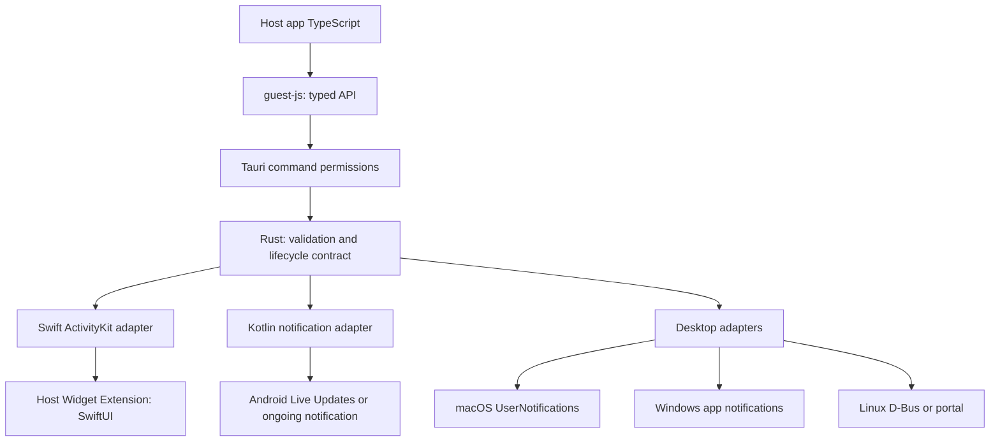

# Multiplatform design proposal

Status: the design drawn up during the first research, on 2026-11-04. The first alpha
implements iOS and Android. What was actually built and tested is in the
[validation record](validation.md). Since 0.5 the iOS side differs from this proposal: the
plugin has no Swift adapter, `ios/` or `templates/ios/` of its own. Its Rust commands call the
[activitykit](https://github.com/1eedaegon/activitykit-rs) crate, whose Swift layer talks to
ActivityKit, and the host's widget extension links activitykit's Swift products
([iOS integration](ios-integration.md)).

## Product requirements

Without opening the app, the user sees the title, status, progress and remaining time of a
running task, and can tap it to get back to the matching screen in the app. The developer
starts, updates and ends activities and queries supported features without handling each
OS's UI code from JS.

The initial scope covers local start, update and end; permission and feature queries;
standard progress and timer templates; reading state back; the four mobile devices; and a
desktop fallback. APNs/FCM, arbitrary custom UI, image downloads, a task scheduler, location
tracking and unlimited background execution are outside it. The API should leave room for
those features, but nothing is built for them now.

## Alternatives compared

| Alternative | Strengths | Cost and compatibility problems | Decision |
| --- | --- | --- | --- |
| Port the Flutter plugin directly | Native code to learn from, a fast start | Depends on Flutter channels, passes data through an App Group, RemoteViews conflicts with the conditions of the latest Live Updates | Use only its structure and examples as reference |
| Wrap only the official notification plugin | Reuses its permission and OS code | Does not offer ActivityKit, the widget target or precise update and end semantics | A candidate to reuse for the notification backend |
| An overlay or window of our own on every OS | The same UI is easy to build | No lock screen integration, extra permissions, accessibility, power and background limits | Ruled out as the default backend |
| Shared state model + native adapters | Keeps what is specific to each OS, explicit fallback on older OSes, each backend tested on its own | Needs a design for capability queries and state mapping | Recommended |

This choice is a design judgment about the required devices and the multiplatform scope,
not a measured performance advantage. Per-platform spikes based on the
[references](references.md) come first.

## Structure and responsibilities



JS provides only the types and the call entry points. Rust defines input validation, the
error format and shared policy, and the Swift, Kotlin or desktop adapters manage OS state.
OS-specific code is not forced into one Rust layer; every backend runs the same contract
tests instead. Observable state is what the OS reports. On a backend that cannot be
queried, such as a portal, a local record is no proof of what is on screen, so the request
history is kept apart from the observed state, and the observed state stays unknown.

A proposed directory layout. It includes files that do not exist yet.

```text
guest-js/                 # TypeScript API and public types
src/
  lib.rs                 # Plugin registration
  commands.rs            # Command entrypoints
  models.rs              # Shared requests, results, capability model
  error.rs               # Serializable errors
  mobile.rs              # Tauri mobile bridge
  desktop/               # macOS, Windows, Linux adapters
permissions/             # Generated command permissions and defaults
android/                 # Kotlin plugin and standard notification renderer
examples/demo/           # Tauri host app and native integration fixtures
tests/                   # Contract and cross-backend fixtures
docs/
```

## iOS design

The static identifiers in `ActivityAttributes` and the dynamic text, progress and times in
`ContentState` are small Codable models. The plugin and the host widget reference the same
Swift module, so they never end up with different type or serialization definitions. The
widget has to be embedded in the host app and signed, so the docs do not claim that
installing the Rust crate or the npm package completes the setup.

The Flutter reference implementation keeps the real data in App Group UserDefaults and
sends ActivityKit only a marker that the state changed. This design takes Apple's default
model instead: the dynamic state itself travels in ContentState. Standard text and
progress need no shared storage. An App Group, with size limits and a file cleanup
policy, is added only once images have to be shared.

The widget UI is written in SwiftUI. No WebView HTML or Flutter widget goes inside it. The
standard progress and timer templates come first; custom templates extend them with
compiled Swift views in the host. Swift types are never created at runtime from arbitrary
JS objects or strings. The app and the extension both check the schema version of the
shared model.

Availability gates separate the original iOS 16.1 API from the 16.2+ API. ActivityKit
calls, and the creation and cancellation of the tasks that observe state and tokens, run
one at a time on an actor or a designated executor. A dismissal by the user, an end by the
OS and the stale state are kept as separate states. When the app launches again, it asks
the OS for the activities of its attributes type and reconnects to them.

## Android design

The Kotlin side uses NotificationCompat and channels. Ordinary notifications and Live
Updates use the same standard text and progress model, and RemoteViews stays out of the
first implementation. API 36+ methods are called only when both the compile SDK and the
runtime version check allow them.

The promotion request, whether promotion is possible and the actual promotion result are
kept apart. When the user or the OEM refuses promotion, the plugin falls back to an
ordinary notification, if the caller allowed one, and returns the reason. An ongoing
notification is not assumed to be impossible to dismiss. Updates do not repeat the sound
or vibration.

The plugin uses its own tag namespace and notification IDs in each app, so it does not
overwrite other notifications. The ID mapping does not rely on hashes never colliding, and
end and list touch only activities the plugin owns. A native receiver is needed to detect
removal by the user. Background execution is the host service's job; the plugin does not
create a foreground service (FGS) by itself.

## Desktop design

- macOS: verify showing and removing notifications by identifier in UserNotifications.
  Posting again with the same identifier is not assumed to give a silent update. Until
  that is verified, the silent update capability is reported as unknown and the default
  update rate is kept low. iPhone Mirroring is a separate path.
- Windows: look first at progress updates through tag/group and data binding. A spike
  compares reusing existing Rust native bindings with the cost of adopting the Windows
  App SDK. The identity and activation of an installed app are verified first; success in
  an unregistered dev run does not count as success in a shipped app.
- Linux: start with the replace, close and capability features that existing notification
  libraries provide. Prefer freedesktop D-Bus in an ordinary session and the portal in a
  sandbox. Persistence, actions or progress that the server does not provide are
  reported as unsupported.

The official notification plugin, or the library under it, is reused as far as it meets
the contract for IDs, updates, ends and state queries. Where a plain send API cannot give
a reliable lifecycle, that platform gets a small adapter of its own. Before a new
dependency is chosen, its MSRV, minimum OS, binary size, license and maintenance state are
checked.

## Proposed API contract

The names below are not a settled public API. None of them can be called yet.

| API | Contract |
| --- | --- |
| getCapabilities() | Queries the available backends, features, limits and current settings; does not decide from the OS version string alone |
| checkPermissions() | Returns the OS permissions outside Tauri (notifications, activities, promotion) separately |
| requestPermissions(kind) | Explicitly requests only the permissions that the OS lets an app request; otherwise returns a state such as settingsRequired |
| start(input) | Starts with a stable activity key from the app; returns the native ID, the backend and the reasons for any degradation |
| update(id, snapshot) | Updates with the full state and an increasing revision; rejects stale updates |
| end(id, policy) | Applies an end policy that the platform supports; an ID that already ended is handled idempotently |
| list() | Reconciles the OS query with the local mappings; a state that cannot be confirmed is unknown |
| onStateChange(handler) | Delivers the supported state changes and offers an unsubscribe; after lost events, list recovers |

The proposal is for the `default` Tauri permission to include only state queries. Start,
update, end and permission requests each need an explicit allow command. Remote web
content does not get them by default. A plugin capability and an OS permission never
stand in for each other.

### Data model

- Static values: `activityKey`, `schemaVersion`, `template`.
- State snapshot: `revision`, `title`, `status`, an optional normalized progress (0..1),
  start and end times, `staleAt`. The checks cover finite numbers, string lengths, time
  order and encoded size.
- Display policy: `fallback: "none" | "notification"`, and at the end either immediate
  removal or a supported policy for staying on screen. An unsupported policy is never
  silently ignored; the plugin returns a reason or an error.
- Result: `id`, `backend`, `state`, `degradedFeatures`, `promotionRequested`,
  `promotionState`. Whether promotion was requested is a boolean; the observed result is
  promoted/notPromoted/unknown/notApplicable. A promotion request does not mean the
  notification was promoted.
- Capabilities: start/update/end, progress, timer, actions, stateObservation,
  silentUpdate, nativeLiveActivity, maxPayloadBytes and others, each reported on its own.
  A feature is supported/unsupported/unknown, and unknown never counts as supported. A
  permission is granted/denied/prompt/settingsRequired/notApplicable/unknown.

There is no single large object of platform options. The shared fields stay few, and
OS-specific options are added later, when needed, as namespaced extensions. Shared type
definitions or shared fixtures check that Rust, TypeScript, Swift and Kotlin serialize the
same way.

### Concurrency and recovery

Native commands for one activity run in order. A repeated start with the same activityKey
does not show a second activity. The same data with the same revision is idempotent, and
conflicting data is an error. A lower revision is rejected, and a late update after end
does not bring the activity back. Intermediate states may be merged to send fewer
updates, but an end request is never lost. Every new activity gets a new opaque handle.
When an activity ends and starts again with the same activityKey, an update with the old
handle does not reach the new activity. An end is idempotent only for a known ended
activity; an unknown handle gets NOT_FOUND.

Local storage holds only minimal metadata such as the ID mapping and the revision. Where it
disagrees with the OS query, the activity is reconnected, ended or marked unknown. A
native notification call and a write to disk are not one atomic step, so tests cover
recovery from duplicates and losses after a crash. When a backend cannot report
dismissals or cannot be queried, the plugin does not assume that the activity is still on
screen.

### Errors and security

Error codes come from a stable set such as `UNSUPPORTED_PLATFORM`, `UNSUPPORTED_FEATURE`,
`PERMISSION_DENIED`, `CONFIGURATION_REQUIRED`, `INVALID_INPUT`, `PAYLOAD_TOO_LARGE`,
`NOT_FOUND`, `STALE_REVISION`, `SYSTEM_LIMIT` and `NATIVE_ERROR`. An error says whether a
retry can help and whether the user has to act, and native internals are not passed
through unfiltered.

Public keys and IDs are kept apart from authentication tokens, and the APNs private key
never goes into the client. The first UI takes only strings and asset IDs; it does not
allow arbitrary HTML, file paths or opening URLs. Deep links are checked against the
schemes and routes that the host registered. If `endAll` is added, it does not remove
other plugins' notifications. A denied platform permission is not worked around with a
loop of new requests.

## Technical checks before the design is settled

1. Link the shared Swift model to the Tauri app and the Widget Extension, and check that
   the link survives regenerating the project.
2. Check the iOS 16.1/16.2 API branches and a build at the minimum deployment target.
3. Check the promotion request and its result on real S23 firmware, and the same data as an
   ordinary notification on the Note10.
4. Check update and end by the same ID, permissions and app restarts on each desktop
   backend.
5. After contract checks and memory measurements across Rust, JS and native code, settle
   the supported versions and the scope of the first release.

The design covers five OSes, but the first implementation starts with iOS and Android.
Until a desktop backend is verified, the runtime explicitly reports it as unsupported, and
the release table says the same.

What was added after the research is in the [research review](review.md). A draft of the
executable input format, and what the native code must check, are in the
[request contract](request-contract.md). The contract tooling is not the plugin
implementation.
