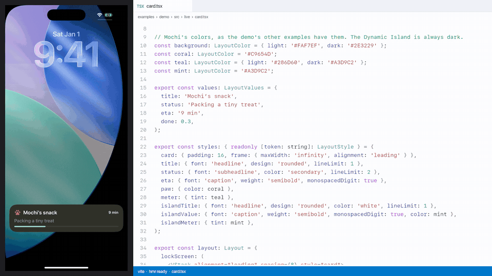

# Live editing

The demo has a second page for working on a layout: while the app runs, edit
[`card.tsx`](../examples/demo/src/live/card.tsx), save, and the Live Activity follows. The page is React with
Vite's hot updates (React Fast Refresh), and the card is written with the plugin's TSX components.



Recorded on the iPhone 17 Pro simulator (iOS 26.3) on 2026-11-20, 44 seconds without cuts; the
[MP4](images/live-editing.mp4) has the full resolution. The simulator's half is its screen recording. The editor's
half is drawn from the log of the saves, each typed in just before the moment it was saved, so it shows when each
save happened rather than an editor's own window.

## Run it

What the demo needs first (Xcode, the Rust targets, `npm ci` at the repository root) is in the
[demo's README](../examples/demo/README.md#run-it). Then, from `examples/demo`:

```sh
npm run live:ios -- "iPhone 17 Pro"
```

`live:ios` is `tauri ios dev --config src-tauri/tauri.live.conf.json`. That file changes only what a dev run
loads: in place of `build.ts`, Tauri links activitykit's Swift package for the Xcode project as `build.ts` does
(`link-activitykit.ts`) and starts Vite ([`vite.config.ts`](../examples/demo/vite.config.ts)), and the app loads the
page from it. The demo's own page and its release build are as they were.

Vite serves the page's folders and nothing else of the repository: on a phone, Tauri has Vite listen on the Mac's
network address, where anyone on that network could ask it for a file. In a mobile dev run Tauri hands the app the
page as Vite serves it, so the demo's CSP does not apply to it (read in Tauri 2.12's source, not tried); the release
build keeps it.

Open `examples/demo/src/live/card.tsx` in an editor and change it. To see the card while you work, pull the Lock
Screen down over the app (from the top left edge): the app stays in front behind it.

## What a save does

| What you change in `card.tsx` | The page | The activity |
| --- | --- | --- |
| A value, keeping its name and type | Fast Refresh draws `LiveCard` again with the new module | `updateLayout`: the card changes in place |
| `layout` or `styles`, or a value added, removed or of another type | The activity key changes: `live:` and a hash of the layout, the styles and the values' names and types ([`live-page.ts`](../examples/demo/src/live-page.ts)) | `endLayout` with `immediate`, then `startLayout` with the new card: it goes and comes back |
| Something Fast Refresh cannot take in place, such as `main.tsx` | Vite loads the page again | The new load ends what the last one left running (`listLayout`, `endLayout`), then starts the card |

An activity keeps its layout for its whole life (the `layout` of a start is "Fixed for this generation; updates
replace the values only", in `guest-js/types.ts`), and an update has exactly the names of the values it started with,
each of the same JSON type ([request contract](request-contract.md#values)). So the page never sends a changed card as an update: it gives each
card its own key, and `useLiveActivity` ends the running activity and starts the next one when the key changes. A
start under the key of a running activity with other content is a conflict, which is why a new load of the page
ends what is left first.

### When the card does not come back

The page shows a refused request under the activity's state. A refused start, for example of a layout that binds a
value the card does not have, waits for the next save that changes the key: add the value, or take the binding out.
A card swiped away on the Lock Screen has ended, and the updates after it are refused: save a change of the layout or
the styles, or load the page again, to start a new one. Vite's client also loads the page again when its socket to
the dev server drops and comes back, and the card then starts again at revision 0 (read in Vite's client, not seen).

## What was seen

On the iPhone 17 Pro simulator with iOS 26.3, on an Intel Mac that other builds kept busy (2026-11-20):

- A save of values changed the card on the Lock Screen 0.6 to 0.9 s after the file was written (four saves, read
  from the recording at 20 frames a second).
- A save of the layout or the styles took the card away within 0.4 s, and the new card was on the Lock Screen 3.9
  to 4.4 s after the save (two saves). The system log shows where the time goes: the new activity exists 0.2 s after
  the save, and SpringBoard holds it back until the widget extension has drawn it.
- The Lock Screen pulled over the app keeps the app in front: updates, ends and starts all went through while it was
  down. The system asks under the first card whether the app may show Live Activities, and under the second whether
  it may go on; the recording was made after both were answered.
- A UI test that looked for the system's buttons on the Lock Screen every half second (an accessibility query of
  SpringBoard each time) delayed the new cards by up to half a minute. Without those queries they came in 4 s.
- A load of the page after a change to `index.html` ended the running activity and started the card again at
  revision 0, with no conflict.

Not tried: an iPhone, Android, and an Apple silicon Mac. On an Intel Mac, `tauri ios dev` for a simulator also
archives a device build, which needs a signing team; [`tests/ios/run.sh`](../tests/ios/run.sh) shows how its dev
mode answers that archive with the simulator build.

## The files

| File | What it does |
| --- | --- |
| [`src/live/card.tsx`](../examples/demo/src/live/card.tsx) | The card: `values`, `styles` and a `layout` written with `tauri-plugin-live-activity/jsx` |
| [`src/live/LiveCard.tsx`](../examples/demo/src/live/LiveCard.tsx) | The page: `useLiveActivity` with the card, its key, and the state of the activity |
| [`src/live/main.tsx`](../examples/demo/src/live/main.tsx) | The entry: ends what an earlier load left running, then draws the page |
| [`src/live-page.ts`](../examples/demo/src/live-page.ts) | The key of a card, and the end of an earlier load's activities |
| [`vite.config.ts`](../examples/demo/vite.config.ts) | Serves `src/live` with React's plugin and nothing outside the page's folders; the plugin is taken as source, as `build.ts` takes it |
| [`plugin-source.ts`](../examples/demo/plugin-source.ts) | Which file of `guest-js` each import path of the plugin is |
| [`src-tauri/tauri.live.conf.json`](../examples/demo/src-tauri/tauri.live.conf.json) | The dev URL and the dev command: activitykit's link, then Vite |
| [`tsconfig.live.json`](../examples/demo/tsconfig.live.json) | The type check of the page, in `npm run typecheck` |

The tests are in `npm run test:demo`. [`live-page.test.ts`](../examples/demo/tests/live-page.test.ts) checks the key,
pinned to two values computed apart from the code, and the end of a load's leftovers.
[`live-card.test.ts`](../examples/demo/tests/live-card.test.ts) compiles the page as Vite does, renders it with
React's test renderer against a fake plugin, and keeps the start it sends and an update of it in
[`tests/fixtures/typescript/demo-live.json`](../tests/fixtures/typescript/demo-live.json), where
`cargo test --test typescript_requests` judges them with the checks the commands run. It also holds the package's
exports, `plugin-source.ts` and the type check's paths to the same files, and Vite to the page's folders. After you
change the card, `npm run write:requests` writes that file again.
