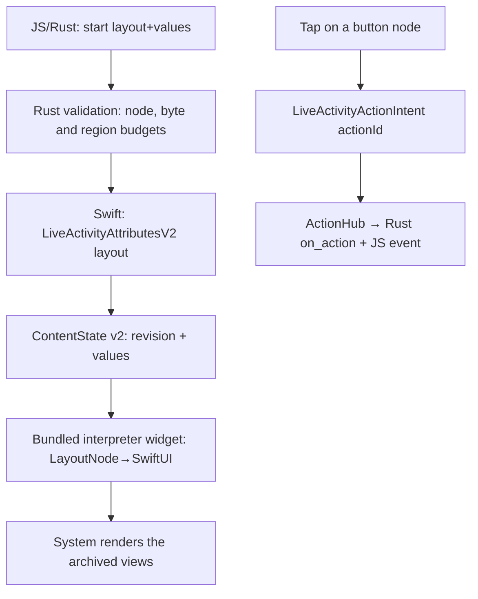

# RFC: layout DSL (request contract v2)

This is the proposal as written on 2026-11-06. Contract v2 shipped in 0.2.0; what it
became, and how it differs from this draft, is in the
[request contract](request-contract.md#request-contract-v2-layout).

Status: design proposal (RFC), before implementation. If accepted, it leads to v2 of
`contracts/request.schema.json` and a revision of `docs/request-contract.md`. It builds on
a feasibility study of 2026-11-05 in an app that uses the plugin and on the
[architecture proposal](architecture.md).

## Goals

Let a host app write and update its Live Activity UI from Tauri (JS/Rust) without a single
line of Swift. The plugin ships an interpreter widget, and the host sends only a JSON
layout tree and data values. This generalizes today's model, a fixed snapshot drawn by a
fixed template, into a layout tree read by an interpreter. Contract v1 stays as it is.

Non-goals: web content or JS running inside the widget (WidgetKit does not allow it: the
extension process builds and serializes the views, and the system renders them);
arbitrary animation, video or Lottie; loading fonts at runtime; arbitrary SwiftUI views
outside the node set.

## Why this structure

| Alternative | Strengths | Problems | Decision |
| --- | --- | --- | --- |
| Declarative layout tree + SwiftUI interpreter | Changes at runtime, no Swift in the host, a closed set that can be validated | 4 KB budget; every new node needs a plugin release | Recommended |
| Build-time code generation (TSX→SwiftUI) | All of SwiftUI's expressiveness | Every UI change needs a native rebuild, so the runtime advantage is gone | On hold |
| Sending rendered images | Freedom down to the pixel | Nothing drives updates while locked, because the WebView is suspended; poor accessibility and Dynamic Island support | Only as a secondary channel |

## Design

The key split is between `layout`, which rarely changes, and `values`, which change with
every update. The layout is fixed in the attributes at start (or referenced through an App
Group), and an update sends only a small map of values.



## Draft of request contract v2

StartInput: `{ activityKey, schemaVersion: 2, fallback, layout | layoutRef, styles?, values, staleAt? }`
UpdateInput: `{ id, snapshot: { revision, values, staleAt? }, layout?/layoutRef? }`. The
values are replaced as a whole. The v1 fields template, progress and timer are not in v2;
what they expressed moves into nodes.

- `values`: `{ [key: string]: string | number | boolean }`. Nodes refer to them with
  `bind`. This is the main way to keep update payloads small.
- `layout`: a node tree per region (below). `styles`: a table of style tokens.
- `layoutRef`: the key of a file in an App Group. It is the way around the limit for
  layouts over 4 KB and for runtime images, and it requires the host to set up an App
  Group (see [The 4 KB budget](#the-4-kb-budget) below).

## Regions

```json
"layout": {
  "lockScreen":        { "...": "node tree" },
  "island": {
    "expanded": { "leading": {}, "trailing": {}, "center": {}, "bottom": {} },
    "compactLeading": {}, "compactTrailing": {}, "minimal": {}
  }
}
```

Each region has its own validation budget, for example at most 2 nodes in compact and
minimal, or an option that forbids text there. The system enforces the sizes, so the
contract filters out what will not fit first. A region left out is filled with the
plugin's default rendering, which looks the same as the generic v1 view.

## Node set v2.0

| Group | Node | Properties (summary) |
| --- | --- | --- |
| Containers | `vstack` `hstack` `zstack` | `children`, spacing, alignment |
| | `spacer` `divider` | — |
| Content | `text` | `value` or `bind`, style |
| | `symbol` | SF Symbol `name`, rendering (mono/hierarchical/palette/multicolor), weight, `variableValue` (can be bound) |
| | `image` | `source: {asset: name}` (build-time xcassets) or `{appGroup: key}` (runtime PNG, must be resized beforehand) |
| | `path` | SVG path `d` string, fill/stroke; the channel for arbitrary vector icons without assets |
| | `progress` | `bind` (0..1), tint |
| | `gauge` | `bind`, range, style |
| | `timerText` | `startedAt`/`endsAt`; the only dynamic element that the OS draws (successor of the v1 timer) |
| Interaction | `button` | `actionId`, `child` (label node); goes through AppIntents, see below |

Unknown nodes and properties are rejected, as in v1 (`deny_unknown_fields`). Nothing is
corrected automatically.

## Styles

- Prefer a token table to inline styles on nodes: `styles: { s1: {...} }`, and a node says
  `style: "s1"`. This is the main tool for staying within the byte budget.
- A color is always a pair or a semantic name: `{"light": "#111111", "dark": "#EEEEEE"}`,
  or `"primary"` and the like. Document that a single hex value applies unchanged to both
  modes.
- Typography: size, weight, design (default/rounded/serif/mono), lineLimit, truncation,
  minimumScaleFactor. A custom font is bundled into the widget extension at build time and
  referenced only by name.
- Layout modifiers: padding, frame (min/max/w/h), cornerRadius, border, opacity, background
  (solid color or LinearGradient).
- Global, outside the nodes: `activityBackgroundTint`, `keylineTint`, and a
  `contentTransition` hint.

## Interaction (button)

- The plugin ships a generic `LiveActivityActionIntent` in `LiveActivityShared` (a
  `LiveActivityIntent` that carries an `actionId`), and the host app target and the widget
  target both compile it from the same module.
- `perform()` calls the ActionHub singleton in the app process, and the plugin passes the
  tap on as a JS event (`live-activity://action`) and to a Rust callback (a new
  `live_activity().on_action(...)`). `trigger()` reaches JS only, so the Rust callback
  needs a channel of its own. While the phone is locked the WebView is suspended, so the
  Rust callback is the primary consumer.
- Platform minimums: buttons themselves need iOS 17+. To run from the lock screen without
  authentication, an iOS 26+ branch uses `.alwaysAllowed`; earlier versions accept the
  system's authentication flow. `capabilities.actions` reports supported or unsupported
  by OS version.
- Whether appintentsmetadataprocessor extracts the intent from a project that XcodeGen
  generated has to be checked on a device. It has not been verified; the check is shared
  with the first device checks of an app that uses the plugin.

## The 4 KB budget

ActivityKit enforces 4 KiB for the attributes and the ContentState together. The plan has
three layers:

1. The layout goes into the attributes once, at start, apart from the update payload.
   Updates send only values.
2. Style tokens remove repetition. Rust validation computes the encoded bytes in advance
   and rejects a request over the limit.
3. Over the limit, `layoutRef`: the layout and image files are written to the host's App
   Group container, and the state holds only the key. The widget reads the files when it
   builds its views. The App Group ID comes from the plugin configuration
   (`tauri.conf.json > plugins > live-activity > appGroup`); without it, layoutRef fails
   with CONFIGURATION_REQUIRED.

## Android mapping

Only a subset of the same contract is projected onto a notification: the first `text`
nodes become title and text, `progress` becomes setProgress, `timerText` the
chronometer, and `button` addAction (under review). Other nodes are ignored and reported
in `degradedFeatures`. The Live Update promotion rules forbid custom RemoteViews, so layout
fidelity on Android is structurally low. The contract docs will state this asymmetry with
iOS. Display on OEM lock screens (the Now Bar and others) keeps the limits that the
existing docs give.

## Compatibility and migration

- v1 (schemaVersion 1) keeps working: the widget bundle holds two
  `ActivityConfiguration`s, v1 and v2, side by side. They can coexist because their
  attributes types differ. Retiring v1 is a separate decision.
- `getCapabilities` gains `layout: supported|unsupported`. An old widget with a new
  plugin fails early, at start, with CONFIGURATION_REQUIRED.
- The rule against redefining the attributes types stays. `LiveActivityShared` is the
  only owner of the v2 types as well.

## Validation and test plan

| Area | Plan |
| --- | --- |
| Contract | `contracts/request.schema.json` v2 and fixtures; keep the four validators (Rust/Swift/Kotlin/JS) |
| Interpreter | Snapshot tests from nodes to views (simulator), cases that region budgets reject, byte counts that match between Rust and Swift |
| Device | A soak test of Rust-driven value updates while locked, the button intent (locked, without authentication), App Group images, each Dynamic Island region. These overlap with the plugin's first device checks, so they run alongside them |
| Regression | The v1 demo (Mochi) passes unchanged |

## Implementation steps (about 4–5 weeks)

1. Contract v2, Rust validation and guest-js builders (~1 week)
2. The `LayoutNode` model, the SwiftUI interpreter, and replacing the bundled widget
   (~1.5 weeks)
3. ActionIntent/ActionHub and Rust `on_action` (~1 week, device checks included)
4. App Group layoutRef and the image channel (~0.5 weeks)
5. Android subset mapping and degraded reporting (~1 week, optional)

## Security

A closed node set and schema validation, with no automatic correction. At render time,
network and file access is limited to App Group key references. Path `d`, the token table
and tree depth have upper limits. Values are display text, so they are handled together
with receipt redaction (a separate issue: receipts-v1.json is stored in plain text).

## Open questions

- With the layout in the attributes, a running activity can change its layout only
  through layoutRef. Is that enough?
- Should v2.0 include the Android counterpart of `button` (addAction), or start with it
  reported as degraded?
- The budget numbers for the compact and minimal regions (node count, character count),
  to be set after device measurements.
- The set of semantic color names for style tokens (how many system colors to expose).
