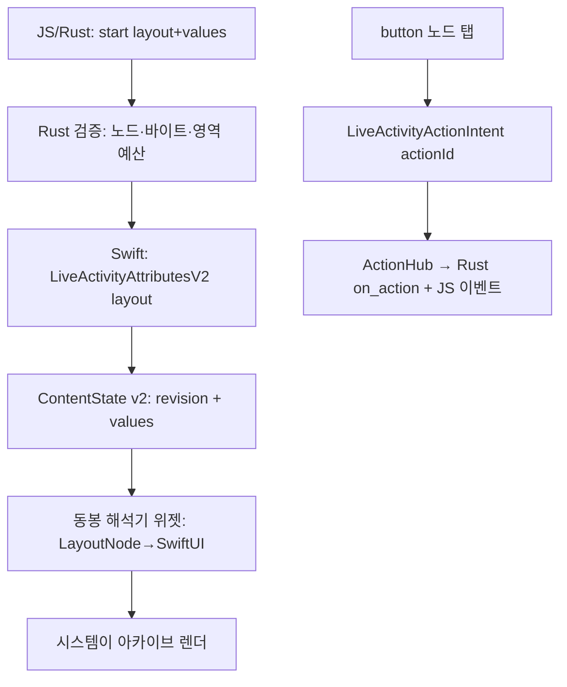

# RFC: 레이아웃 DSL (요청 계약 v2)

상태: 설계 제안(RFC). 구현 전이며, 수용 시 `contracts/request.schema.json` v2와
`docs/request-contract.md` 개정으로 이어집니다. 배경 조사는 fremen 저장소의
`docs/tauri/`(2026-11-05 타당성 조사)와 [architecture.md](architecture.md)를 전제로 합니다.

## 목표

호스트 앱이 **Swift를 한 줄도 쓰지 않고** Tauri(JS/Rust)에서 Live Activity UI를
작성·갱신할 수 있게 합니다. 플러그인이 해석기(인터프리터) 위젯을 동봉하고, 호스트는
JSON 레이아웃 트리와 데이터 값만 보냅니다. 지금의 "고정 스냅샷 → 고정 템플릿" 모델을
"레이아웃 트리 → 해석기"로 일반화하되, v1 계약은 그대로 유지합니다.

비목표: 위젯 안에서의 웹 콘텐츠/JS 실행(WidgetKit 구조상 불가 — 뷰는 확장 프로세스가
만들어 직렬화하고 시스템이 렌더), 임의 애니메이션·비디오·Lottie, 런타임 폰트 로딩,
노드 집합 밖의 임의 SwiftUI 뷰.

## 왜 이 구조인가

| 대안 | 장점 | 문제 | 판단 |
| --- | --- | --- | --- |
| 선언적 레이아웃 트리 + SwiftUI 해석기 | 런타임 변경, 호스트 Swift 0줄, 폐쇄 집합이라 검증 가능 | 4KB 예산, 노드 추가마다 플러그인 릴리스 | **권장** |
| 빌드타임 코드젠(TSX→SwiftUI) | SwiftUI 표현력 100% | UI 변경마다 네이티브 재빌드 — 런타임 이점 소멸 | 보류 |
| 이미지 렌더 전달 | 픽셀 단위 자유 | 잠금 중 WebView 정지로 갱신 주체 부재, 접근성·DI 대응 불량 | 보조 채널로만 |

## 설계 개요

핵심 분리: **layout**(드물게 변경)과 **values**(매 갱신 변경)를 나눕니다.
layout은 start 시 attributes에 고정(또는 App Group 참조), 갱신은 작은 값 맵만 보냅니다.



## 요청 계약 v2 초안

StartInput: `{ activityKey, schemaVersion: 2, fallback, layout | layoutRef, styles?, values, staleAt? }`
UpdateInput: `{ id, snapshot: { revision, values, staleAt? }, layout?/layoutRef? }` — values는 전체 교체.
v1의 template/progress/timer 필드는 v2에 없습니다(해당 표현은 노드로 이동).

- `values`: `{ [key: string]: string | number | boolean }`. 노드가 `bind`로 참조.
  갱신 페이로드를 최소화하는 주 채널입니다.
- `layout`: 영역별 노드 트리(아래). `styles`: 스타일 토큰 테이블.
- `layoutRef`: App Group 파일 키. 4KB 초과 레이아웃·런타임 이미지의 우회 경로이며
  호스트에 App Group 설정을 요구합니다(아래 "4KB 예산").

## 영역 모델

```json
"layout": {
  "lockScreen":        { "...": "노드 트리" },
  "island": {
    "expanded": { "leading": {}, "trailing": {}, "center": {}, "bottom": {} },
    "compactLeading": {}, "compactTrailing": {}, "minimal": {}
  }
}
```

영역마다 검증 예산을 둡니다(예: compact/minimal은 노드 ≤2, 텍스트 금지 옵션 등 —
시스템이 크기를 강제하므로 계약이 먼저 걸러줍니다). 미지정 영역은 플러그인 기본
렌더(v1 제네릭과 동일한 모양)로 채웁니다.

## 노드 집합 v2.0

| 분류 | 노드 | 속성(요지) |
| --- | --- | --- |
| 컨테이너 | `vstack` `hstack` `zstack` | `children`, spacing, alignment |
| | `spacer` `divider` | — |
| 콘텐츠 | `text` | `value` 또는 `bind`, style |
| | `symbol` | SF Symbol `name`, rendering(mono/hierarchical/palette/multicolor), weight, `variableValue`(bind 가능) |
| | `image` | `source: {asset: name}`(빌드타임 xcassets) 또는 `{appGroup: key}`(런타임 PNG, 사전 리사이즈 필수) |
| | `path` | SVG path `d` 문자열, fill/stroke — 에셋 없는 임의 벡터 아이콘 채널 |
| | `progress` | `bind`(0..1), tint |
| | `gauge` | `bind`, 범위, 스타일 |
| | `timerText` | `startedAt`/`endsAt` — OS가 그리는 유일한 동적 요소(v1 timer의 후계) |
| 상호작용 | `button` | `actionId`, `child`(레이블 노드) — AppIntents 경유, 아래 참조 |

알 수 없는 노드·속성은 v1과 동일하게 거부합니다(`deny_unknown_fields`). 자동 보정 없음.

## 스타일 시스템

- 노드 인라인 대신 **토큰 테이블** 우선: `styles: { s1: {...} }`, 노드는 `style: "s1"`.
  바이트 예산의 핵심 수단입니다.
- 색은 항상 쌍 또는 시맨틱: `{"light": "#111111", "dark": "#EEEEEE"}` 또는 `"primary"` 등.
  단일 hex는 두 모드에 그대로 적용됨을 문서화.
- 타이포그래피: size, weight, design(default/rounded/serif/mono), lineLimit, truncation,
  minimumScaleFactor. 커스텀 폰트는 위젯 확장 번들에 빌드타임 동봉 + 이름 참조만.
- 레이아웃 모디파이어: padding, frame(min/max/w/h), cornerRadius, border, opacity,
  배경(단색/LinearGradient).
- 전역(노드 밖): `activityBackgroundTint`, `keylineTint`, `contentTransition` 힌트.

## 상호작용 (button)

- 플러그인이 `LiveActivityShared`에 제네릭 `LiveActivityActionIntent`(`LiveActivityIntent`,
  `actionId` 운반)를 동봉하고, 호스트 앱·위젯 양 타겟이 같은 모듈로 컴파일합니다.
- `perform()`은 앱 프로세스에서 ActionHub 싱글톤을 호출 → 플러그인이 JS 이벤트
  (`live-activity://action`)와 **Rust 콜백**(`live_activity().on_action(...)` 신설)으로 전달.
  `trigger()`는 JS에만 닿으므로 Rust 콜백 채널이 별도로 필요합니다 — 잠금 중에는
  WebView가 정지하므로 Rust 콜백이 1차 소비자입니다.
- 플랫폼 하한: 버튼 자체는 iOS 17+. 잠금 화면에서 인증 없이 실행하려면 iOS 26+
  `.alwaysAllowed` 분기(미만 버전은 시스템 인증 UX 수용). `capabilities.actions`는
  OS 버전에 따라 supported/unsupported로 보고.
- appintentsmetadataprocessor가 XcodeGen 생성 프로젝트에서 인텐트를 추출하는지는
  실기기 검증 항목입니다(미검증 영역 — fremen Phase 0 S4와 공유).

## 4KB 예산

ActivityKit은 attributes+ContentState 합산 4KiB를 강제합니다. 전략 세 겹:

1. layout은 start 시 attributes에 1회(갱신 페이로드와 분리), 갱신은 values만.
2. 스타일 토큰화로 중복 제거. Rust 검증이 인코딩 바이트를 사전 계산해 초과를 거부.
3. 초과 시 `layoutRef`: 호스트 App Group 컨테이너에 레이아웃/이미지 파일을 쓰고
   상태에는 키만. 위젯은 뷰 생성 시점에 파일을 읽습니다. App Group ID는
   플러그인 설정(`tauri.conf.json > plugins > live-activity > appGroup`)으로 받고,
   미설정 시 layoutRef는 CONFIGURATION_REQUIRED.

## Android 매핑

같은 계약의 **부분집합**만 알림에 투영합니다: 첫 `text`들 → title/text, `progress` →
setProgress, `timerText` → 크로노미터, `button` → addAction(검토), 나머지 노드는
무시하고 `degradedFeatures`에 보고. Live Update 승격 요건이 RemoteViews 커스텀을
금지하므로 Android에서 레이아웃 충실도는 구조적으로 낮습니다 — iOS와의 비대칭을
계약 문서에 명시합니다. OEM 잠금화면 노출(Now Bar 등)은 기존 문서의 제약 그대로.

## 호환성과 마이그레이션

- v1(schemaVersion 1)은 그대로 동작: 위젯 번들에 v1·v2 두 `ActivityConfiguration`을
  나란히 둡니다(attributes 타입이 다르므로 공존 가능). v1 폐기는 별도 결정.
- `getCapabilities`에 `layout: supported|unsupported` 추가. 구버전 위젯 + 신버전
  플러그인 조합은 start 시 CONFIGURATION_REQUIRED로 조기 실패.
- attributes 타입 재정의 금지 규칙은 유지 — v2 타입도 `LiveActivityShared`가 단일 소유.

## 검증·테스트 계획

| 항목 | 내용 |
| --- | --- |
| 계약 | `contracts/request.schema.json` v2 + fixtures — Rust/Swift/Kotlin/JS 4중 validator 유지 |
| 해석기 | 노드→뷰 스냅샷 테스트(시뮬레이터), 영역 예산 거부 케이스, 바이트 계산 일치(Rust↔Swift) |
| 실기기 | 잠금 중 Rust 주도 values 갱신 소크, button 인텐트(잠금·무인증), App Group 이미지 표시, DI 각 영역 — **플러그인 최초의 실기기 검증과 겹치므로 fremen Phase 0과 병행** |
| 회귀 | v1 데모(Mochi) 무수정 통과 |

## 구현 단계 (어림 4–5주)

1. 계약 v2 + Rust 검증 + guest-js 빌더 (~1주)
2. `LayoutNode` 모델 + SwiftUI 해석기 + 동봉 위젯 교체 (~1.5주)
3. ActionIntent/ActionHub + Rust `on_action` (~1주, 실기기 검증 포함)
4. App Group layoutRef/이미지 채널 (~0.5주)
5. Android 부분집합 매핑 + degraded 보고 (~1주, 선택)

## 보안 고려

폐쇄 노드 집합 + 스키마 검증(자동 보정 없음), 렌더 시점 네트워크·파일 접근은
App Group 키 참조로 한정, path `d`·토큰 테이블·트리 깊이에 상한, values는 표시
텍스트이므로 영수증 redaction(별도 이슈: receipts-v1.json 평문 저장)과 함께 다룹니다.

## 미해결 질문

- layout을 attributes에 넣으면 활동 중 레이아웃 변경은 layoutRef로만 가능 — 충분한가?
- `button`의 Android 대응(addAction)을 v2.0에 포함할지, degraded로 시작할지.
- compact/minimal 영역의 예산 수치(노드 수·문자 수) 확정 — 실기기 측정 후.
- 스타일 토큰의 시맨틱 색 이름 집합(시스템 색 노출 범위).
