# Usage

This guide has the parts that the [README](../README.md) leaves out: what `setup` does, the
same steps by hand, every layout node with captures from iOS and Android, the progress and
timer templates, and the plugin configuration.

The plugin shows state that the app sends. The app still owns the task, background work and
how often it updates. OS permissions, Focus and promotion rules decide where the activity
appears. `fallback: 'none'` rejects an unavailable native backend; it cannot force Android to
promote a notification.

## Install

Requires Tauri 2 and Rust 1.90+. Use the same minor version of the crate and the npm package.
From the app's folder:

```sh
cargo add tauri-plugin-live-activity --manifest-path src-tauri/Cargo.toml
npm i tauri-plugin-live-activity
npx tauri-plugin-live-activity setup
```

Then register the plugin in `src-tauri/src/lib.rs`:

```rust
tauri::Builder::default()
    .plugin(tauri_plugin_live_activity::init())
```

Android builds need Android SDK 37. iOS builds need Xcode and XcodeGen, which `tauri ios init`
asks for too.

### What setup does

`setup` runs in the app's folder or in its `src-tauri` folder. It finds the plugin crate with
`cargo metadata` and takes the iOS templates from it, so they always match the crate's version.

- **Permissions.** It adds `live-activity:default` and the `allow-` permissions of
  `request_permissions`, `start`, `update`, `end`, `start_layout`, `update_layout` and
  `end_layout` to `src-tauri/capabilities/default.json`, or to the only capability file there.
  `onAction` also needs `core:event:default`, which `core:default` in a new app includes.
- **Android.** The plugin needs Android 8 (API 26); a new Tauri app starts at 24. It sets
  `bundle.android.minSdkVersion` to 26 in `tauri.conf.json`, which `tauri android init` reads,
  and `minSdk` in `src-tauri/gen/android/app/build.gradle.kts` when that project exists. The
  plugin's manifest adds the notification permissions and its receivers when Gradle merges it.
- **iOS**, on a Mac, once `src-tauri/gen/apple` exists:
  - adds `NSSupportsLiveActivities` = true to `src-tauri/Info.ios.plist`, which Tauri merges into
    the app's Info.plist when it builds;
  - copies `LiveActivityWidget.swift`, `LiveActivityActionIntent.swift` and the extension's
    `Info.plist` from the crate's `templates/ios` to `src-tauri/gen/apple/LiveActivityWidget`;
  - writes `src-tauri/gen/apple/live-activity.yml`, an XcodeGen spec with the
    `LiveActivityWidget` app extension (iOS 16.1, the `LiveActivityShared` and `LiveActivityUI`
    products of the crate's Swift package, `TauriLiveActivityLayout` = 2, the bundle identifier
    `<app identifier>.widget` and the app's version), and adds the intent file and the extension
    to the app target;
  - adds `live-activity.yml` to the `include` list of `src-tauri/gen/apple/project.yml`;
  - copies Tauri's Swift API next to the crate's Swift package (`.tauri/tauri-api` in the crate's
    folder) when it is not there yet, as the plugin's iOS build does. Xcode resolves that package
    before the Rust code is built;
  - runs `xcodegen generate` when any of these files changed, or when the Xcode project has no
    widget target yet.

It prints what it changed. A second run changes nothing. It leaves a file alone when it differs
from what setup would write, and says so: a widget file you edited, or a `live-activity.yml`
changed by hand. To take the template again, delete the file and run setup again. It also
leaves alone an Xcode project that already has a widget extension, such as the
[demo's](../examples/demo/src-tauri/gen/apple/project.yml); add the plugin's widget to that one
as [iOS setup](ios-integration.md) describes.

Run it again:

- when `src-tauri/gen/apple` is made from scratch, for example after you delete it and run
  `tauri ios init`: the new `project.yml` does not include `live-activity.yml`. A `tauri ios init`
  over an existing folder keeps `project.yml` (checked with Tauri CLI 2.12.4);
- after a plugin update: it rewrites `live-activity.yml` for the new crate folder, and names
  widget files that differ from the new templates;
- after a change of the app's version, so that the extension's version matches the app's, which
  the App Store requires.

| Option | Effect |
| --- | --- |
| `--dry-run` | Shows what would change and writes nothing |
| `--ios-only` | Does the iOS part only; leaves the capabilities and `tauri.conf.json` alone |

It exits with 0 when everything is set up, 1 when something is left to do (listed under
"To do") or it could not start, and 2 for an unknown option. It reads `tauri.conf.json`, not
`tauri.conf.json5` or `Tauri.toml`, and uses `$CARGO` when that is set.

### Set up by hand

These steps do what `setup` does. Run them from the app's folder.

Grant the permissions:

```sh
for p in default allow-request-permissions allow-start allow-update allow-end allow-start-layout allow-update-layout allow-end-layout; do npx tauri permission add live-activity:$p; done
```

Raise the Android minimum: set `bundle.android.minSdkVersion` to `26` in
`src-tauri/tauri.conf.json`, and, if `src-tauri/gen/android` exists, `minSdk = 26` in
`src-tauri/gen/android/app/build.gradle.kts`.

On iOS, after `tauri ios init`, in one shell:

1. find the plugin's folder (`jq` comes with macOS 15 and later);
2. copy the widget, the button intent and the extension's Info.plist;
3. add `NSSupportsLiveActivities` to `src-tauri/Info.ios.plist`;
4. prepare the Tauri dependency of the plugin's Swift package. On an Intel Mac, use
   `--target x86_64-apple-ios`.

```sh
LA=$(cargo metadata --format-version 1 --manifest-path src-tauri/Cargo.toml | jq -r '.packages[] | select(.name == "tauri-plugin-live-activity") | .manifest_path | rtrimstr("Cargo.toml")')
mkdir -p src-tauri/gen/apple/LiveActivityWidget && cp "$LA"templates/ios/* src-tauri/gen/apple/LiveActivityWidget/
/usr/libexec/PlistBuddy -c 'Add :NSSupportsLiveActivities bool true' src-tauri/Info.ios.plist
IPHONEOS_DEPLOYMENT_TARGET=16.1 cargo check --manifest-path src-tauri/Cargo.toml --target aarch64-apple-ios-sim
```

Then write `src-tauri/gen/apple/live-activity.yml`. Replace `app_iOS` with the name of the app
target in `project.yml` (`<name>_iOS`), the path with the plugin's folder plus `ios`, and the
bundle identifier and the versions with the app's:

```yaml
packages:
  LiveActivity:
    path: "/path/to/tauri-plugin-live-activity-0.2.1/ios"
targets:
  app_iOS:
    sources: [LiveActivityWidget/LiveActivityActionIntent.swift]
    dependencies: [{ target: LiveActivityWidget }]
    settings:
      base:
        SWIFT_VERSION: "5.0"
  LiveActivityWidget:
    type: app-extension
    platform: iOS
    deploymentTarget: "16.1"
    sources: [LiveActivityWidget]
    dependencies:
      - package: LiveActivity
        product: LiveActivityShared
      - package: LiveActivity
        product: LiveActivityUI
    info:
      path: LiveActivityWidget/Info.plist
      properties:
        CFBundleShortVersionString: "0.1.0"
        CFBundleVersion: "0.1.0"
        NSExtension:
          NSExtensionPointIdentifier: com.apple.widgetkit-extension
        TauriLiveActivityLayout: 2
    settings:
      groups: [app]
      base:
        PRODUCT_NAME: LiveActivityWidget
        PRODUCT_BUNDLE_IDENTIFIER: "com.example.app.widget"
        SWIFT_VERSION: "5.0"
        APPLICATION_EXTENSION_API_ONLY: YES
        SKIP_INSTALL: YES
```

`groups: [app]` gives the extension the signing team of Tauri's `app` setting group. Include
the file and regenerate the Xcode project:

```sh
printf '\ninclude:\n  - live-activity.yml\n' >> src-tauri/gen/apple/project.yml && xcodegen generate --spec src-tauri/gen/apple/project.yml
```

The intent file goes into both targets: the widget builds its buttons from it, and the system
runs it in the app. A `src-tauri/gen/apple` made from scratch has a new `project.yml`; run the
last line again then.

## Layouts

Captures: iOS 26.3 on the iPhone 17 simulator, Android 16 on an emulator. The demo adds
Mochi's colors and padding to the code shown here.

With a layout the app designs the activity itself: a tree of nodes, a table of styles and a
map of values. On iOS the plugin's widget template draws it, with no SwiftUI in the app.
Android shows part of it as a notification. The tree is fixed at start; an update sends new
values with the same keys and types. Layout, styles and values share ActivityKit's 4 KiB
limit.

### Text, values and styles

```ts
import { layout, startLayout, updateLayout, endLayout } from 'tauri-plugin-live-activity';

const { vstack, bound, text } = layout;

const card = await startLayout({
  activityKey: 'mochi:text',
  schemaVersion: 2,
  fallback: 'notification',
  layout: {
    lockScreen: vstack([
      bound('title', { style: 'title' }),
      bound('status', { style: 'status', unless: 'arrived' }),
      text('Snack time! Made it home', { style: 'done', if: 'arrived' }),
    ], { alignment: 'leading' }),
  },
  styles: {
    title: { font: 'headline' },
    status: { font: 'subheadline', color: 'secondary' },
    done: { font: 'subheadline', weight: 'bold', color: '#C9654D' },
  },
  snapshot: { revision: 0, values: { title: 'Mochi’s snack', status: 'Packing a tiny treat', arrived: false } },
});

await updateLayout({
  id: card.id,
  snapshot: { revision: 1, values: { title: 'Mochi’s snack', status: 'Packing a tiny treat', arrived: true } },
});

await endLayout({ id: card.id, policy: { kind: 'immediate' } });
```

`bound` shows a value, `text` a literal. `if` shows a node only while a value is truthy,
`unless` only while it is not. The examples below show only the members after `fallback`; the
builders are all in `layout`.

<table>
  <tr><th></th><th>iOS 26.3 simulator</th><th>Android 16 emulator</th></tr>
  <tr>
    <td><code>arrived: false</code></td>
    <td>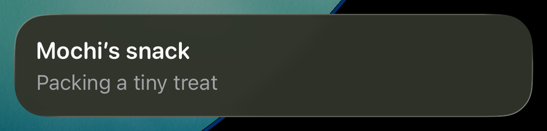</td>
    <td>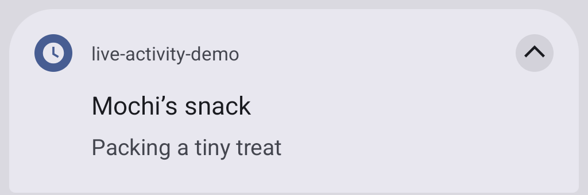</td>
  </tr>
  <tr>
    <td><code>arrived: true</code></td>
    <td>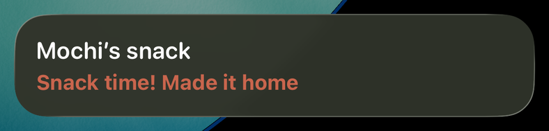</td>
    <td>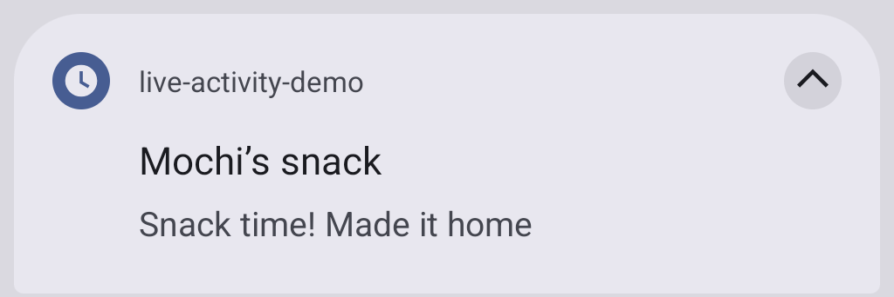</td>
  </tr>
</table>

Android drops styles: the first text is the title and the second the body.

### SF Symbols

```ts
layout: {
  lockScreen: hstack([
    symbol('cat.fill'),
    symbol('heart.fill', { rendering: 'multicolor' }),
    symbol('speaker.wave.3.fill', { variableBind: 'purr' }),
    bound('title'),
  ], { spacing: 12 }),
},
snapshot: { revision: 0, values: { title: 'Purr meter', purr: 0.35 } },
```

`variableBind` fills a variable symbol from a number between 0 and 1.

| iOS 26.3 simulator | Android |
| --- | --- |
|  | Not shown. Listed as `layout.symbol` in `degradedFeatures`. |

### Image

```ts
layout: {
  lockScreen: hstack([image('mochi', { resizable: true, style: 'portrait' }), bound('title')], { spacing: 12 }),
},
styles: { portrait: { frame: { width: 56, height: 56 } } },
snapshot: { revision: 0, values: { title: 'Mochi’s portrait' } },
```

`image` names a picture in the widget extension's asset catalog. Put an `Assets.xcassets`
folder in `src-tauri/gen/apple/LiveActivityWidget` and run
`xcodegen generate --spec src-tauri/gen/apple/project.yml`; the widget target picks it up. The
demo's `mochi` is a PNG drawn from an SVG file.

| iOS 26.3 simulator | Android |
| --- | --- |
|  | Not shown. Listed as `layout.image`. |

### Paths (SVG path data)

```ts
const head = 'M14 40C12 32 11 22 14 14Q15 11 18 13L35 27Q50 23 65 27L82 13Q85 11 86 14C89 22 88 32 86 40C93 48 94 61 87 71C79 81 66 85 50 85C34 85 21 81 13 71C6 61 7 48 14 40Z';
layout: {
  lockScreen: zstack([
    path(head, [100, 90], { style: 'fur' }),
    path(head, [100, 90], { stroke: 1.5 }),
    path('M28 54Q33 58 38 54M62 54Q67 58 72 54', [100, 90], { stroke: 2 }),
    path('M48 64Q50 62 52 64Q50 66 48 64Z', [100, 90], { style: 'nose' }),
  ], { style: 'face' }),
},
styles: { face: { frame: { width: 60, height: 54 } }, fur: { color: '#F6E9CD' }, nose: { color: '#C9654D' } },
snapshot: { revision: 0, values: {} },
```

`path` draws the `d` of an SVG `<path>` in a `box` of `[width, height]`, scaled to fit. It is
filled, or stroked when `stroke` gives a line width. `d` takes `M L H V C S Q T Z`, up to
512 bytes. Arcs (`A`) are not supported; convert them to curves first.

| iOS 26.3 simulator | Android |
| --- | --- |
|  | Not shown. Listed as `layout.path`. |

### Gauge

```ts
layout: {
  lockScreen: hstack([gauge('bowl', { max: 100, kind: 'circular' }), gauge('bowl', { max: 100 })], { spacing: 12 }),
},
snapshot: { revision: 0, values: { bowl: 80 } },
```

A gauge shows a number between `min` and `max` (0 and 1 when left out), as a ring or a bar.

| iOS 26.3 simulator | Android |
| --- | --- |
|  | Not shown. Listed as `layout.gauge`. |

### Progress

```ts
layout: {
  lockScreen: vstack([bound('title'), progress('done', { kind: 'circular' }), progress('done')]),
},
snapshot: { revision: 0, values: { title: 'Mochi’s snack delivery', done: 0.65 } },
```

A progress view shows a number from 0 to 1 as a bar or a ring.

<table>
  <tr><th>iOS 26.3 simulator</th><th>Android 16 emulator</th></tr>
  <tr>
    <td></td>
    <td>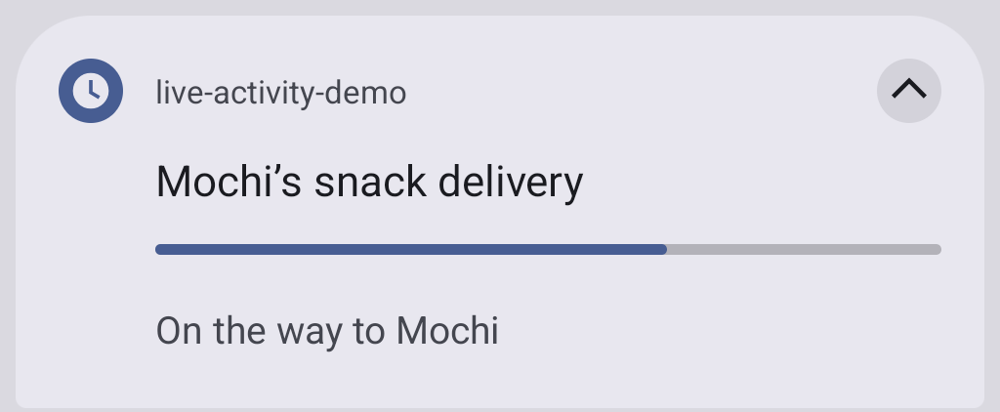</td>
  </tr>
</table>

Android turns the first progress view into the notification's bar.

### Timer

```ts
layout: {
  lockScreen: vstack([bound('title'), timerText('start', 'end')]),
},
snapshot: { revision: 0, values: { title: 'Mochi’s nap', start: Date.now(), end: Date.now() + 5 * 60_000 } },
```

`timerText` counts down to the `end` value, or up from `start` with `countsDown: false`.

<table>
  <tr><th>iOS 26.3 simulator</th><th>Android 16 emulator</th></tr>
  <tr>
    <td></td>
    <td>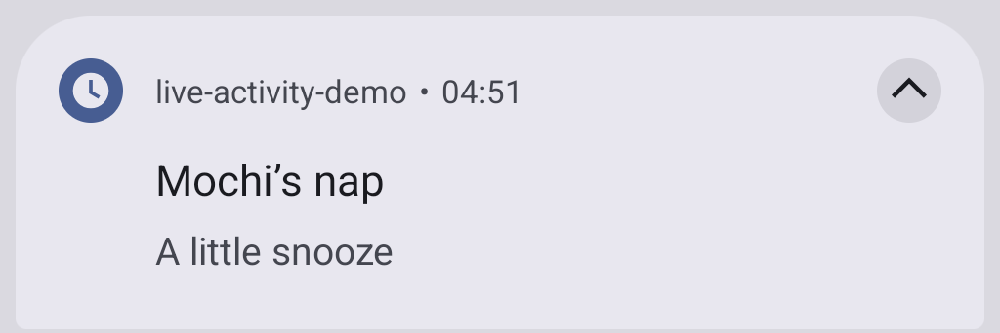</td>
  </tr>
</table>

Android shows the first timer as the notification's chronometer.

### Stacks

```ts
layout: {
  lockScreen: vstack([
    hstack([zstack([symbol('circle.fill'), symbol('pawprint.fill', { style: 'mark' })]), bound('title'), spacer(), bound('eta')]),
    divider(),
    hstack([bound('from'), spacer(), bound('to')]),
  ], { spacing: 10 }),
},
styles: { mark: { size: 13, color: 'white' } },
snapshot: { revision: 0, values: { title: 'Snack route', eta: '4 min', from: 'Kitchen', to: 'Mochi’s bowl' } },
```

`vstack`, `hstack` and `zstack` put nodes in a column, in a row or on top of each other.
`spacer` takes the free space and `divider` draws a line.

| iOS 26.3 simulator | Android |
| --- | --- |
| 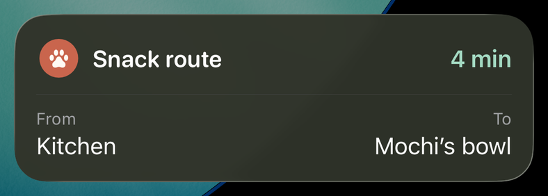 | Only the first two texts, as the title and the body. Not captured. |

### Buttons

```ts
layout: {
  lockScreen: vstack([
    bound('title'),
    bound('status'),
    hstack([button('pet', text('Pet Mochi')), button('done', text('All done'))], { spacing: 8 }),
  ], { alignment: 'leading' }),
},
snapshot: { revision: 0, values: { title: 'Mochi wants attention', status: 'No pets yet', pets: 0 } },
```

A tap reports the button's action ID. It does not change the activity: update or end it in a
handler. `onAction` hears taps while the web view runs:

```ts
import { endLayout, onAction } from 'tauri-plugin-live-activity';

await onAction(async ({ actionId, activityId }) => {
  if (actionId === 'done') await endLayout({ id: activityId, policy: { kind: 'immediate' } });
});
```

The system can start the app in the background for a tap, and Tauri may then create no web
view. Taps that must work then belong in Rust. Register the handler on the built `App`
before `run`:

```rust
use tauri_plugin_live_activity::{EndInput, EndPolicy, LiveActivityExt};

let app = tauri::Builder::default()
    .plugin(tauri_plugin_live_activity::init())
    .build(tauri::generate_context!())
    .expect("error while building tauri application");
let handle = app.handle().clone();
app.live_activity().on_action(move |event| {
    if event.action_id == "done" {
        let input = EndInput { id: event.activity_id, policy: EndPolicy::Immediate {} };
        let _ = handle.live_activity().end_layout(input);
    }
});
app.run(|_, _| {});
```

Rust handlers run first, on a plugin thread, and may call the plugin. `onAction` needs
`core:event:default`, which a new app has.

<table>
  <tr><th></th><th>iOS 26.3 simulator</th><th>Android 16 emulator</th></tr>
  <tr>
    <td>Start</td>
    <td>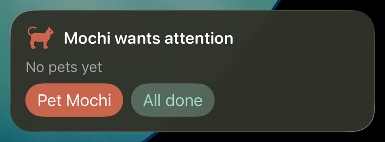</td>
    <td>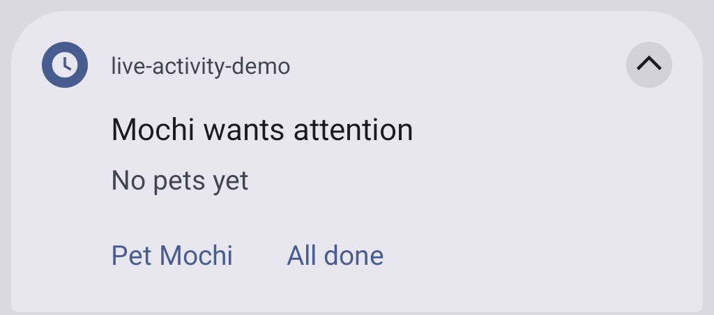</td>
  </tr>
  <tr>
    <td>After taps on Pet Mochi</td>
    <td></td>
    <td>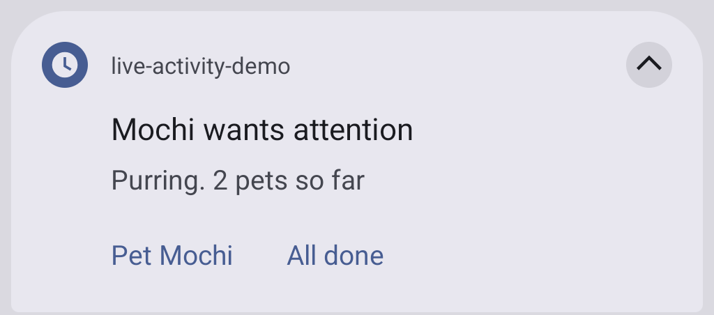</td>
  </tr>
</table>

The demo's Rust handler counts the pets and updates the status. Buttons need iOS 17
(`getCapabilities()` reports `actions`). Android shows up to three buttons as notification
actions. On Android, a tap that starts a killed app waits in memory and is lost if the Tauri
runtime does not start.

### Dynamic Island

```ts
layout: {
  lockScreen: vstack([bound('title'), bound('status'), progress('done')]),
  island: {
    expanded: {
      leading: image('mochi', { resizable: true, style: 'portrait' }),
      center: bound('title'),
      trailing: bound('eta'),
      bottom: vstack([bound('status'), progress('done')]),
    },
    compactLeading: symbol('pawprint.fill'),
    compactTrailing: bound('eta'),
    minimal: progress('done', { kind: 'circular' }),
  },
  keyline: '#A3D9C2',
},
styles: { portrait: { frame: { width: 44, height: 44 } } },
snapshot: { revision: 0, values: { title: 'Mochi’s snack', status: 'Packing a tiny treat', done: 0.15, eta: '9 min' } },
```

`island` gives each part its own nodes. A part left out gets a default: the expanded view
shows the lock screen tree, compact leading and minimal show its first symbol. `keyline` tints
the island's edge.

<table>
  <tr><th>Compact</th><th>Minimal</th><th>Expanded</th></tr>
  <tr>
    <td></td>
    <td></td>
    <td></td>
  </tr>
</table>

iOS 26.3 on the iPhone 17 simulator. Android has no Dynamic Island and lists `layout.island`.

### Android

A notification cannot draw a layout. Android takes these parts of the lock screen tree, in
order, with the current values:

| Layout | Notification |
| --- | --- |
| first `text` | title |
| second `text` | body |
| first `progress` | progress bar |
| first `timerText` | chronometer |
| up to three `button`s | actions, labelled with their first text |
| `android.visibility` | lock screen visibility: `public`, `private` (default) or `secret` |

Everything else is listed in `degradedFeatures`, here `layout.symbol` and `layout.styles`:

```ts
layout: {
  lockScreen: vstack([
    hstack([symbol('moon.zzz.fill'), bound('title', { style: 'title' })], { spacing: 8 }),
    bound('status'),
    progress('sleep'),
    button('wake', text('Wake Mochi')),
  ], { alignment: 'leading' }),
},
styles: { title: { font: 'headline' } },
snapshot: { revision: 0, values: { title: 'Mochi’s nap', status: 'Dozing off', sleep: 0.2 } },
android: { visibility: 'public' },
```

| iOS | Android 16 emulator |
| --- | --- |
| Drawn as written, like the examples above. |  |

The capture is after an update to `Fast asleep` and `0.6`. On Android 16 and later the plugin
requests promotion to a Live Update where the app may post one; `promotionState` reports what
Android did.

### Samsung Now Bar

One UI shows a promoted notification in the Now Bar only for apps on Samsung's allow list, or
for every app while the user has the developer option "Live notifications for all apps" on.
Samsung adds apps to the list privately; no public way to apply was found. To show the title
and the body there on Android 17 and later, turn on the plugin's One UI extras in
`tauri.conf.json`:

```json
{ "plugins": { "live-activity": { "android": { "samsungNowBar": true } } } }
```

| Galaxy S23, One UI 9 (Android 17), locked |
| --- |
|  |

This is the demo's Now Bar example (title, status and a progress bar, with
`android: { visibility: 'public' }`) after one update, with the developer option on. The
extras do not put the app on the allow list. An app that Samsung lists without its `RON` flag
also needs this entry in the `<application>` of
`src-tauri/gen/android/app/src/main/AndroidManifest.xml`, which the plugin does not add:

```xml
<meta-data android:name="com.samsung.android.support.ongoing_activity" android:value="true" />
```

What was found about the Now Bar on One UI 9 is in [Android setup](android-integration.md#samsung-now-bar).

## Templates: progress and timer

Request contract v1 has two fixed templates. The plugin's widget draws them on iOS, with a
title, a status and a bar or a countdown; Android shows them as a notification.

### Progress template

```ts
import { getCapabilities, requestPermissions, start, update, end } from 'tauri-plugin-live-activity';

const { platform } = await getCapabilities();
await requestPermissions(platform === 'android' ? 'notifications' : 'liveActivities');

const snack = await start({
  activityKey: 'mochi:snack',
  schemaVersion: 1,
  template: 'progress',
  fallback: 'notification',
  snapshot: { revision: 0, title: 'Mochi’s snack delivery', status: 'Packing a tiny treat', progress: 0.15 },
});
await update({
  id: snack.id,
  snapshot: { revision: 1, title: 'Mochi’s snack delivery', status: 'On the way to Mochi', progress: 0.65 },
});
await end({ id: snack.id, policy: { kind: 'immediate' } });
```

Each update sends a complete snapshot with a higher revision. `list()` finds the activities
again after a restart.

<table>
  <tr><th>iOS 26.3 simulator</th><th>Android 16 emulator</th></tr>
  <tr>
    <td>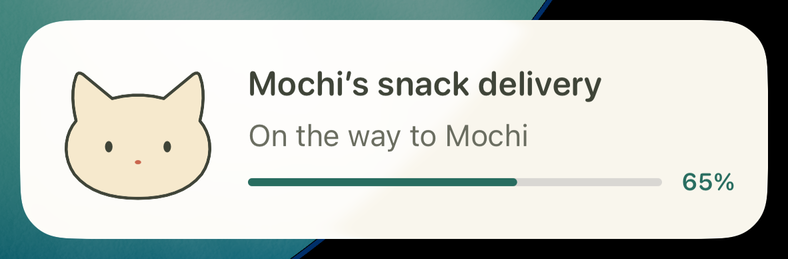</td>
    <td>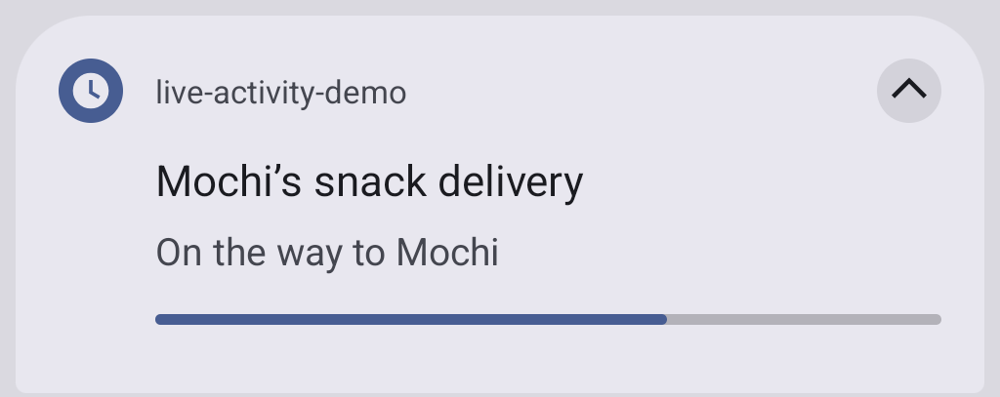</td>
  </tr>
</table>

On iOS the cat comes from the demo's own widget. The plugin's template shows the same title,
status and bar.

### Timer template

```ts
import { start } from 'tauri-plugin-live-activity';

const now = Date.now();
await start({
  activityKey: 'mochi:nap',
  schemaVersion: 1,
  template: 'timer',
  fallback: 'notification',
  snapshot: {
    revision: 0, title: 'Mochi’s nap', status: 'A little snooze, a little peace',
    timer: { startedAt: now, endsAt: now + 5 * 60_000 },
  },
});
```

Times are Unix milliseconds. The system counts down; the app sends nothing per second.

<table>
  <tr><th>iOS 26.3 simulator</th><th>Android 16 emulator</th></tr>
  <tr>
    <td>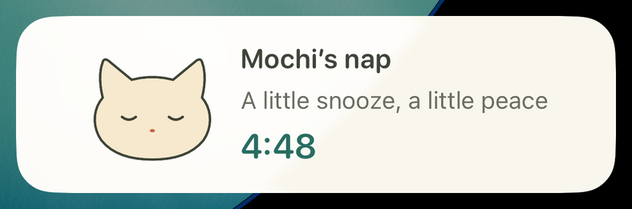</td>
    <td>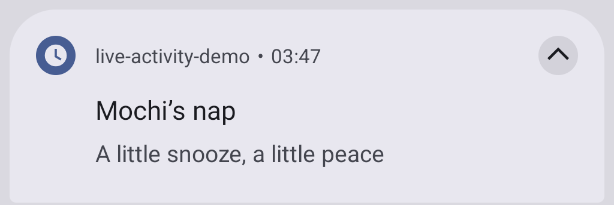</td>
  </tr>
</table>

## Plugin configuration

`plugins.live-activity` in `tauri.conf.json` is optional:

```json
{ "plugins": { "live-activity": { "receipts": "redacted", "android": { "samsungNowBar": true } } } }
```

- `receipts`: iOS stores a receipt of each accepted request, so that a late ActivityKit read
  cannot bring back an older revision, also after a restart. `full`, the default, keeps the
  snapshot and its text. `redacted` keeps only a SHA-256 digest of it; a digest hides only
  values that cannot be guessed. Android ignores the option for now and stores records in
  full in app-private preferences.
- `android.samsungNowBar`: the [Samsung Now Bar](#samsung-now-bar) extras; off when absent.

## Try the demo

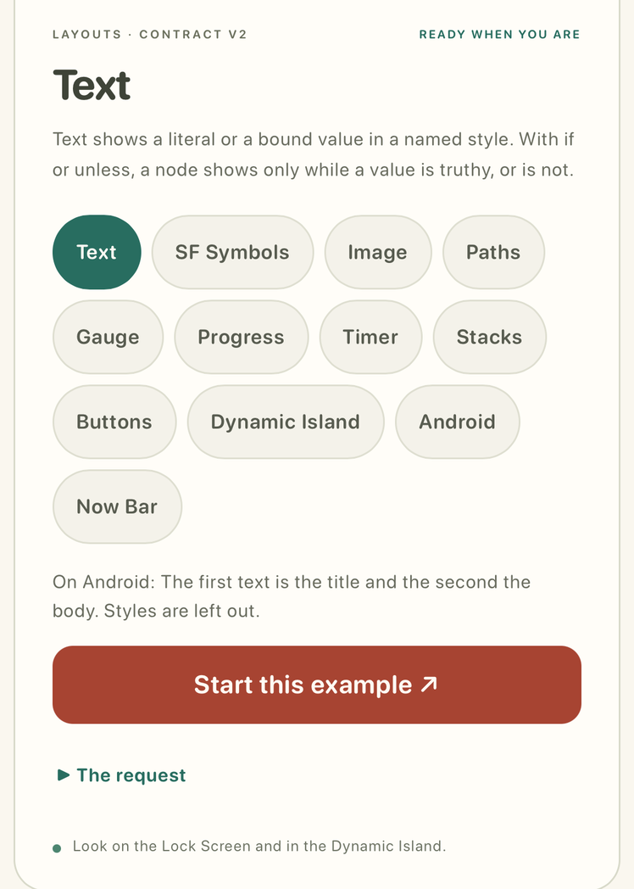

The demo's Layouts tab starts each layout example of this page. From the repository root,
with the mobile toolchain configured:

```sh
npm ci && npm run build:demo && cd examples/demo && npm run tauri -- ios dev
```

Use `android dev` for Android. The [demo's README](../examples/demo/README.md) has more.
