# Usage

This guide has the parts that the [README](../README.md) leaves out: what `setup` does, the
same steps by hand, every layout node with captures from iOS and Android, fonts, drawn images
and custom views, the progress and timer templates, and the plugin configuration.

The plugin shows state that the app sends. The app still owns the task, background work and
how often it updates. OS permissions, Focus and promotion rules decide where the activity
appears. `fallback: 'none'` rejects an unavailable native backend; it cannot force Android to
promote a notification.

## Install

Requires Tauri 2 and Rust 1.90+. Use the same minor version of the crate and the npm package.
From the app's folder:

```sh
cargo add tauri-plugin-live-activity --manifest-path src-tauri/Cargo.toml
npm i tauri-plugin-live-activity
npx tauri-plugin-live-activity setup
```

Then register the plugin in `src-tauri/src/lib.rs`:

```rust
tauri::Builder::default()
    .plugin(tauri_plugin_live_activity::init())
```

Android builds need Android SDK 37. iOS builds need Xcode and XcodeGen, which `tauri ios init`
asks for too. The plugin is an adapter of the [liveactivity](https://github.com/1eedaegon/liveactivity-rs) crate,
which runs iOS on [activitykit](https://github.com/1eedaegon/activitykit-rs) and Android on
[liveupdate](https://github.com/1eedaegon/liveupdate-rs); the three come from crates.io with the plugin's crate, and
`tauri_plugin_live_activity` re-exports the request and record types.

### What setup does

`setup` runs in the app's folder or in its `src-tauri` folder. It finds the plugin crate and the activitykit crate
it depends on with `cargo metadata`, and takes the widget template and the Swift package from activitykit's folder,
so they always match the version the app builds with. It stops with a message when the plugin or activitykit is not
in the app's build.

- **Permissions.** It adds `live-activity:default` and the `allow-` permissions of
  `request_permissions`, `start`, `update`, `end`, `start_layout`, `update_layout`,
  `end_layout` and `write_image` to `src-tauri/capabilities/default.json`, or to the only
  capability file there.
  `onAction` also needs `core:event:default`, which `core:default` in a new app includes.
- **Android.** The plugin needs Android 8 (API 26); a new Tauri app starts at 24. It sets
  `bundle.android.minSdkVersion` to 26 in `tauri.conf.json`, which `tauri android init` reads,
  and `minSdk` in `src-tauri/gen/android/app/build.gradle.kts` when that project exists. The
  plugin's manifest adds the notification permissions and its receivers when Gradle merges it.
- **iOS**, on a Mac, once `src-tauri/gen/apple` exists:
  - adds `NSSupportsLiveActivities` = true to `src-tauri/Info.ios.plist`, which Tauri merges into
    the app's Info.plist when it builds;
  - writes activitykit's widget template, a widget bundle of `ActivityKitLayoutWidget()`, as
    `src-tauri/gen/apple/LiveActivityWidget/LiveActivityWidget.swift`, and creates
    `LiveActivityCustomViews.swift` there once, for [custom views](#custom-swiftui-views);
  - with `--font` and `--asset`, copies [fonts and pictures](#fonts-and-pictures-of-the-widget)
    into that folder;
  - writes `src-tauri/gen/apple/live-activity.yml`, an XcodeGen spec with activitykit's Swift
    package (the `swift` folder of activitykit's crate), the `LiveActivityWidget` app extension
    (iOS 16.2, the `ActivityKitWidget` and `ActivityKitViews` products, `ActivityKitLayout` = 2 in
    its Info.plist, the bundle identifier `<app identifier>.widget`, the app's version, the bundled
    fonts and, with `--app-group`, the [App Group](#pictures-the-app-draws)), and in the app target
    the extension, the `ActivityKitIntent` and `ActivityKitViews` products and the custom views file.
    That file is also the Swift the app target must compile, so that Xcode takes the App Intents
    metadata of the button intent;
  - adds `live-activity.yml` to the `include` list of `src-tauri/gen/apple/project.yml`;
  - on an app that 0.2 or 0.3 set up, removes the plugin's old Swift files, replaces the old
    widget file and gives the custom views file activitykit's names
    ([Migrating from 0.3](ios-integration.md#migrating-from-03));
  - runs `xcodegen generate` when any of these files changed or was removed, or when the Xcode
    project has no widget target yet.

It prints what it changed. A second run changes nothing. It leaves a file alone when it differs
from what setup would write, and says so: a widget file you edited, or a `live-activity.yml`
changed by hand. To take the template again, delete the file and run setup again. It also
leaves alone an Xcode project that already has a widget extension, such as the
[demo's](../examples/demo/src-tauri/gen/apple/project.yml); add activitykit's widget to that one
as [iOS setup](ios-integration.md) describes.

Run it again:

- when `src-tauri/gen/apple` is made from scratch, for example after you delete it and run
  `tauri ios init`: the new `project.yml` does not include `live-activity.yml`. A `tauri ios init`
  over an existing folder keeps `project.yml` (checked with Tauri CLI 2.12.4);
- after a plugin update: it rewrites `live-activity.yml` for activitykit's folder of the new
  version, whose path changes with each activitykit revision, and names a widget file that
  differs from the new template;
- after a change of the app's version, so that the extension's version matches the app's, which
  the App Store requires.

| Option | Effect |
| --- | --- |
| `--dry-run` | Shows what would change and writes nothing |
| `--ios-only` | Does the iOS part only; leaves the capabilities and `tauri.conf.json` alone |
| `--font <file>` | Bundles a `.ttf`, `.otf` or `.ttc` font in the widget extension and prints its names; repeatable |
| `--asset <file>` | Puts a `.png`, `.jpg`, `.jpeg`, `.pdf` or `.svg` image in the widget's asset catalog; repeatable |
| `--app-group[=<id>]` | Gives both targets an App Group for `writeImage`, `group.<app identifier>` unless named; kept on later runs |

It exits with 0 when everything is set up, 1 when something is left to do (listed under
"To do") or it could not start, such as a `--font` file that does not exist, and 2 for an
unknown option or an option without its file. It reads `tauri.conf.json`, not
`tauri.conf.json5` or `Tauri.toml`, and uses `$CARGO` when that is set.

### Set up by hand

These steps do what `setup` does. Run them from the app's folder.

Grant the permissions:

```sh
for p in default allow-request-permissions allow-start allow-update allow-end allow-start-layout allow-update-layout allow-end-layout allow-write-image; do npx tauri permission add live-activity:$p; done
```

Raise the Android minimum: set `bundle.android.minSdkVersion` to `26` in
`src-tauri/tauri.conf.json`, and, if `src-tauri/gen/android` exists, `minSdk = 26` in
`src-tauri/gen/android/app/build.gradle.kts`.

On iOS, after `tauri ios init`, in one shell:

1. find activitykit's folder, which `cargo metadata` lists as a dependency of the plugin (`jq`
   comes with macOS 15 and later);
2. copy activitykit's widget template, and once the plugin's custom views file from the npm
   package;
3. add `NSSupportsLiveActivities` to `src-tauri/Info.ios.plist`.

```sh
AK=$(cargo metadata --format-version 1 --manifest-path src-tauri/Cargo.toml | jq -r '.packages[] | select(.name == "activitykit") | .manifest_path | rtrimstr("Cargo.toml")')
mkdir -p src-tauri/gen/apple/LiveActivityWidget && cp "$AK"templates/ios/Widget.swift src-tauri/gen/apple/LiveActivityWidget/LiveActivityWidget.swift
# Once: LiveActivityCustomViews.swift is yours from now on; do not copy it over your edits again.
cp node_modules/tauri-plugin-live-activity/cli/templates/LiveActivityCustomViews.swift src-tauri/gen/apple/LiveActivityWidget/
/usr/libexec/PlistBuddy -c 'Add :NSSupportsLiveActivities bool true' src-tauri/Info.ios.plist
```

Then write `src-tauri/gen/apple/live-activity.yml`. Replace `app_iOS` with the name of the app
target in `project.yml` (`<name>_iOS`), the path with activitykit's folder (`$AK`) plus `swift`,
and the bundle identifier and the versions with the app's:

```yaml
packages:
  ActivityKit:
    path: "/path/to/activitykit/swift"
targets:
  app_iOS:
    sources: [LiveActivityWidget/LiveActivityCustomViews.swift]
    dependencies:
      - target: LiveActivityWidget
      - package: ActivityKit
        product: ActivityKitIntent
      - package: ActivityKit
        product: ActivityKitViews
    settings:
      base:
        SWIFT_VERSION: "5.0"
  LiveActivityWidget:
    type: app-extension
    platform: iOS
    deploymentTarget: "16.2"
    sources: [LiveActivityWidget]
    dependencies:
      - package: ActivityKit
        product: ActivityKitWidget
      - package: ActivityKit
        product: ActivityKitViews
    info:
      path: LiveActivityWidget/Info.plist
      properties:
        CFBundleShortVersionString: "0.1.0"
        CFBundleVersion: "0.1.0"
        NSExtension:
          NSExtensionPointIdentifier: com.apple.widgetkit-extension
        ActivityKitLayout: 2
    settings:
      groups: [app]
      base:
        PRODUCT_NAME: LiveActivityWidget
        PRODUCT_BUNDLE_IDENTIFIER: "com.example.app.widget"
        SWIFT_VERSION: "5.0"
        APPLICATION_EXTENSION_API_ONLY: YES
        SKIP_INSTALL: YES
```

`groups: [app]` gives the extension the signing team of Tauri's `app` setting group. For bundled
fonts, add `UIAppFonts` with the file names under `properties`, and put the files in
`LiveActivityWidget/Fonts`. For drawn images, add `ActivityKitAppGroup: "group.com.example.app"`
under `properties`, and to both targets:

```yaml
    entitlements:
      path: LiveActivityWidget.entitlements   # app_iOS/app_iOS.entitlements in the app target
      properties:
        com.apple.security.application-groups: ["group.com.example.app"]
```

Include the file and regenerate the Xcode project:

```sh
printf '\ninclude:\n  - live-activity.yml\n' >> src-tauri/gen/apple/project.yml && xcodegen generate --spec src-tauri/gen/apple/project.yml
```

The custom views file goes into both targets: the extension compiles the whole `LiveActivityWidget`
folder and draws the views, and activitykit in the app reads which names have one. It is also the
Swift that the app target must compile: Xcode takes the App Intents metadata of the linked
`ActivityKitIntent` only for a target that compiles Swift, and without it a button does nothing.
Link no other activitykit product to the app, and never `ActivityKitBridge`: the Rust library holds
it already. A `src-tauri/gen/apple` made from scratch has a new `project.yml`; run the last line
again then.

## Layouts

Captures: iOS 26.3 on the iPhone 17 simulator, Android 16 on an emulator. The demo adds
Mochi's colors and padding to the code shown here. The iOS captures were made with 0.3, before
the renderer moved from the plugin into activitykit. The Android captures were made before 0.5.0,
when the plugin posted the notification itself.

With a layout the app designs the activity itself: a tree of nodes, a table of styles and a
map of values. On iOS activitykit's widget, `ActivityKitLayoutWidget`, draws it, with no SwiftUI
in the app.
Android shows part of it as a notification. The tree is fixed at start; an update sends new
values with the same keys and types, and a few style members can read values
([Changing styles](#changing-styles)). Layout, styles and values share ActivityKit's 4 KiB
limit.

### Text, values and styles

```ts
import { layout, startLayout, updateLayout, endLayout } from 'tauri-plugin-live-activity';

const { vstack, bound, text } = layout;

const card = await startLayout({
  activityKey: 'mochi:text',
  schemaVersion: 2,
  fallback: 'notification',
  layout: {
    lockScreen: vstack([
      bound('title', { style: 'title' }),
      bound('status', { style: 'status', unless: 'arrived' }),
      text('Snack time! Made it home', { style: 'done', if: 'arrived' }),
    ], { alignment: 'leading' }),
  },
  styles: {
    title: { font: 'headline' },
    status: { font: 'subheadline', color: 'secondary' },
    done: { font: 'subheadline', weight: 'bold', color: '#C9654D' },
  },
  snapshot: { revision: 0, values: { title: 'Mochi’s snack', status: 'Packing a tiny treat', arrived: false } },
});

await updateLayout({
  id: card.id,
  snapshot: { revision: 1, values: { title: 'Mochi’s snack', status: 'Packing a tiny treat', arrived: true } },
});

await endLayout({ id: card.id, policy: { kind: 'immediate' } });
```

`bound` shows a value, `text` a literal. `if` shows a node only while a value is truthy,
`unless` only while it is not. The examples below show only the members after `fallback`; the
builders are all in `layout`.

<table>
  <tr><th></th><th>iOS 26.3 simulator</th><th>Android 16 emulator</th></tr>
  <tr>
    <td><code>arrived: false</code></td>
    <td></td>
    <td></td>
  </tr>
  <tr>
    <td><code>arrived: true</code></td>
    <td></td>
    <td></td>
  </tr>
</table>

Android drops styles: the first text is the title and the second the body.

### Changing styles

A style member can name a value with `bind` instead of holding a literal. The member reads
the value each time the activity is drawn, so an update changes it:

```ts
import { layout, startLayout, updateLayout } from 'tauri-plugin-live-activity';

const { vstack, hstack, symbol, bound, progress, bind } = layout;

const values = { title: 'Mochi’s snack', status: 'On time', tone: 'green', weight: 'regular', done: 0.3 };
const delivery = await startLayout({
  activityKey: 'mochi:styles',
  schemaVersion: 2,
  fallback: 'notification',
  layout: {
    lockScreen: vstack([
      hstack([symbol('clock.fill', { style: 'badge' }), bound('title')], { spacing: 8 }),
      bound('status', { style: 'status' }),
      progress('done', { style: 'meter' }),
    ], { alignment: 'leading' }),
  },
  styles: {
    badge: { color: bind('tone') },
    status: { font: 'subheadline', weight: bind('weight'), color: bind('tone') },
    meter: { tint: bind('tone') },
  },
  snapshot: { revision: 0, values },
});

// The snack runs late: the badge, the status and the bar turn red, and the status bold.
await updateLayout({
  id: delivery.id,
  snapshot: { revision: 1, values: { ...values, status: 'Running 5 min late', tone: 'red', weight: 'bold', done: 0.5 } },
});
```

`bind('tone')` writes `{ "bind": "tone" }`. In Rust, `Bound::key("tone")` writes the same, and
`.into()` turns it, or a literal, into the member's `Bindable`:

```rust
use std::collections::BTreeMap;
use tauri::{AppHandle, Runtime};
use tauri_plugin_live_activity::{
    Bound, Element, Fallback, Layout, LayoutSnapshot, LayoutStartInput, LayoutUpdateInput,
    LiveActivityExt, Node, Result, Style, Value,
};

fn delivery(revision: u64, status: &str, tone: &str) -> LayoutSnapshot {
    let values = [("status", status), ("tone", tone)]
        .map(|(key, text)| (key.to_string(), Value::Text(text.into())));
    LayoutSnapshot::new(revision, BTreeMap::from(values))
}

fn start_input() -> LayoutStartInput {
    let text = Element::Text { value: None, bind: Some("status".into()) };
    let status = Node { style: Some("status".into()), ..text.into() };
    let style = Style { color: Some(Bound::key("tone").into()), ..Style::default() };
    LayoutStartInput {
        activity_key: "mochi:snack".into(),
        schema_version: 2,
        fallback: Fallback::Notification,
        layout: Layout { lock_screen: status, island: None, background: None, keyline: None, url: None },
        styles: Some(BTreeMap::from([("status".to_string(), style)])),
        snapshot: delivery(0, "On time", "green"),
        android: None,
        ios: None,
        scheduled: None,
        push: None,
    }
}

fn run_late<R: Runtime>(app: &AppHandle<R>) -> Result<()> {
    let record = app.live_activity().start_layout(start_input())?;
    // Later: every value again, with a higher revision. The status turns red.
    let snapshot = delivery(1, "Running late", "red");
    let update = LayoutUpdateInput::new(record.id, snapshot);
    app.live_activity().update_layout(update)?;
    Ok(())
}
```

`LayoutStartInput::validate_update` checks an update against a start the way activitykit's
Swift layer and Android do, before anything is sent; `validate_end` does the same for the final
content of an end.

The limits:

- Only these members can be bound: `color`, `background` and `tint` (a color name or a hex
  color), `size` (a number from 6 to 96), `opacity` (0 to 1), `cornerRadius` (0 to 64),
  `weight` (a weight name), the layout's `background`, `keyline` and `url`, the `url` of a `link`,
  the `label`, `value` and `hint` of a node's `accessibility` (a value of any type, read as text), and
  the props of a `custom` node.
- A bound color cannot be a light and dark pair, because a value is a string, a number or a
  boolean. Color names such as `primary` or `red` follow the appearance; a hex color does not.
- The tree and every other member are fixed after start: `font`, `design`, `monospacedDigit`,
  `lineLimit`, `minimumScaleFactor`, `alignment`, `padding`, `frame`, `buttonStyle`,
  `contentTransition` and the members of nodes. To change them, end the activity and start it again.
- The value must exist at start and fit the member. Every update is checked again; a value
  that does not fit fails with `INVALID_INPUT`, and the activity keeps what it showed.
- Every update sends all values again. Layout, styles and values share the weight limit of
  3584, and each binding counts toward it.
- Android draws no styles: the status text changes, its color does not.
- A plugin before 0.3 rejects bindings with `INVALID_INPUT`. Keep the npm package and the crate on
  the same minor version.
- On iOS, `ActivityKitLayoutWidget` passes the values to the background and keyline tints too.

The demo's **Changing styles** example cycles through on time (green), late (red and bold) and
home (a teal hex color). The full rules are in the
[request contract](request-contract.md#bound-style-members).

### SF Symbols

```ts
layout: {
  lockScreen: hstack([
    symbol('cat.fill'),
    symbol('heart.fill', { rendering: 'multicolor' }),
    symbol('speaker.wave.3.fill', { variableBind: 'purr' }),
    bound('title'),
  ], { spacing: 12 }),
},
snapshot: { revision: 0, values: { title: 'Purr meter', purr: 0.35 } },
```

`variableBind` fills a variable symbol from a number between 0 and 1.

| iOS 26.3 simulator | Android |
| --- | --- |
| 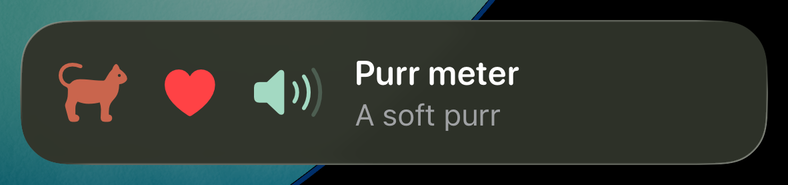 | Not shown. Listed as `layout.symbol` in `degradedFeatures`. |

### Image

```ts
layout: {
  lockScreen: hstack([image('mochi', { resizable: true, style: 'portrait' }), bound('title')], { spacing: 12 }),
},
styles: { portrait: { frame: { width: 56, height: 56 } } },
snapshot: { revision: 0, values: { title: 'Mochi’s portrait' } },
```

`image` names a picture in the widget extension's asset catalog; `setup --asset` puts one there
([Fonts and pictures](#fonts-and-pictures-of-the-widget)). An `Assets.xcassets` folder made by hand
in `src-tauri/gen/apple/LiveActivityWidget` works too: run
`xcodegen generate --spec src-tauri/gen/apple/project.yml` and the widget target picks it up. The
demo's `mochi` is a PNG drawn from an SVG file. `image({ file: 'badge.png' })` shows a picture the
app drew instead ([Pictures the app draws](#pictures-the-app-draws)).

| iOS 26.3 simulator | Android |
| --- | --- |
| 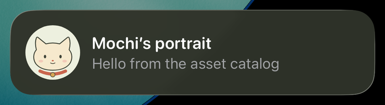 | Not shown. Listed as `layout.image`. |

### Paths (SVG path data)

```ts
const head = 'M14 40C12 32 11 22 14 14Q15 11 18 13L35 27Q50 23 65 27L82 13Q85 11 86 14C89 22 88 32 86 40C93 48 94 61 87 71C79 81 66 85 50 85C34 85 21 81 13 71C6 61 7 48 14 40Z';
layout: {
  lockScreen: zstack([
    path(head, [100, 90], { style: 'fur' }),
    path(head, [100, 90], { stroke: 1.5 }),
    path('M28 54Q33 58 38 54M62 54Q67 58 72 54', [100, 90], { stroke: 2 }),
    path('M48 64Q50 62 52 64Q50 66 48 64Z', [100, 90], { style: 'nose' }),
  ], { style: 'face' }),
},
styles: { face: { frame: { width: 60, height: 54 } }, fur: { color: '#F6E9CD' }, nose: { color: '#C9654D' } },
snapshot: { revision: 0, values: {} },
```

`path` draws the `d` of an SVG `<path>` in a `box` of `[width, height]`, scaled to fit. It is
filled, or stroked when `stroke` gives a line width. `d` takes `M L H V C S Q T Z`, up to
512 bytes. Arcs (`A`) are not supported; convert them to curves first.

| iOS 26.3 simulator | Android |
| --- | --- |
| 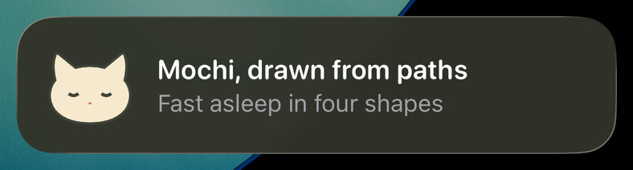 | Not shown. Listed as `layout.path`. |

### Gauge

```ts
layout: {
  lockScreen: hstack([gauge('bowl', { max: 100, kind: 'circular' }), gauge('bowl', { max: 100 })], { spacing: 12 }),
},
snapshot: { revision: 0, values: { bowl: 80 } },
```

A gauge shows a number between `min` and `max` (0 and 1 when left out), as a ring or a bar.

| iOS 26.3 simulator | Android |
| --- | --- |
| 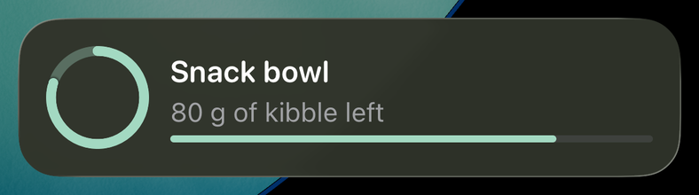 | Not shown. Listed as `layout.gauge`. |

### Progress

```ts
layout: {
  lockScreen: vstack([bound('title'), progress('done', { kind: 'circular' }), progress('done')]),
},
snapshot: { revision: 0, values: { title: 'Mochi’s snack delivery', done: 0.65 } },
```

A progress view shows a number from 0 to 1 as a bar or a ring.

<table>
  <tr><th>iOS 26.3 simulator</th><th>Android 16 emulator</th></tr>
  <tr>
    <td>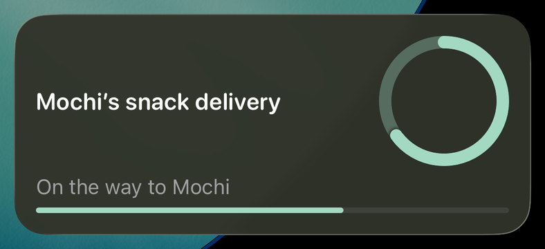</td>
    <td></td>
  </tr>
</table>

Android turns the first progress view into the notification's bar. The capture is from before 0.5.0.

### Timer

```ts
layout: {
  lockScreen: vstack([bound('title'), timerText('start', 'end')]),
},
snapshot: { revision: 0, values: { title: 'Mochi’s nap', start: Date.now(), end: Date.now() + 5 * 60_000 } },
```

`timerText` counts down to the `end` value, or up from `start` with `countsDown: false`.

<table>
  <tr><th>iOS 26.3 simulator</th><th>Android 16 emulator</th></tr>
  <tr>
    <td>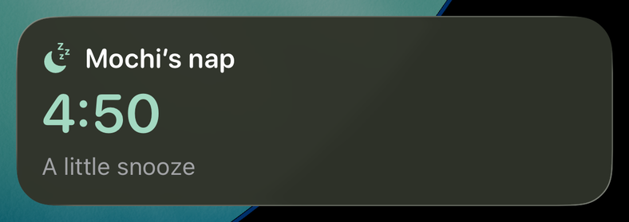</td>
    <td></td>
  </tr>
</table>

Android shows the first timer as the notification's chronometer.

### Stacks

```ts
layout: {
  lockScreen: vstack([
    hstack([zstack([symbol('circle.fill'), symbol('pawprint.fill', { style: 'mark' })]), bound('title'), spacer(), bound('eta')]),
    divider(),
    hstack([bound('from'), spacer(), bound('to')]),
  ], { spacing: 10 }),
},
styles: { mark: { size: 13, color: 'white' } },
snapshot: { revision: 0, values: { title: 'Snack route', eta: '4 min', from: 'Kitchen', to: 'Mochi’s bowl' } },
```

`vstack`, `hstack` and `zstack` put nodes in a column, in a row or on top of each other.
`spacer` takes the free space and `divider` draws a line.

| iOS 26.3 simulator | Android |
| --- | --- |
|  | Only the first two texts, as the title and the body. Not captured. |

### Buttons

```ts
layout: {
  lockScreen: vstack([
    bound('title'),
    bound('status'),
    hstack([button('pet', text('Pet Mochi')), button('done', text('All done'))], { spacing: 8 }),
  ], { alignment: 'leading' }),
},
snapshot: { revision: 0, values: { title: 'Mochi wants attention', status: 'No pets yet', pets: 0 } },
```

A tap reports the button's action ID. It does not change the activity: update or end it in a
handler. `onAction` hears taps while the web view runs:

```ts
import { endLayout, onAction } from 'tauri-plugin-live-activity';

await onAction(async ({ actionId, activityId }) => {
  if (actionId === 'done') await endLayout({ id: activityId, policy: { kind: 'immediate' } });
});
```

The system can start the app in the background for a tap, and Tauri may then create no web
view. Taps that must work then belong in Rust. Register the handler on the built `App`
before `run`:

```rust
use tauri_plugin_live_activity::{EndPolicy, LayoutEndInput, LiveActivityExt};

let app = tauri::Builder::default()
    .plugin(tauri_plugin_live_activity::init())
    .build(tauri::generate_context!())
    .expect("error while building tauri application");
let handle = app.handle().clone();
app.live_activity().on_action(move |event| {
    if event.action_id == "done" {
        let input = LayoutEndInput { id: event.activity_id, policy: EndPolicy::Immediate {}, snapshot: None };
        let _ = handle.live_activity().end_layout(input);
    }
});
app.run(|_, _| {});
```

Rust handlers run first, on a plugin thread, and may call the plugin. The tap's intent, and so an
app that the system launched for the tap, waits until they have run and the tap has gone to
JavaScript, at most 4 seconds. `onAction` listeners are not awaited: a webview handler is
asynchronous, and does not run while the web view is suspended or was never created. Act on a tap
in Rust when it must not be lost. `onAction` needs `core:event:default`, which a new app has.

<table>
  <tr><th></th><th>iOS 26.3 simulator</th><th>Android 16 emulator</th></tr>
  <tr>
    <td>Start</td>
    <td></td>
    <td></td>
  </tr>
  <tr>
    <td>After taps on Pet Mochi</td>
    <td></td>
    <td></td>
  </tr>
</table>

The demo's Rust handler counts the pets and updates the status. Buttons need iOS 17
(`getCapabilities()` reports `actions`). Android shows up to three actions, buttons, links and
toggles together, as notification actions. Android stores a tap that starts a killed app, and the
plugin delivers it when it starts.

### Links and toggles

A `link` opens the app with its URL, which the app receives as any URL it is opened with; no event
reports it on iOS. A `toggle` shows the boolean value of its key beside its label. A tap reports the
action with `on`, the state the person asked for, and does not move the switch: send an update with
the new value, or none to refuse the change.

```ts
const { vstack, bound, text, link, toggle } = layout;

layout: {
  lockScreen: vstack([
    bound('title'),
    link('myapp://delivery/7', text('Open the delivery')),
    toggle('ring', 'muted', text('Mute')),
  ], { alignment: 'leading' }),
  url: 'myapp://delivery/7',
},
snapshot: { revision: 0, values: { title: 'Mochi’s snack', muted: false } },
```

```ts
import { onAction, updateLayout } from 'tauri-plugin-live-activity';

await onAction(async ({ actionId, activityId, on }) => {
  // revision and values are the last ones this app sent for the activity.
  if (actionId === 'ring' && on !== undefined) {
    await updateLayout({ id: activityId, snapshot: { revision: revision + 1, values: { ...values, muted: on } } });
  }
});
```

On Android a `link` is an action of the notification that opens its URL, and `layout.url` is what a
tap on the notification opens, where the device offers `links`. The app declares the URL's scheme
in an intent filter of one of its activities ([Android setup](android-integration.md#links)); without
one the snapshot is shown without its links, and the record names `layout.link` and `layout.url`. A
toggle is an action titled by its label, with a check mark before it while on, and its tap has `on`.

### Dynamic Island

```ts
layout: {
  lockScreen: vstack([bound('title'), bound('status'), progress('done')]),
  island: {
    expanded: {
      leading: image('mochi', { resizable: true, style: 'portrait' }),
      center: bound('title'),
      trailing: bound('eta'),
      bottom: vstack([bound('status'), progress('done')]),
    },
    compactLeading: symbol('pawprint.fill'),
    compactTrailing: bound('eta'),
    minimal: progress('done', { kind: 'circular' }),
  },
  keyline: '#A3D9C2',
},
styles: { portrait: { frame: { width: 44, height: 44 } } },
snapshot: { revision: 0, values: { title: 'Mochi’s snack', status: 'Packing a tiny treat', done: 0.15, eta: '9 min' } },
```

`island` gives each part its own nodes. A part left out gets a default: the expanded view
shows the lock screen tree, compact leading and minimal show its first symbol. `keyline` tints
the island's edge.

<table>
  <tr><th>Compact</th><th>Minimal</th><th>Expanded</th></tr>
  <tr>
    <td>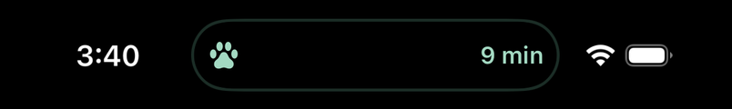</td>
    <td>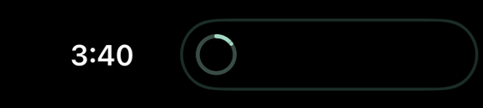</td>
    <td>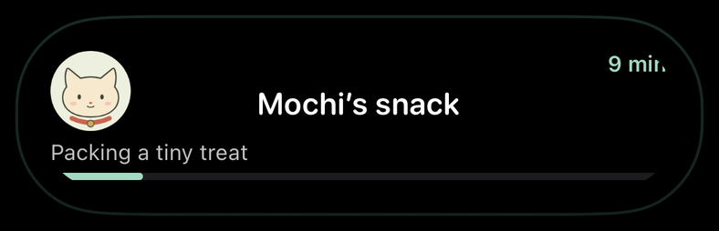</td>
  </tr>
</table>

iOS 26.3 on the iPhone 17 simulator. Android has no Dynamic Island and lists `layout.island`.

When the app runs several activities, the Dynamic Island shows the one with the highest `relevance`, a number that
a snapshot may carry, at a start, an update or an end. Without one the activity keeps its score, which is 0 at first:

```ts
await updateLayout({ id: snack.id, snapshot: { revision: 2, values, relevance: 90 } });
```

In Rust it is `snapshot.relevance = Some(90.0)` on a `LayoutSnapshot::new(revision, values)`. Android ignores the
member, and an Android record does not repeat it.

The parts take more options. `expanded.priority` gives the width first to a region (a number from 0 to
100 per region), `expanded.belowIfTooWide` names the regions that go below the camera when they are too
wide to stand beside it, and `margins` sets the margins of a presentation as a style's `padding`:

```ts
island: {
  expanded: { leading: image('mochi'), center: bound('title'), trailing: bound('eta'), priority: { center: 10 }, belowIfTooWide: ['trailing'] },
  margins: { expanded: 8, compactLeading: [0, 4, 0, 4] },
},
```

### Android

A notification cannot draw a layout. Android takes these parts of the lock screen tree, in
order, with the current values:

| Layout | Notification |
| --- | --- |
| first `text` | title |
| second `text` | body |
| first `progress` | progress bar |
| first `timerText` | chronometer; beside a progress, the clock in the header |
| up to three `button`s, `link`s and `toggle`s, in the order of the tree | actions: a button's tap reaches the app, a link opens its URL, a toggle is titled by its label with a check mark while on |
| `layout.url` | what a tap on the notification opens, where the device offers `links` |
| an `accessibility` label or value on a node the notification cannot draw | a text in its place |
| `android.visibility` | lock screen visibility: `public`, `private` (default) or `secret` |

Everything else is listed in `degradedFeatures`, here `layout.symbol` and `layout.styles`:

```ts
layout: {
  lockScreen: vstack([
    hstack([symbol('moon.zzz.fill'), bound('title', { style: 'title' })], { spacing: 8 }),
    bound('status'),
    progress('sleep'),
    button('wake', text('Wake Mochi')),
  ], { alignment: 'leading' }),
},
styles: { title: { font: 'headline' } },
snapshot: { revision: 0, values: { title: 'Mochi’s nap', status: 'Dozing off', sleep: 0.2 } },
android: { visibility: 'public' },
```

| iOS | Android 16 emulator |
| --- | --- |
| Drawn as written, like the examples above. | 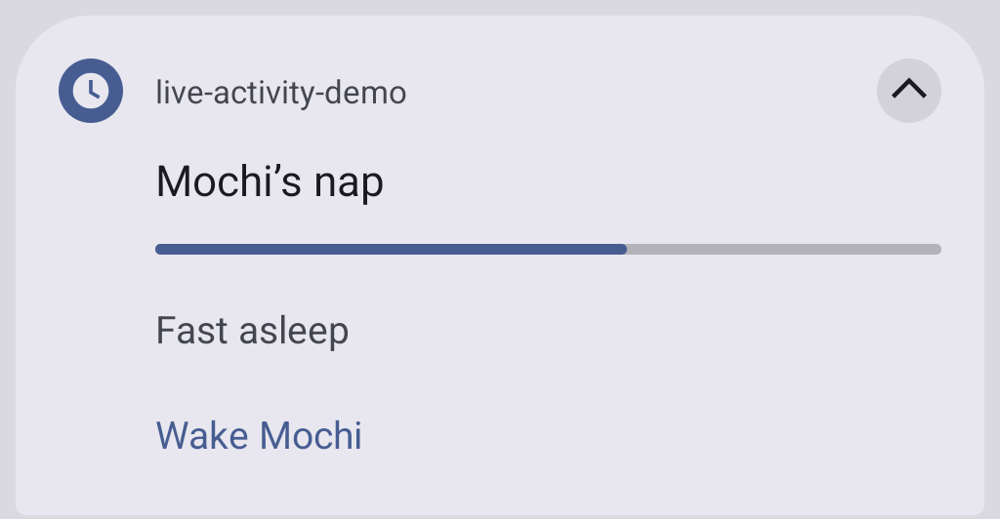 |

The capture is after an update to `Fast asleep` and `0.6`. On Android 16 and later the plugin
requests promotion to a Live Update where the app may post one; `promotionState` reports what
Android did.

Known: on Android 16 a notification whose time is more than two weeks past is not shown, and the app
is told nothing. This is a timer whose start or end lies that far before the post; the post is answered
as shown. Measured on an Android 16 emulator: 13 days shows, 15 days does not.

### Android content

The projection takes what a notification can show of a layout. To say what Android shows in its own terms, give the
snapshot an `android` content: a title, a status and one of the notification styles of the liveupdate crate. Android
shows it in place of the projection, and iOS ignores it.

```ts
import { getCapabilities, layout, startLayout } from 'tauri-plugin-live-activity';

const { vstack, bound, progress } = layout;
// Which styles the device draws: absent on iOS and desktop.
const { androidPresentation } = await getCapabilities();

const delivery = await startLayout({
  activityKey: 'mochi:snack',
  schemaVersion: 2,
  fallback: 'notification',
  layout: { lockScreen: vstack([bound('title'), bound('status'), progress('done')]) },
  snapshot: {
    revision: 0,
    values: { title: 'Mochi’s snack', status: 'On the way', done: 0.6 },
    android: {
      title: 'Mochi’s snack',
      status: '2 stops away',
      presentation: {
        style: {
          kind: 'progress',
          value: {
            progress: 60,
            // Segments of their own colors need Android 16; one segment is a plain bar.
            segments: androidPresentation?.progressStyle ? [{ length: 60, color: 0xff007f00 }, { length: 40 }] : [{ length: 100 }],
          },
        },
        shortCriticalText: '8 min', // the status chip, at most 7 code points
        actions: [{ id: 'done', title: 'All done' }],
      },
    },
  },
});
```

| `style.kind` | `value` | Shows |
| --- | --- | --- |
| `standard` | none | the title and the status |
| `bigText` | `{ text, summary? }` | a longer text under the title |
| `progress` | `{ progress, segments, points?, indeterminate?, styledByProgress?, startIcon?, endIcon?, trackerIcon? }` | a bar; its 1 to 32 segments, up to 32 points, colors and icons from Android 16 (`progressStyle`), a plain bar below |
| `timer` | `{ timer: { startedAt, endsAt }, countsDown }` | the chronometer, counting down to the end or up from the start |
| `metric` | `{ metrics, criticalMetric? }` | up to three labelled values, each an integer, a decimal or a text; Android 17 (`metricStyle`) |

- The title is 1 to 120 code points and the status 1 to 240. `largeIcon` and an action's `icon` name a drawable or
  mipmap resource of the app (`{ kind: 'resource', value }`) or a file under the app's files, such as one that
  `writeImage` wrote (`{ kind: 'appFile', value }`). `samsungNowBar: { primary?, secondary? }` gives the Now Bar its
  own two lines.
- A tap on one of the content's actions comes through `onAction` and `on_action`, like a tap on a button node.
- A metric's `stopwatch` (`{ startedAt }`) and `countdown` (`{ endsAt }`) values are posted.
- A snapshot may have another notification style than the activity's first where the device offers
  `styleChange`. Elsewhere it is `UNSUPPORTED_FEATURE`, and the activity keeps what it shows.
- A presentation takes `openUrl`, a `chronometer`, an `alert` (this revision alerts again), a
  `publicVersion`, a `smallIcon`, an `accentColor` and a `subText`. Each is behind a capability of
  `getCapabilities().androidPresentation`: `links`, `chronometer`, `alert`, `publicVersion` and
  `branding` (the small icon, the color and the sub text). A content that uses a member its device
  does not offer is `UNSUPPORTED_FEATURE`, except the alert: it is left out and `alert` is named in
  `degradedFeatures`.
- An action takes `openUrl` too. Such an action opens the URL in the app and sends no tap; `onOpened`
  reports it with the action's `id`.
- The Android record keeps the content in its snapshot, and its `degradedFeatures` names nothing of the layout,
  since the content is what Android shows; an iOS record does not repeat it. Every platform checks the content, so a request is valid everywhere or nowhere.
- In Rust it is `snapshot.android = Some(AndroidContent { title, status, presentation })`. `AndroidContent` is the
  liveactivity crate's, and the presentation types are liveupdate's, re-exported: `AndroidPresentation`,
  `PresentationStyle`, `ProgressStyle`, `ProgressSegment` and the rest. One is missing: a `TimerStyle` takes
  liveupdate's `Timer`, which the plugin does not re-export (its `Timer` is the template's). Read a timer style from
  JSON with `serde_json`, or add the `liveupdate` crate at the version the plugin builds with.

### Samsung Now Bar

One UI shows a promoted notification in the Now Bar only for apps on Samsung's allow list, or
for every app while the user has the developer option "Live notifications for all apps" on.
Samsung adds apps to the list privately; no public way to apply was found. To show the title
and the body there on Android 17 and later, turn on the plugin's One UI extras in
`tauri.conf.json`:

```json
{ "plugins": { "live-activity": { "android": { "samsungNowBar": true } } } }
```

| Galaxy S23, One UI 9 (Android 17), locked |
| --- |
| 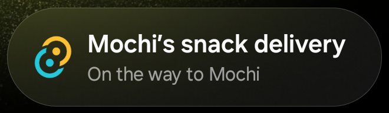 |

This is the demo's Now Bar example (title, status and a progress bar, with
`android: { visibility: 'public' }`) after one update, with the developer option on. The
extras do not put the app on the allow list. An app that Samsung lists without its `RON` flag
also needs this entry in the `<application>` of
`src-tauri/gen/android/app/src/main/AndroidManifest.xml`, which the plugin does not add:

```xml
<meta-data android:name="com.samsung.android.support.ongoing_activity" android:value="true" />
```

What was found about the Now Bar on One UI 9 is in [Android setup](android-integration.md#samsung-now-bar).

## Revisions, timestamps and ends

Every update sends the whole snapshot with a higher revision. A lower revision fails with `STALE_REVISION`; the
same revision answers the record when the values are the same, and fails with `CONFLICT` when they differ.

The revision goes out as sent, on iOS as on Android. Count from the record, as the demo does:

```ts
let record = await startLayout(request);
record = await updateLayout({ id: record.id, snapshot: { revision: record.snapshot.revision + 1, values } });
```

While an activity runs under a key, the same start returns it, also after a relaunch, and a different start fails with
`CONFLICT`. Call `listLayout()` at launch to find the activities that still run.

A snapshot may carry a `timestamp`, the time its content was made, in Unix milliseconds. ActivityKit uses it from
iOS 17.2 to drop content older than what the activity shows: such an update still succeeds, but the activity keeps
the newer content. Without one, iOS takes the time the content is sent. iOS records carry the timestamp of the
accepted content.
Android keeps the timestamp in the record as sent.

An end can carry final content:

```ts
import { endLayout } from 'tauri-plugin-live-activity';

await endLayout({
  id: snack.id,
  policy: { kind: 'default' },
  snapshot: { revision: 3, values: { title: 'Mochi’s snack', status: 'Delivered', done: 1 }, timestamp: Date.now() },
});
```

```rust
use std::collections::BTreeMap;
use tauri_plugin_live_activity::{EndPolicy, LayoutEndInput, LayoutSnapshot, LiveActivityExt, Value};

let values = BTreeMap::from([
    ("title".to_string(), Value::Text("Mochi’s snack".into())),
    ("status".to_string(), Value::Text("Delivered".into())),
    ("done".to_string(), Value::Number(1.0)),
]);
let snapshot = LayoutSnapshot::new(3, values);
app.live_activity().end_layout(LayoutEndInput { id, policy: EndPolicy::Default {}, snapshot: Some(snapshot) })?;
```

- The final content is checked as an update: the same keys and value types as the start, `STALE_REVISION` below
  the accepted revision, `CONFLICT` at it with other values. `LayoutStartInput::validate_end` checks it in Rust.
- Without `snapshot` the activity ends with its last accepted values. On iOS that end goes out at the next revision,
  so the record's revision is one higher.
- On iOS, `immediate` removes the activity at once, `default` keeps it on the Lock Screen for up to four hours, and
  `after` until the given time or four hours after the end, whichever comes first; a time in the past removes it at
  once. Android removes the notification on `immediate` and `default`. `after` keeps the last content, no longer
  ongoing, until its time where the device offers `delayedEnd`; elsewhere it is `UNSUPPORTED_FEATURE` and the
  activity stays. The final content is in the record.
- Ending again answers the record; an update after the end fails with `NOT_FOUND`. On iOS, after a relaunch, ending
  again an activity that ended at once, and that the system no longer lists, fails with `NOT_FOUND`. The v1 `end`
  takes no final content.

A record's `state` is `pending`, `active`, `stale`, `ended`, `dismissed` or `unknown`. `pending` is the state of a
scheduled start that has not begun yet (see [Scheduled and transient starts](#scheduled-and-transient-starts)). Rust's `ActivityState` may gain states: match it with a `_` arm.

An update is silent unless it carries an `alert`, a title of 1 to 120 code points and a body of 1 to 240:

```ts
await updateLayout({
  id: snack.id,
  snapshot: { revision: 4, values: { title: 'Mochi’s snack', status: 'At the door', done: 1 } },
  alert: { title: 'Snack delivered', body: 'Mochi is waiting at the door' },
});
```

On iOS the device lights up, the Dynamic Island expands (without one, the Lock Screen presentation shows as a
banner) and an Apple Watch shows the title and the body. On Android the notification alerts again with that
revision, where the device offers `alert`; elsewhere the update is silent and the record names `alert` in
`degradedFeatures`. `sound` names a sound of the app's bundle on iOS (a file name such as `chime.aiff`, 1 to 64
ASCII letters, digits, `.`, `_` and `-`). Android alerts with the sound of its channel and names `alert.sound`.
In Rust: `update.alert = Some(Alert::new(title, body))` on a `LayoutUpdateInput::new(id, snapshot)`, with
`.with_sound(name)` for a sound.

### Scheduled and transient starts

`scheduled` starts the activity at a later time (iOS 26). `at` is epoch milliseconds, and the alert is
required: the system shows it when the activity begins. Until then the record is `pending`: the key is
held, the activity can be ended, and an update is `CONFLICT`, since the activity begins with the content of
its start. `onState` reports `active` when it begins.

```ts
await startLayout({
  activityKey: 'mochi:ride',
  schemaVersion: 2,
  fallback: 'notification',
  layout,
  snapshot: { revision: 0, values: { title: 'Mochi’s ride', status: 'Waiting for the car' } },
  scheduled: { at: Date.now() + 60 * 60_000, alert: { title: 'Your ride', body: 'It starts now', sound: 'chime.aiff' } },
});
```

Before iOS 26 and on Android a start with `scheduled` answers `UNSUPPORTED_FEATURE` and keeps nothing: a
notification is posted when it is asked for, so the app starts the activity itself when the time comes.

`ios: { transient: true }` asks for a transient activity (iOS 18). By Apple's description it shows in the
expanded Dynamic Island, and the system ends it when the person locks the device, collapses that
presentation or leaves the app. Before iOS 18 it is `UNSUPPORTED_FEATURE`; Android ignores the option. The
React hook takes `ios` as well, and not `scheduled`.

### Starts, states and permission changes

What happens to an activity outside the app's own calls comes as events:

```ts
import { onPermissions, onStarted, onState } from 'tauri-plugin-live-activity';

await onState(({ activityId, activityKey, state }) => { /* 'stale', 'ended', 'dismissed', … */ });
await onStarted(({ record }) => { /* a layout activity began, also one a push started (iOS) */ });
await onPermissions(permissions => { /* the person changed them in Settings (iOS) */ });
```

| Event | Function | iOS | Android |
| --- | --- | --- | --- |
| `live-activity://state` | `onState` | every new lifecycle state of an activity, of a template or a layout, while the app runs | `active`, `stale`, `ended` and `dismissed`, each once, for templates and layouts; `stale` arrives at the stale time while the app runs |
| `live-activity://opened` | `onOpened` | none | the person opened the app from an activity's notification, by the notification or by an action that opens a URL |
| `live-activity://started` | `onStarted` | a layout activity began: one the app started, or one a push started | none |
| `live-activity://permissions` | `onPermissions` | Live Activities or frequent pushes were turned on or off in Settings | none |

An event reaches only the listeners there are when it goes out. What happened while the app did not run, or before
the page listened, is in the records: `list()` and `listLayout()` at launch give every activity with its state, and
`checkPermissions()` the permissions. On Android liveupdate stores the dismissal of a notification as it stores a tap, and the plugin reports it
when it drains them: at once while the app's process lives, else when the app starts. The plugin's events
thread also wakes at an activity's stale time. `onOpened` gives `{ activityId, activityKey, actionId }`:
`actionId` is absent when the person tapped the notification itself, `link:<n>` for the nth `link` of the
lock screen tree, and the id of an action of an Android content otherwise. The URL comes to the app as any
deep link. The event names are public in Rust (`STATE_EVENT`, `STARTED_EVENT`, `PERMISSIONS_EVENT`,
`OPENED_EVENT`) for `app.listen`.

On iOS a start needs the app in the foreground and fails with `NOT_FOREGROUND` otherwise. The system ends an iOS
activity after 8 hours and removes it from the Lock Screen after 12. [iOS integration](ios-integration.md) has the
details.

## Pushes

On iOS a server can update an activity, end it, or start one, through APNs; the plugin asks ActivityKit for what the
server needs and reports it, and the server builds the payloads with the activitykit crate's `push::Payload`
(see [its usage guide](https://github.com/1eedaegon/activitykit-rs/blob/main/docs/usage.md#pushes)). The plugin
holds no key and sends nothing. The app needs the Push Notifications capability (`aps-environment`); without it, as in
the simulator, a start that asks for a token fails with `CONFIGURATION_REQUIRED`. Android takes no pushes and ignores
the member.

```ts
import { onPushToken, onPushToStartToken, onUpdated, startLayout } from 'tauri-plugin-live-activity';

// Listen first: a token comes when ActivityKit makes it, and those the plugin already holds come at once.
await onPushToken(({ activityId, token }) => { /* send the token to the server; it may change */ });
await onPushToStartToken(({ token }) => { /* with pushToStart in the plugin configuration (iOS 17.2) */ });
await onUpdated(({ record }) => { /* a push changed the content: record.snapshot has it */ });

// A token of the activity's own: the server sends to /3/device/<token>.
const record = await startLayout({ activityKey: 'job:1', schemaVersion: 2, fallback: 'none', layout, snapshot, push: 'token' });
// Or a broadcast channel the server made at APNs (iOS 18; UNSUPPORTED_FEATURE before).
await startLayout({ ...input, push: { channel: 'dHN0LXNyY2gtY2hubA==' } });
```

A token is not in the start's record: ActivityKit makes it later, and may change it, and each one comes as a
`live-activity://push-token` event. An event reaches only the listeners there are when it goes out, and a token can
come before the page listens: the push-to-start token at every launch, and the token of an activity that outlived a
relaunch. The plugin therefore keeps the newest token of each of the last 32 activities and the push-to-start token
since launch, `pushTokens()`, and `onPushToken` and `onPushToStartToken` deliver what it holds right after
subscribing, each token once; the read is in the plugin's `default` permission. Content a push delivered before the
page listened is in the activity's record, as `listLayout` gives it.

Push-to-start (iOS 17.2) needs `"pushToStart": true` under `plugins.live-activity` in `tauri.conf.json`, a setting
that holds for the process like the receipts; an activity a push starts comes to `onStarted` with its record while
the app runs and is a listed activity, and a start of the app under its key answers `CONFLICT`. Content a push delivers comes as `live-activity://updated`
with the activity's record when its revision is above every revision the app sent or accepted, so the app's own
updates do not come this way; a server numbers its pushes above the app's. The record is the activity's state when
the plugin reads the event: two pushes close together may both report the later one. `checkPermissions` reports
`frequentPushes`, the switch in Settings behind `NSSupportsLiveActivitiesFrequentUpdates`, `denied` as well when the
app offers no such switch, and `getCapabilities` reports `push`.

The events go out as the liveactivity crate reports them, one at a time on its events thread, without waiting for
JavaScript. A tap is reported on the same thread and holds it until the handlers of `on_action` have run, at most
4 seconds, so an event behind a tap comes after that tap's handlers. A Rust listener (`app.listen` with
`PUSH_TOKEN_EVENT`, `PUSH_TO_START_TOKEN_EVENT` or `UPDATED_EVENT`) runs inline on that thread: one that blocks
delays the taps and the events behind it. One that panics is caught, so that the thread, the taps and the events to
JavaScript go on, but Tauri then delivers nothing more to any Rust listener of the app: a listener must not panic.
Rust reads the tokens with `push_tokens()`.

With React, `useLiveActivity` listens for pushes when its options carry `push`, keeps the activity's `pushToken` in
its state and takes pushed content as its record; the component's values stand as last sent, and their next change
goes above the pushed revision. A subscription the plugin refuses lands in `error`.

## TSX and React

### Layouts in TSX

`tauri-plugin-live-activity/jsx` is a JSX import source of its own. Its components return the same node objects as the
builders, so TSX needs no React. Name it in `tsconfig.json` (`"jsx": "react-jsx"`, `"jsxImportSource":
"tauri-plugin-live-activity/jsx"`), or per file:

```tsx
/** @jsxImportSource tauri-plugin-live-activity/jsx */
import { Button, HStack, SFSymbol, Text, VStack } from 'tauri-plugin-live-activity/jsx';

const lockScreen = (
  <VStack alignment="leading" spacing={8}>
    <HStack spacing={8}>
      <SFSymbol name="cat.fill" />
      <Text bind="title" />
    </HStack>
    <Text bind="status" />
    <HStack spacing={8}>
      <Button actionId="pet"><Text>Pet Mochi</Text></Button>
      <Button actionId="done"><Text>All done</Text></Button>
    </HStack>
  </VStack>
);
```

There is one component per node: `VStack`, `HStack`, `ZStack`, `Spacer`, `Divider`, `Text`, `SFSymbol`, `Image`, `Path`,
`Progress`, `Gauge`, `TimerText`, `Button`, `Link`, `Toggle` and `Custom`. Their props are the node's members, and `bind` comes from the
same entry. `Text` shows its children, strings and numbers joined, or with `bind` the value of a key. A stack takes
nodes and arrays of them and leaves out booleans, `null` and `undefined`, so `{late && <Text>Late</Text>}` and `.map`
work. A `Button`, a `Link` or a `Toggle` holds exactly one node, its label for a toggle; an `Image` takes `asset` or `file`. Wrong children are a `TypeError` that
names the component. There are no HTML elements and no fragments: `<div>` does not compile, and `<>` neither loads nor
bundles. Put the children in a stack.

The entry imports neither Tauri nor React. A server can build the same layout, for example for a push payload.

### React

`tauri-plugin-live-activity/react` keeps one layout activity in step with a component. React (18 or later) is an
optional peer dependency; only this entry imports it.

```tsx
import { useLiveActivity } from 'tauri-plugin-live-activity/react';

function Delivery({ order }: { order: Order }) {
  const { status, error } = useLiveActivity({
    activityKey: `delivery:${order.id}`,
    layout: { lockScreen },
    values: { title: order.title, status: order.status },
    enabled: order.open,
    onAction: ({ actionId }) => { if (actionId === 'done') closeOrder(order.id); },
  });
  return <p>{status}{error ? `: ${error.message}` : ''}</p>;
}
```

- The activity starts on mount at revision 0, with `fallback: 'notification'` unless the options name another.
  `status` goes from `idle` to `starting` and `active`; `record` is the plugin's newest record.
- A render whose `values` differ from the last sent ones sends them all as an update at the next revision. One request
  is in flight at a time; values that change meanwhile go out once it answers, the newest only.
- `layout`, `styles`, `fallback`, `android`, `ios` and `push` are read at start. To change them, end the activity and start
  it again, for example with another `activityKey`, which ends the running activity and starts one for the new key.
- Unmount, or `enabled: false`, ends the activity with `endPolicy` (`immediate` unless given). React's Strict Mode
  neither ends nor restarts it.
- A refused request sets `error` to the plugin's `{ code, message }`. After a refused start `status` is `failed`, until
  `enabled` turns off and on again or the key changes; after a refused update the activity stays `active`, and the
  same values are not sent again.
- `onAction` gets the taps of this activity only. It runs while the web view does; taps that must work in the
  background belong in Rust ([Buttons](#buttons)).

## Beyond the built-in parts

The nodes above draw with system fonts, SF Symbols, the widget's asset catalog, SVG path data, progress views,
gauges and timers. Four ways go further. The first two need no Swift:

| You want | How | Swift |
| --- | --- | --- |
| your fonts, your pictures | `setup --font`, `setup --asset`; a style's `fontFamily`, `image(name)` | no |
| pictures the app draws while it runs | `setup --app-group`; `writeImage`, `image({ file })` | no |
| a view of your own | `custom(name)` and a SwiftUI view in `LiveActivityCustomViews.swift` | yes, that view |
| everything | edit the copied `LiveActivityWidget.swift` | yes, all of it |

The captures were made with 0.3 in a scratch Tauri app on the iOS 26.3 simulator (iPhone 17 Pro), with the plugin
added by path.

### Fonts and pictures of the widget

```sh
npx tauri-plugin-live-activity setup --font fonts/Pacifico-Regular.ttf --asset art/paw@2x.png --asset art/paw@3x.png
```

`--font` copies a `.ttf`, `.otf` or `.ttc` file to `src-tauri/gen/apple/LiveActivityWidget/Fonts` and lists every
font of that folder under `UIAppFonts` in the extension's Info.plist, through `live-activity.yml`. It prints the
names the font answers to, for example `fontFamily: "Pacifico-Regular" or "Pacifico"`: the PostScript name and the
family name from the font's name table. A style takes either:

```ts
styles: {
  title: { fontFamily: 'Pacifico-Regular', font: 'title3' }, // the size of title3, scaled with Dynamic Type
  price: { fontFamily: 'Pacifico', size: 18, weight: 'bold' }, // 18 points, not scaled
}
```

- With `font`, the custom font takes that text style's size (title3 is 20 points at the default text size) and
  scales with Dynamic Type. With `size`, it has that size. Alone it takes the size of `body`, 17 points.
- `weight` picks another face of the family when the extension bundles one; a family of one face draws that face.
- `fontFamily` and `design` exclude each other, as `font` and `size` do: `design` chooses a design of the system
  font. `fontFamily` is fixed at start, like `font`.
- A name the extension does not have draws the system font at the same size. Nothing reports it, so check the
  names that `setup` prints.

`--asset` copies a `.png`, `.jpg`, `.jpeg`, `.pdf` or `.svg` file into the extension's asset catalog,
`LiveActivityWidget/Assets.xcassets`. The file name is the asset name, without the extension and a `@2x` or `@3x`
scale: `paw@2x.png` and `paw@3x.png` become the two scales of `paw`, which `image('paw')` shows. A PDF or SVG is kept
as vector data. The name must follow the asset rule (1 to 64 ASCII letters, digits, `.`, `_` and `-`). An image set
that you edited in Xcode keeps its entries; setup only adds the file it copies.

Both options copy a file again when it changed, and leave it alone otherwise. The fonts in the folder stay listed
on later runs without `--font`. Both files and folders live in `gen/apple`; keep that folder in version control, and
restore `LiveActivityWidget` with it if you ever make it from scratch.

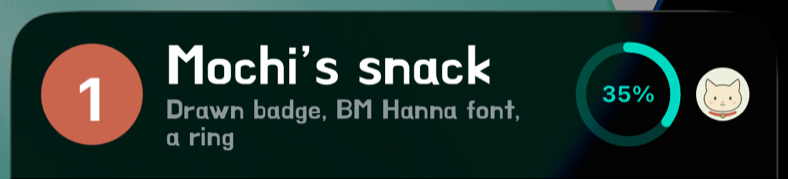

The title uses a bundled font by its PostScript name, the line below it the same font by its family name; Mochi's
portrait on the right is an asset that `--asset` added.

### Pictures the app draws

The widget extension runs in a process of its own and cannot read the app's files. An App Group gives both a shared
container:

```sh
npx tauri-plugin-live-activity setup --app-group                 # group.<app identifier>
npx tauri-plugin-live-activity setup --app-group=group.com.example.shared
```

Setup writes the group into `live-activity.yml`: into the entitlements of the app target and of the extension, and
under `ActivityKitAppGroup` into the extension's Info.plist, where activitykit and the widget read it. Later runs
keep the group without the option. XcodeGen writes both entitlements files from the spec each time it generates the
project, and it did so before this option too: with Tauri's `project.yml` it writes the app's file empty. An
entitlement the app needs, such as `aps-environment`, belongs under `entitlements.properties` of the app target in
`project.yml`; XcodeGen merges it with the App Group of `live-activity.yml`. In the simulator nothing
more is needed. For a device the group has to exist in your Apple Developer account and in the provisioning profiles
of both targets: with automatic signing, Xcode registers it the first time it builds for a device, which needs your
account signed in to Xcode; with manual signing, add the group to both App IDs and download the profiles again.

Then write a PNG and point an `image` at it:

```ts
import { layout, startLayout, updateLayout, writeImage } from 'tauri-plugin-live-activity';

const { hstack, image, bound } = layout;

async function badge(color: string, label: string): Promise<Uint8Array> {
  const canvas = document.createElement('canvas');
  canvas.width = canvas.height = 168; // 56 points at @3x
  const context = canvas.getContext('2d')!;
  context.fillStyle = color;
  context.beginPath();
  context.arc(84, 84, 80, 0, Math.PI * 2);
  context.fill();
  context.fillStyle = '#FFFFFF';
  context.font = 'bold 96px -apple-system';
  context.textAlign = 'center';
  context.fillText(label, 84, 118);
  const blob = await new Promise<Blob>(resolve => canvas.toBlob(png => resolve(png!), 'image/png'));
  return new Uint8Array(await blob.arrayBuffer());
}

await writeImage('badge.png', await badge('#C9654D', '1'));
const card = await startLayout({
  activityKey: 'mochi:badge',
  schemaVersion: 2,
  fallback: 'none',
  layout: { lockScreen: hstack([image({ file: 'badge.png' }, { resizable: true, style: 'badge' }), bound('title')]) },
  styles: { badge: { frame: { width: 52, height: 52 } } },
  snapshot: { revision: 0, values: { title: 'Mochi’s snack' } },
});

// Later: a new picture under the same name, then an update.
await writeImage('badge.png', await badge('#2E8B7A', '2'));
await updateLayout({ id: card.id, snapshot: { revision: 1, values: { title: 'Mochi is home' } } });
```

In Rust, `write_image` takes the bytes, for example from a PNG encoder such as the `png` or `image` crate:

```rust
app.live_activity().write_image("badge.png", &png_bytes)?;
```

- The name follows the rule of a `file` source, the same as an asset name: 1 to 64 ASCII letters, digits, `.`, `_`
  and `-`, starting with a letter or digit. No folders, so a name cannot leave the image folder.
  `INVALID_INPUT` otherwise.
- The bytes are a PNG file, from its signature and image header to its end chunk (`INVALID_INPUT` otherwise), of at
  most 1 MiB and 1224 × 480 pixels (`PAYLOAD_TOO_LARGE` beyond). Apple requires an image of a Live Activity to be no
  larger than its presentation and says that a larger one may keep the activity from starting; 1224 × 480 is the
  largest Lock Screen presentation, 408 × 160 points, at @3x. Draw at the size the frame shows at @3x: 56 points are
  168 pixels.
- On iOS activitykit writes the file to `activitykit/images` in the App Group container, replacing an earlier file
  of that name as a whole: the widget reads the old picture or the new one, never part of one. Without an App Group in the
  extension the call fails with `CONFIGURATION_REQUIRED`. On desktop it checks the PNG and returns
  `UNSUPPORTED_PLATFORM`.
- The widget reads the file each time it draws the activity, which it does on start and on every update. Writing
  alone draws nothing new: write first, then update. The update may keep every value; its higher revision is new
  content. A missing or unreadable file draws nothing and is not reported.
- The name is fixed in the tree at start, so a new picture takes the same name. Files stay until the app writes them
  again; neither the plugin nor activitykit removes any, so reuse a few names.
- Files get the app's default data protection, readable after the first unlock, so the Lock Screen can draw them.

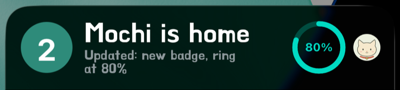

The same activity after an update: the app wrote a teal badge under the same name, then sent new values. A
later update that kept every value and only raised the revision, sent after a third badge was written, drew the
third badge too.

On Android, `writeImage` writes to the app's private files. The notification shows the first image of the lock
screen tree whose source is a file, in document order with the conditions applied, as its large icon, scaled to at
most 256 pixels. Google's requirements for a Live Update do not name the large icon, so it keeps promotion; One UI's
Now Bar was not checked with one. Asset images and further file images are listed as `layout.image`.

### Custom SwiftUI views

A `custom` node draws a SwiftUI view that the app registers under a name:

```ts
const { custom, bind } = layout;

lockScreen: hstack([bound('title'), custom('ring', { props: { level: bind('done'), label: bind('percent'), width: 5 }, style: 'ring' })]),
styles: { ring: { frame: { width: 46, height: 46 }, color: 'mint' } },
snapshot: { revision: 0, values: { title: 'Mochi’s snack', done: 0.35, percent: '35%' } },
```

`setup` creates `src-tauri/gen/apple/LiveActivityWidget/LiveActivityCustomViews.swift` once and never writes it again,
except to give a file of 0.3 activitykit's names. Fill in its table:

```swift
import ActivityKitViews
import SwiftUI

@available(iOS 16.1, *)
@objc(ActivityKitCustomViews)
final class LiveActivityCustomViews: ActivityKitCustomViewRegistry {
    override class var views: [String: ActivityKitCustomView] {
        [
            "ring": ActivityKitCustomView { props in
                Ring(level: props.number("level") ?? 0, label: props.string("label") ?? "", width: props.number("width") ?? 4)
            },
        ]
    }
}

@available(iOS 16.1, *)
struct Ring: View {
    let level: Double
    let label: String
    let width: Double

    var body: some View {
        ZStack {
            Circle().stroke(lineWidth: width).opacity(0.25)
            Circle().trim(from: 0, to: level).stroke(style: StrokeStyle(lineWidth: width, lineCap: .round)).rotationEffect(.degrees(-90))
            Text(label).font(.system(size: 11, weight: .bold))
        }
    }
}
```

- `props` holds 1 to 16 inputs under value-key names. A literal is text of at most 200 code points, a number or a
  boolean; `bind(key)` reads a value, so each update can change it. In Swift, `props.number`, `props.string` and
  `props.bool` read them, and `props["key"]` gives the value as it is. A prop the node does not set is absent.
- The node's `style` and conditions work as on any node: the style sets the frame, padding, colors and font around
  the view, which inherits the foreground color and the tint.
- The file is compiled into the widget extension, which draws the views, and into the app, so that activitykit can
  tell which names have a view. Both targets link activitykit's `ActivityKitViews` product, which holds
  `ActivityKitCustomViewRegistry`, `ActivityKitCustomView` and the props type `ActivityKitCustomProps`. Keep
  `@objc(ActivityKitCustomViews)`: the widget and activitykit find the table by it. The Swift class name may stay
  `LiveActivityCustomViews`. Mark your views `@available(iOS 16.1, *)` when they use newer SwiftUI, because the app
  target may support an older iOS than the extension.
- The registry comes from activitykit's package, so an update of the plugin or of activitykit leaves this file and
  your views alone. On a file that 0.3 created, `setup` puts activitykit's names in place of 0.3's
  (`TauriLiveActivityCustomViews`, `LiveActivityCustomViewRegistry`, `LiveActivityCustomView`) and adds
  `import ActivityKitViews`; your views stay.
- A node whose name has no view draws nothing. On iOS the record names it in `degradedFeatures` as
  `layout.custom.<name>`, for every such name of the layout. Android draws no custom view and lists `layout.custom`.
- The validators check the name (the asset name rule) and the props, not the view: what it draws, how much memory it
  takes and whether it compiles are yours to test. A Live Activity has no network; draw with shapes, text and images
  of the extension, and leave out timers and animations of your own.

The ring in the captures is this view, with `level` bound to a value: 35% at start, 80% after the update.

### The whole widget

The last resort is to edit `src-tauri/gen/apple/LiveActivityWidget/LiveActivityWidget.swift`, the copy of
activitykit's template, and put a widget of your own in place of `ActivityKitLayoutWidget()` that draws
`context.state.values` your own way. `import ActivityKitWidget` brings `LiveActivityLayoutAttributes`,
`LayoutDocument` and `LayoutView`. Keep `ActivityConfiguration(for: LiveActivityLayoutAttributes.self)` and the
extension's `ActivityKitLayout` = 2. What you give up:

- `setup` keeps a file that differs from the template and says so on every run; fixes and features of
  activitykit's widget are yours to merge by hand.
- activitykit draws nothing of the layout any more: the validators still check every request, but what the widget
  shows for it is your code, outside the shared fixtures and activitykit's tests.
- `degradedFeatures` describes activitykit's widget, not yours.

### Limits

- A Live Activity runs in a sandbox of its own with no network and no location (Apple: "unlike a widget, a Live
  Activity can't access the network or receive location updates"). Everything it shows must be in the extension,
  in the payload, or in the App Group container.
- Apple does not publish the memory limit of the widget extension. A decoded image takes 4 bytes per pixel, so a
  picture of 1224 × 480 takes about 2.3 MB; keep few of them on screen.
- Images of a Live Activity must be no larger than the presentation (Apple); `writeImage` holds to 1 MiB and
  1224 × 480 pixels, the largest Lock Screen presentation at @3x. The Lock Screen is 160 points high at most and a
  compact island part about 36 points.
- Fonts must be bundled in the extension; the extension cannot load the app's fonts or download one.
- Drawn images need the App Group, configured in both targets, which a device build registers with your Apple
  account once.
- The validators check a custom node's name and props; the view itself is not checked.
- Android shows a standard notification for a Live Update: no fonts, no styles, no custom views and no asset
  images. A drawn image becomes the large icon.
- Layout, styles and values share the weight limit of 3584, custom props and font names included; each update sends
  every value again.

## Templates: progress and timer

Request contract v1 has two fixed templates. On iOS each becomes a layout activity with a fixed
tree, which activitykit's widget draws like any layout: a title, a status and a bar or a countdown
on the Lock Screen, and parts of them in the Dynamic Island
([iOS integration](ios-integration.md#the-progress-and-timer-templates)). Android shows them as a
notification.

### Progress template

```ts
import { getCapabilities, requestPermissions, start, update, end } from 'tauri-plugin-live-activity';

const { platform } = await getCapabilities();
await requestPermissions(platform === 'android' ? 'notifications' : 'liveActivities');

const snack = await start({
  activityKey: 'mochi:snack',
  schemaVersion: 1,
  template: 'progress',
  fallback: 'notification',
  snapshot: { revision: 0, title: 'Mochi’s snack delivery', status: 'Packing a tiny treat', progress: 0.15 },
});
await update({
  id: snack.id,
  snapshot: { revision: 1, title: 'Mochi’s snack delivery', status: 'On the way to Mochi', progress: 0.65 },
});
await end({ id: snack.id, policy: { kind: 'immediate' } });
```

Each update sends a complete snapshot with a higher revision; on iOS the revisions follow the
[rules of layouts](#revisions-timestamps-and-ends). `list()` finds the activities again after a
restart. It gives template activities only, and `listLayout()` layout activities only.

<table>
  <tr><th>iOS 26.3 simulator</th><th>Android 16 emulator</th></tr>
  <tr>
    <td></td>
    <td></td>
  </tr>
</table>

The iOS captures here show the demo's own widget of 0.3, with the cat. 0.5 has no such widget:
activitykit's widget draws the template's fixed layout, with the same title, status and bar.

### Timer template

```ts
import { start } from 'tauri-plugin-live-activity';

const now = Date.now();
await start({
  activityKey: 'mochi:nap',
  schemaVersion: 1,
  template: 'timer',
  fallback: 'notification',
  snapshot: {
    revision: 0, title: 'Mochi’s nap', status: 'A little snooze, a little peace',
    timer: { startedAt: now, endsAt: now + 5 * 60_000 },
  },
});
```

Times are Unix milliseconds. The system counts down; the app sends nothing per second. The iOS
capture is of 0.3's demo widget too.

<table>
  <tr><th>iOS 26.3 simulator</th><th>Android 16 emulator</th></tr>
  <tr>
    <td></td>
    <td></td>
  </tr>
</table>

## Plugin configuration

`plugins.live-activity` in `tauri.conf.json` is optional:

```json
{ "plugins": { "live-activity": { "receipts": "full", "pushToStart": true, "android": { "samsungNowBar": true } } } }
```

- `receipts`: on iOS activitykit keeps a receipt of each accepted request in the app's
  Application Support (`activitykit/receipts-v2.json`), so that a late ActivityKit read cannot
  bring back an older revision, also after a restart. A receipt holds the last accepted values
  in plain text with `full`, the default. `redacted` keeps a SHA-256 digest of each accepted
  content instead; after a relaunch a list then gives the values that ActivityKit shows. A digest
  of guessable values can be guessed, and ActivityKit keeps the values in the activity's content.
  Android ignores the option for now and stores records in full in app-private preferences.
- `android.samsungNowBar`: the [Samsung Now Bar](#samsung-now-bar) extras; off when absent.
- `pushToStart`: on iOS 17.2 and later the plugin watches the app's push-to-start token and reports it, new or
  changed, as `live-activity://push-to-start-token` ([Pushes](#pushes)); off when absent. Like the receipts, the
  setting holds for the process.

## Try the demo


The demo's Layouts tab starts each layout example of this page. From the repository root,
with the mobile toolchain configured:

```sh
npm ci && npm run build:demo && cd examples/demo && npm run tauri -- ios dev
```

Use `android dev` for Android. `tests/ios/run.sh` runs the demo with UI tests on an iOS Simulator
of its own ([iOS integration](ios-integration.md#testing)). The
[demo's README](../examples/demo/README.md) has more.
